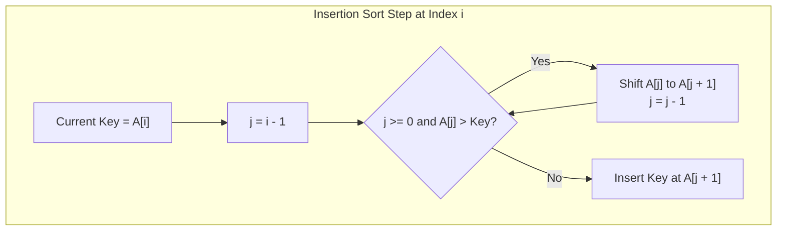
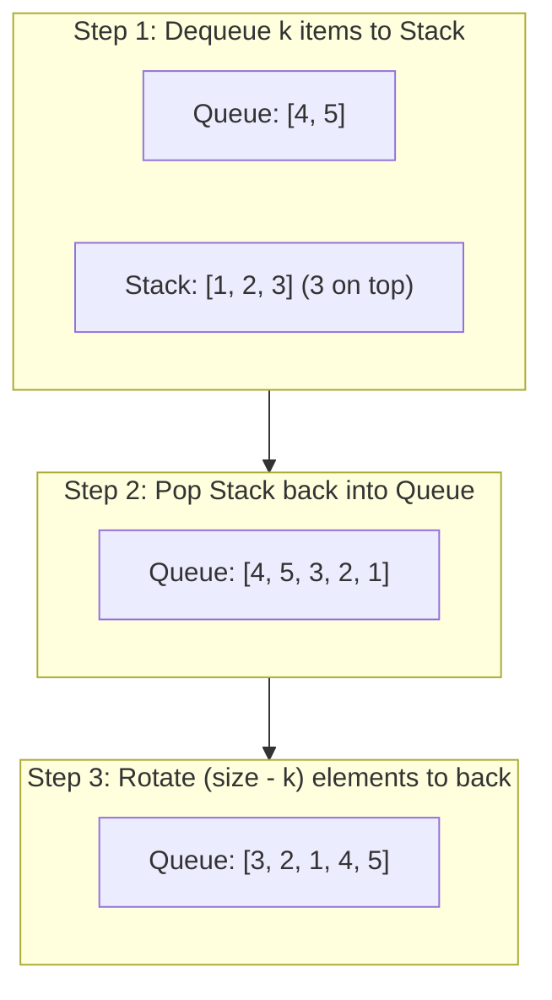

# Mock Exam 1: Detailed Solutions & Explanations

---

## Question 1: Sorting (20 Marks)

### Problem Statement
Present the idea of the Insertion Sort algorithm for an array. For a given random data, compare and explain the runtime efficiency of Insertion Sort with that of Bubble Sort and Selection Sort.

---

### 1.1 The Core Idea of Insertion Sort

#### Mechanical Explanation
Insertion Sort divides the array conceptually into two regions:
1. A **sorted prefix** on the left (initially just the first element at index `0`).
2. An **unsorted suffix** on the right (indices `1` to `n - 1`).

In each iteration $i$ (from $1$ to $n-1$), the algorithm takes the first element of the unsorted region—called the **key**—and scans backwards through the sorted prefix from right to left. Elements in the sorted prefix that are larger than the key are shifted one position to the right to make room. The moment an element smaller than or equal to the key is encountered (or the beginning of the array is reached), the scan stops, and the key is placed into the vacated position.



#### Bioinformatics Mental Model
Think of Insertion Sort like assembling a physical genetic map or organizing sequencing reads manually by chromosome start position:
- You already have an ordered stack of mapped reads on your desk.
- You pick up a new read card (the `key`).
- You flip backward through your sorted stack until you find where its coordinate fits, slide the higher-coordinate cards over, and drop the new card into place.

---

### 1.2 Comparison on Random Data: Insertion Sort vs. Bubble Sort vs. Selection Sort

All three algorithms have an asymptotic worst-case and average-case time complexity of $\mathcal{O}(n^2)$. However, on **randomly permuted data**, their real-world runtime efficiency differs significantly due to the constant factors hidden inside the $\mathcal{O}$ notation: the number of comparisons and the cost of memory writes (swaps vs. shifts).

| Algorithm | Average Comparisons | Average Data Movements (Writes) | Primary Mechanism | Practical Speed on Random Data |
| :--- | :--- | :--- | :--- | :--- |
| **Insertion Sort** | $\approx \frac{n^2}{4}$ comparisons | $\approx \frac{n^2}{4}$ single shifts | Adaptive scan with early exit | **Fastest** among the three |
| **Bubble Sort** | $\approx \frac{n^2}{2}$ comparisons | $\approx \frac{3n^2}{4}$ memory writes ($\frac{n^2}{4}$ full swaps) | Repeated adjacent pairwise swaps | **Slowest** (heavy overhead) |
| **Selection Sort** | Exactly $\frac{n(n - 1)}{2} \approx \frac{n^2}{2}$ | Exactly $n - 1$ swaps ($3(n - 1)$ writes) | Blind scan for global minimum | Moderate (fewer writes, but maximum comparisons) |

#### Detailed Comparison Breakdown

1. **Insertion Sort vs. Selection Sort**:
   - **Comparisons**: Selection Sort is non-adaptive. To find the minimum in the remaining unsorted subarray, it unconditionally compares every single remaining pair. For an array of size $n$, it **always** performs $\frac{n(n-1)}{2} \approx 0.5 n^2$ comparisons, regardless of whether the array is sorted, reversed, or random. In contrast, for random data, Insertion Sort finds the correct insertion slot on average halfway through the sorted prefix. Thus, Insertion Sort performs only $\approx \frac{n^2}{4} = 0.25 n^2$ comparisons—roughly **half as many comparisons as Selection Sort**.
   - **Data Movements**: Selection Sort performs at most $n - 1$ swaps (which is optimal in write-sensitive media like EEPROM). However, in standard RAM cache architectures, comparisons and branching dominate for small to medium arrays, making Insertion Sort faster overall on random data.

2. **Insertion Sort vs. Bubble Sort**:
   - **Comparisons**: Standard Bubble Sort scans adjacent pairs across the entire array pass-by-pass, requiring $\approx \frac{n^2}{2}$ comparisons on random data (twice that of Insertion Sort).
   - **Swaps vs. Shifts**: When Bubble Sort detects an inversion, it performs a complete 3-step swap using a temporary variable:
     ```java
     int temp = A[j]; A[j] = A[j + 1]; A[j + 1] = temp; // 3 memory writes per inversion!
     ```
     Insertion Sort simply shifts the larger element one slot to the right (`A[j + 1] = A[j];` — 1 write). Only after all shifting is complete does it write the `key` once. Because random data contains roughly $\frac{n^2}{4}$ inversions, Bubble Sort does $\frac{3n^2}{4}$ memory writes, whereas Insertion Sort does only $\approx \frac{n^2}{4}$ writes. This makes Bubble Sort drastically slower in CPU cache performance.

---

## Question 2: Sorting (15 Marks)

### Problem Statement
Given the sequence $S$:
$$17, 72, 99, 32, 58, 70, 44, 12, 23$$
Provide the detailed steps to arrange $S$ in **descending order** using the Insertion Sort algorithm, showing the changes in $S$ at each iteration.

---

### Step-by-Step Execution

- **Input Array Size**: $n = 9$
- **Target Order**: Descending (largest to smallest, so $A[j] < \text{key}$ causes elements to shift right).
- **Initial State**:
  $$[17, 72, 99, 32, 58, 70, 44, 12, 23]$$
  Sorted prefix initially contains index `0`: `[17]`.

| Iteration | Key | Comparisons & Shifts | Array State After Iteration |
| :---: | :---: | :--- | :--- |
| **Initial** | — | Unsorted input | `[17, 72, 99, 32, 58, 70, 44, 12, 23]` |
| **$i = 1$** | **72** | $17 < 72 \implies$ shift 17 to right; insert 72 at index 0 | `[72, 17, 99, 32, 58, 70, 44, 12, 23]` |
| **$i = 2$** | **99** | $17 < 99 \implies$ shift 17; $72 < 99 \implies$ shift 72; insert 99 at index 0 | `[99, 72, 17, 32, 58, 70, 44, 12, 23]` |
| **$i = 3$** | **32** | $17 < 32 \implies$ shift 17; $72 > 32 \implies$ stop; insert 32 at index 2 | `[99, 72, 32, 17, 58, 70, 44, 12, 23]` |
| **$i = 4$** | **58** | $17 < 58 \implies$ shift 17; $32 < 58 \implies$ shift 32; $72 > 58 \implies$ stop; insert 58 at index 2 | `[99, 72, 58, 32, 17, 70, 44, 12, 23]` |
| **$i = 5$** | **70** | Shift 17, 32, 58; $72 > 70 \implies$ stop; insert 70 at index 2 | `[99, 72, 70, 58, 32, 17, 44, 12, 23]` |
| **$i = 6$** | **44** | Shift 17, 32; $58 > 44 \implies$ stop; insert 44 at index 4 | `[99, 72, 70, 58, 44, 32, 17, 12, 23]` |
| **$i = 7$** | **12** | $17 > 12 \implies$ stop immediately (0 shifts); insert 12 at index 7 | `[99, 72, 70, 58, 44, 32, 17, 12, 23]` |
| **$i = 8$** | **23** | Shift 12, 17; $32 > 23 \implies$ stop; insert 23 at index 6 | `[99, 72, 70, 58, 44, 32, 23, 17, 12]` |

### Final Result
$$\mathbf{[99, 72, 70, 58, 44, 32, 23, 17, 12]}$$

---

## Question 3: Linked List (35 Marks)

### Problem Statement
Given the sorted (ascending order) `SinglyLinkList` class below:
```java
public class SinglyLinkList {
    private Node first;

    public void insertNode(int value) {
        // YOUR CODE
    }

    public void deleteAllNodes(int value) {
        // YOUR CODE
    }
}

public class Node {
    private int key;
    private Node next;
}
```
- **a)** (15 marks) Complete the `insertNode` method that inserts a `Node` with a given integer into the sorted list at the right location.
- **b)** (20 marks) Complete the `deleteAllNodes` method that deletes all occurrences of a given integer value from the list.

---

### Solution 3(a): `insertNode(int value)`

#### Algorithm & Edge Case Walkthrough
Because the list is maintained in **ascending order**:
1. **Case 1 (Empty list or Insert at Front)**: If `first == null` or the new `value <= first.key`, the new node becomes the new head of the list. Its `next` points to the old `first`, and `first` is updated.
2. **Case 2 (Insert Middle or End)**: Traverse the list using a pointer `current` starting at `first`. We advance while `current.next != null` and `current.next.key < value`. Once the loop terminates, `current` points to the exact node after which the new node must be spliced:
   ```java
   newNode.next = current.next;
   current.next = newNode;
   ```

#### Java Implementation
```java
public void insertNode(int value) {
    Node newNode = new Node();
    newNode.key = value;
    newNode.next = null;

    // Edge Case: List is empty OR value belongs before the first node
    if (first == null || value <= first.key) {
        newNode.next = first;
        first = newNode;
        return;
    }

    // Traverse to locate the node immediately preceding the insertion point
    Node current = first;
    while (current.next != null && current.next.key < value) {
        current = current.next;
    }

    // Splice the new node into the list
    newNode.next = current.next;
    current.next = newNode;
}
```

- **Time Complexity**: $\mathcal{O}(n)$ in the worst case (inserting at the end of the list), $\mathcal{O}(1)$ in the best case (inserting before the head).
- **Space Complexity**: $\mathcal{O}(1)$ auxiliary space.

---

### Solution 3(b): `deleteAllNodes(int value)`

#### Algorithm & Edge Case Walkthrough
Deletions in a singly linked list require updating the `next` reference of the *preceding* node:
1. **Head Cleanup**: The target `value` might appear at the head of the list (one or multiple times, e.g., `20 -> 20 -> 30`). We must advance `first = first.next` until `first == null` or `first.key != value`.
2. **Body Cleanup**: After trimming the head, if the list is empty, we stop. Otherwise, we traverse using `current = first`.
   - If `current.next.key == value`, we bypass that node: `current.next = current.next.next;` (we do *not* advance `current` yet, because the newly linked node might also contain `value`).
   - Because the list is sorted in ascending order, if `current.next.key > value`, no further occurrences of `value` can exist downstream, so we can terminate early!
   - Otherwise, advance `current = current.next`.

#### Java Implementation
```java
public void deleteAllNodes(int value) {
    // Step 1: Remove all matching occurrences at the head of the list
    while (first != null && first.key == value) {
        first = first.next;
    }

    // If the list is now empty, nothing left to delete
    if (first == null) {
        return;
    }

    // Step 2: Remove matching occurrences in the remainder of the list
    Node current = first;
    while (current.next != null) {
        if (current.next.key == value) {
            // Bypass the target node (unlinks it from the chain)
            current.next = current.next.next;
        } else if (current.next.key > value) {
            // Optimization: since the list is sorted, we can terminate early
            break;
        } else {
            current = current.next;
        }
    }
}
```

- **Time Complexity**: $\mathcal{O}(n)$ single pass over the list.
- **Space Complexity**: $\mathcal{O}(1)$ auxiliary memory.

---

## Question 4: Queue and Stack (20 Marks)

### 4(a) Max Priority Queue Operations (10 Marks)

#### Problem Statement
Show the queue after each operation of the following sequence of **MAX PRIORITY QUEUE** operations, if executed on an initially empty queue:
```text
enqueue(1), enqueue(20), dequeue(), enqueue(30), enqueue(4), dequeue(), dequeue(),
enqueue(50), enqueue(0), dequeue(), enqueue(2), enqueue(6), dequeue(), dequeue(),
enqueue(100), dequeue(), dequeue()
```

#### Behavioral Rules of Max Priority Queue
- `enqueue(x)`: Adds item $x$ into the priority queue.
- `dequeue()`: Extracts and returns the item with the **maximum numerical value**.
- Mental Model: Like an automated variant caller queue that always pulls the genetic variant with the highest quality/confidence score first.

#### Step-by-Step Trace

| Step | Operation | Action & Priority Queue State (Ordered Highest to Lowest) | Value Returned |
| :---: | :--- | :--- | :---: |
| 1 | `enqueue(1)` | `[1]` | — |
| 2 | `enqueue(20)` | `[20, 1]` | — |
| 3 | `dequeue()` | Remove max element (20) $\implies$ Queue: `[1]` | **20** |
| 4 | `enqueue(30)` | `[30, 1]` | — |
| 5 | `enqueue(4)` | `[30, 4, 1]` | — |
| 6 | `dequeue()` | Remove max element (30) $\implies$ Queue: `[4, 1]` | **30** |
| 7 | `dequeue()` | Remove max element (4) $\implies$ Queue: `[1]` | **4** |
| 8 | `enqueue(50)` | `[50, 1]` | — |
| 9 | `enqueue(0)` | `[50, 1, 0]` | — |
| 10 | `dequeue()` | Remove max element (50) $\implies$ Queue: `[1, 0]` | **50** |
| 11 | `enqueue(2)` | `[2, 1, 0]` | — |
| 12 | `enqueue(6)` | `[6, 2, 1, 0]` | — |
| 13 | `dequeue()` | Remove max element (6) $\implies$ Queue: `[2, 1, 0]` | **6** |
| 14 | `dequeue()` | Remove max element (2) $\implies$ Queue: `[1, 0]` | **2** |
| 15 | `enqueue(100)` | `[100, 1, 0]` | — |
| 16 | `dequeue()` | Remove max element (100) $\implies$ Queue: `[1, 0]` | **100** |
| 17 | `dequeue()` | Remove max element (1) $\implies$ Queue: `[0]` | **1** |

- **Final Queue State**: `[0]`
- **Sequence of Dequeued Values**: `20, 30, 4, 50, 6, 2, 100, 1`

---

### 4(b) Stack Operations (10 Marks)

#### Problem Statement
Show the stack after each operation of the following series of stack operations, if executed upon an initially empty stack:
```text
push(10), push(20), pop(), push(0), push(1), pop(), pop(), push(2), push(30), pop(),
push(3), push(4), pop(), pop(), push(100), pop(), pop()
```

#### Behavioral Rules of Stack
- Last-In, First-Out (LIFO). Elements are pushed and popped strictly at the **top**.
- Mental Model: Like the nested call stack in recursive DNA sequence parsing or RNA secondary structure stem-loop matching.

#### Step-by-Step Trace

| Step | Operation | Stack State (Bottom $\to$ Top) | Top Element | Value Returned by `pop()` |
| :---: | :--- | :--- | :---: | :---: |
| 1 | `push(10)` | `[10]` | 10 | — |
| 2 | `push(20)` | `[10, 20]` | 20 | — |
| 3 | `pop()` | `[10]` | 10 | **20** |
| 4 | `push(0)` | `[10, 0]` | 0 | — |
| 5 | `push(1)` | `[10, 0, 1]` | 1 | — |
| 6 | `pop()` | `[10, 0]` | 0 | **1** |
| 7 | `pop()` | `[10]` | 10 | **0** |
| 8 | `push(2)` | `[10, 2]` | 2 | — |
| 9 | `push(30)` | `[10, 2, 30]` | 30 | — |
| 10 | `pop()` | `[10, 2]` | 2 | **30** |
| 11 | `push(3)` | `[10, 2, 3]` | 3 | — |
| 12 | `push(4)` | `[10, 2, 3, 4]` | 4 | — |
| 13 | `pop()` | `[10, 2, 3]` | 3 | **4** |
| 14 | `pop()` | `[10, 2]` | 2 | **3** |
| 15 | `push(100)` | `[10, 2, 100]` | 100 | — |
| 16 | `pop()` | `[10, 2]` | 2 | **100** |
| 17 | `pop()` | `[10]` | 10 | **2** |

- **Final Stack State**: `[10]` (Top is `10`)
- **Sequence of Popped Values**: `20, 1, 0, 30, 4, 3, 100, 2`

---

## Question 5: Queue Reversal (10 Marks)

### Problem Statement
Given an integer $k$ and a queue of integers, implement a function to reverse the order of the first $k$ elements of the queue while keeping the other elements in the same original order.

**Allowed Queue Operations Only**:
- `enqueue(x)`: Add item $x$ to rear of queue.
- `dequeue()`: Remove item from front of queue.
- `size()`: Returns number of elements.
- `front()`: Returns front item without removing.

#### Examples
- **Input**: $q = [1, 2, 3, 4, 5], k = 3 \implies$ **Output**: $[3, 2, 1, 4, 5]$
- **Input**: $q = [4, 3, 2, 1], k = 4 \implies$ **Output**: $[1, 2, 3, 4]$

---

### Algorithm Design & The LIFO Inversion Principle

A Queue is FIFO (First-In, First-Out), which preserves order. A Stack is LIFO (Last-In, First-Out), which **naturally reverses order** (just like taking the reverse complement of an oligonucleotide).

To reverse the first $k$ elements while preserving the remaining $n - k$ elements:
1. **Extract & Reverse**: Dequeue the first $k$ elements from the queue and push them onto an auxiliary Stack.
2. **Re-insert Reversed**: Pop all $k$ elements from the stack and enqueue them back into the queue. They are now at the *back* of the queue in reversed order.
3. **Rotate Remaining Elements**: The remaining $n - k$ elements are currently sitting at the front of the queue in their original order. Dequeue and immediately enqueue them one-by-one ($n - k$ times). This rotates them behind the reversed prefix, restoring their original relative order.



### Complete Java Implementation

```java
import java.util.Queue;
import java.util.Stack;

public class QueueReversal {

    public static void reverseFirstK(Queue<Integer> q, int k) {
        // Validation / Edge Cases
        if (q == null || k <= 0 || k > q.size()) {
            return;
        }

        Stack<Integer> stack = new Stack<>();

        // Step 1: Dequeue first k elements and push onto stack
        for (int i = 0; i < k; i++) {
            stack.push(q.poll()); // dequeue
        }

        // Step 2: Pop from stack and enqueue back to the queue (reversed order)
        while (!stack.isEmpty()) {
            q.add(stack.pop()); // enqueue
        }

        // Step 3: Rotate the remaining (size - k) elements to the rear
        int remaining = q.size() - k;
        for (int i = 0; i < remaining; i++) {
            q.add(q.poll()); // dequeue front and enqueue back
        }
    }
}
```

### Complexity Analysis
- **Time Complexity**:
  - Pushing $k$ elements to stack: $\mathcal{O}(k)$
  - Popping $k$ elements to queue: $\mathcal{O}(k)$
  - Rotating $(n - k)$ elements: $\mathcal{O}(n - k)$
  - Total Time: $\mathcal{O}(k + k + n - k) = \mathcal{O}(n)$, strictly linear.
- **Space Complexity**: $\mathcal{O}(k)$ auxiliary space for the auxiliary stack.
