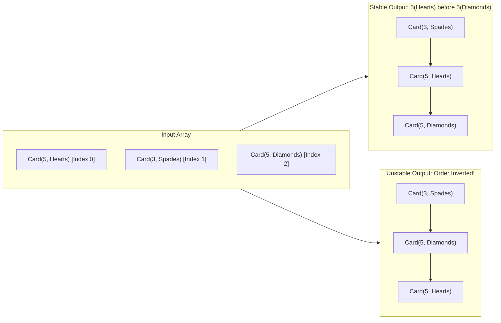
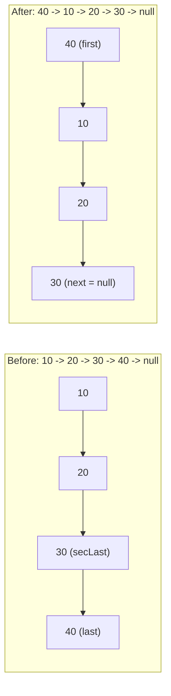
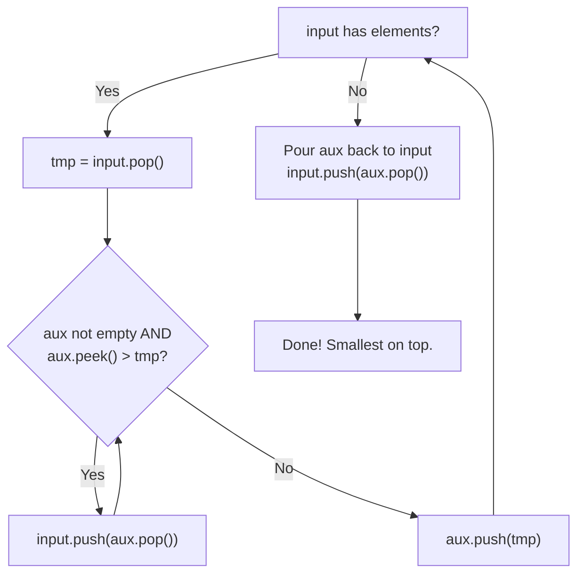

# Mock Exam 2: Detailed Solutions & Explanations

---

## Question 1: Sorting (20 Marks)

### 1(a) Concept of Stability in Sorting (10 Marks)

#### Definition of Stability
A sorting algorithm is defined as **stable** if and only if elements with equal keys maintain their original relative order (their input sequence) in the sorted output.



#### Bioinformatics Mental Model
In computational genomics, multi-pass sorting is standard practice. Suppose you have a table of genetic variations (SNPs) sorted by chromosome position (`POS`). If you subsequently sort by chromosome identifier (`CHROM`) using a **stable** sort, all SNPs on chromosome 1 will remain sorted by position. If the sort is **unstable**, SNPs on chromosome 1 will be scrambled into random coordinate order, breaking downstream binary searches and coordinate indexing.

---

#### Stability Analysis: Insertion Sort vs. Selection Sort

1. **Insertion Sort is STABLE**:
   - **Why**: When inserting an element `key`, Insertion Sort scans backwards from right to left through the sorted subarray. It only shifts an element $A[j]$ if $A[j] > \text{key}$ (strictly greater).
   - If an element equal to `key` is encountered ($A[j] == \text{key}$), the strict inequality fails, the scan stops, and the key is placed immediately to its right.
   - Therefore, elements with identical values never cross or jump over each other. Their relative input order is preserved.

2. **Selection Sort is UNSTABLE**:
   - **Why**: Selection Sort finds the extremum (minimum or maximum) and swaps it with the element at the boundary of the unsorted subarray. This long-range swap can leapfrog over identical elements located in between.
   - **Concrete Counterexample**:
     Consider sorting the 3-element array:
     $$[2_a, 2_b, 1]$$
     (where $2_a$ and $2_b$ have equal key value 2, but $2_a$ appears first).
     - Iteration 1: The minimum element in the array is $1$ at index 2. Selection Sort swaps $1$ with the element at index 0 ($2_a$).
     - The array becomes:
       $$[1, 2_b, 2_a]$$
     - Result: $2_b$ is now placed *before* $2_a$. Their relative order is inverted. Hence, Selection Sort is fundamentally unstable.

---

### 1(b) Best-Case Comparison: Insertion Sort vs. Selection Sort (10 Marks)

Assume an array of size $n$ that is **already sorted in ascending order** (Best Case).

| Metric | Insertion Sort (Best Case) | Selection Sort (Best Case) | Key Conceptual Difference |
| :--- | :---: | :---: | :--- |
| **Comparisons** | $n - 1$ ($\mathcal{O}(n)$) | $\frac{n(n - 1)}{2}$ ($\mathcal{O}(n^2)$) | Insertion Sort exits early; Selection Sort blindly scans everything. |
| **Swaps / Shifts** | $0$ shifts ($\mathcal{O}(1)$) | $0$ swaps (or $n - 1$ self-swaps) | Neither algorithm moves data in the already-sorted case. |
| **Time Complexity** | $\mathbf{\mathcal{O}(n)}$ (Linear) | $\mathbf{\mathcal{O}(n^2)}$ (Quadratic) | Insertion Sort is adaptive; Selection Sort is completely non-adaptive. |

#### Detailed Mechanical Explanation

1. **Insertion Sort**:
   - For each element from index $i = 1$ to $n - 1$, the key is compared to its immediate predecessor $A[i - 1]$.
   - Because the array is already sorted, $A[i - 1] \le \text{key}$ is immediately true on the very first comparison.
   - The inner while-loop never executes any shifts and terminates after exactly **1 comparison per outer loop step**.
   - Total comparisons: $\sum_{i=1}^{n-1} 1 = n - 1$.
   - Total data movements: $0$ elements shifted.
   - Overall Best-Case Time: **$\mathcal{O}(n)$**.

2. **Selection Sort**:
   - To place the minimum element at index $i$, Selection Sort has no mechanism to know that the subarray $A[i \dots n-1]$ is already sorted.
   - It is forced to scan every single element from $i + 1$ to $n - 1$ to verify that no smaller element exists.
   - For $i = 0$, it makes $n - 1$ comparisons; for $i = 1$, $n - 2$ comparisons, all the way to $1$.
   - Total comparisons:
     $$\sum_{i=0}^{n-2} (n - 1 - i) = (n - 1) + (n - 2) + \dots + 1 = \frac{n(n - 1)}{2} \in \mathcal{O}(n^2)$$
   - Total swaps: With an optimization check (`if (min_idx != i)`), $0$ swaps are performed; without it, $n - 1$ redundant self-swaps occur.
   - Overall Best-Case Time: Still **$\mathcal{O}(n^2)$**.

---

## Question 2: Sorting (15 Marks)

### Problem Statement
Given the sequence $S$:
$$45, 12, 85, 32, 89, 45, 21$$
Provide the detailed steps to arrange $S$ in **ascending order** using the Selection Sort algorithm.

**Constraint**: In each iteration, you **MUST** find the **MAXIMUM** element and swap it with the element at the **END** of the unsorted portion (instead of the traditional way of finding the minimum and swapping it to the front). Show the changes in $S$ at each iteration.

---

### Step-by-Step Execution

- Array length: $n = 7$.
- Indices: `0` to `6`.
- Unsorted portion at iteration $k$ is $A[0 \dots \text{end}]$, where $\text{end}$ ranges from $6$ down to $1$.
- Tie-breaking convention for equal keys: We maintain the standard strict comparison (`if (A[j] > maxVal)`), keeping the first occurrence encountered.

| Iteration | Unsorted Range | Max Found (Value @ Index) | End Index | Swap Action | Array State After Iteration |
| :---: | :---: | :---: | :---: | :--- | :--- |
| **Initial** | `A[0..6]` | — | — | — | `[45, 12, 85, 32, 89, 45, 21]` |
| **1** | `A[0..6]` | **89** at index 4 | 6 | Swap $A[4]$ (89) with $A[6]$ (21) | `[45, 12, 85, 32, 21, 45, 89]` |
| **2** | `A[0..5]` | **85** at index 2 | 5 | Swap $A[2]$ (85) with $A[5]$ (45) | `[45, 12, 45, 32, 21, 85, 89]` |
| **3** | `A[0..4]` | **45** at index 0 | 4 | Swap $A[0]$ (45) with $A[4]$ (21) | `[21, 12, 45, 32, 45, 85, 89]` |
| **4** | `A[0..3]` | **45** at index 2 | 3 | Swap $A[2]$ (45) with $A[3]$ (32) | `[21, 12, 32, 45, 45, 85, 89]` |
| **5** | `A[0..2]` | **32** at index 2 | 2 | Max is already at index 2 (self-swap) | `[21, 12, 32, 45, 45, 85, 89]` |
| **6** | `A[0..1]` | **21** at index 0 | 1 | Swap $A[0]$ (21) with $A[1]$ (12) | `[12, 21, 32, 45, 45, 85, 89]` |

> [!NOTE]
> Observe Iteration 3: The element `45` at index 0 was swapped with `21` at index 4, jumping past the second `45` at index 2! This vividly demonstrates in practice why Selection Sort is unstable.

### Final Result
$$\mathbf{[12, 21, 32, 45, 45, 85, 89]}$$

---

## Question 3: Linked List (35 Marks)

### Problem Statement
Given the sorted (ascending order) `SinglyLinkList` class below:
```java
public class SinglyLinkList {
    private Node first;

    public void moveLastToFront() {
        // YOUR CODE
    }

    public void removeDuplicates() {
        // YOUR CODE
    }
}

public class Node {
    private int key;
    private Node next;
}
```
- **a)** (15 marks) Complete the `moveLastToFront()` method that removes the last node of the list and makes it the new first node. (You must handle edge cases like an empty list or a list with only one node).
- **b)** (20 marks) Complete the `removeDuplicates()` method that removes all duplicate values from the sorted list, keeping only the first occurrence of each value.

---

### Solution 3(a): `moveLastToFront()`

#### Edge Cases & Pointer Manipulation
1. **Edge Case (0 or 1 Node)**: If `first == null` (empty list) or `first.next == null` (single node), moving the last to front changes nothing. Return immediately.
2. **General Case ($\ge 2$ Nodes)**:
   - We need to locate the **second-to-last node** (`secLast`), because its `next` pointer must be set to `null` to detach the last node cleanly.
   - Traverse: `while (secLast.next.next != null) secLast = secLast.next;`.
   - Identify `last = secLast.next`.
   - Sever link: `secLast.next = null;`.
   - Prepend: `last.next = first;`.
   - Update head: `first = last;`.



#### Java Implementation
```java
public void moveLastToFront() {
    // Edge case: Empty list or list with only one node
    if (first == null || first.next == null) {
        return;
    }

    // Traverse to find the second-to-last node
    Node secLast = first;
    while (secLast.next.next != null) {
        secLast = secLast.next;
    }

    // secLast.next is the last node
    Node last = secLast.next;

    // Disconnect the last node from the end
    secLast.next = null;

    // Attach last node before current first node
    last.next = first;

    // Make last node the new head
    first = last;
}
```

- **Time Complexity**: $\mathcal{O}(n)$ because we must traverse the list once to reach the second-to-last node.
- **Space Complexity**: $\mathcal{O}(1)$ auxiliary space.

---

### Solution 3(b): `removeDuplicates()`

#### Algorithm & Pointer Manipulation
Because the linked list is **already sorted in ascending order**, all identical values are contiguous (adjacent in memory).
1. If the list is empty (`first == null`), do nothing.
2. Maintain a pointer `current = first`.
3. While `current.next != null`:
   - If `current.key == current.next.key`, bypass the duplicate node:
     ```java
     current.next = current.next.next;
     ```
     *(Crucial: Do not advance `current` here, because the newly spliced `current.next` might also be a duplicate, e.g., in `1 -> 1 -> 1`)*.
   - If `current.key != current.next.key`, advance:
     ```java
     current = current.next;
     ```

#### Java Implementation
```java
public void removeDuplicates() {
    if (first == null) {
        return;
    }

    Node current = first;
    while (current.next != null) {
        if (current.key == current.next.key) {
            // Duplicate detected: bypass current.next
            current.next = current.next.next;
        } else {
            // Distinct value: advance to the next node
            current = current.next;
        }
    }
}
```

- **Time Complexity**: $\mathcal{O}(n)$ single linear pass.
- **Space Complexity**: $\mathcal{O}(1)$ in-place modification.

---

## Question 4: Queue and Stack (20 Marks)

### 4(a) Min Priority Queue Operations (10 Marks)

#### Problem Statement
Consider a **MIN PRIORITY QUEUE**. Execute the following sequence of operations on an initially empty queue and write down the exact sequence of values returned by the `dequeue()` operations:
```text
enqueue(15), enqueue(10), enqueue(20), dequeue(), enqueue(5), dequeue(),
dequeue(), enqueue(30), enqueue(2), dequeue()
```

#### Behavioral Rules
- `enqueue(x)`: Adds item $x$.
- `dequeue()`: Always removes and returns the **minimum numerical value** currently present in the queue.

#### Step-by-Step Trace

| Step | Operation | Priority Queue Contents (Sorted Ascending) | Value Returned by `dequeue()` |
| :---: | :--- | :--- | :---: |
| 1 | `enqueue(15)` | `[15]` | — |
| 2 | `enqueue(10)` | `[10, 15]` | — |
| 3 | `enqueue(20)` | `[10, 15, 20]` | — |
| 4 | `dequeue()` | Remove min (10) $\implies$ Queue: `[15, 20]` | **10** |
| 5 | `enqueue(5)` | `[5, 15, 20]` | — |
| 6 | `dequeue()` | Remove min (5) $\implies$ Queue: `[15, 20]` | **5** |
| 7 | `dequeue()` | Remove min (15) $\implies$ Queue: `[20]` | **15** |
| 8 | `enqueue(30)` | `[20, 30]` | — |
| 9 | `enqueue(2)` | `[2, 20, 30]` | — |
| 10 | `dequeue()` | Remove min (2) $\implies$ Queue: `[20, 30]` | **2** |

#### Final Answer
The exact sequence of values returned by the `dequeue()` operations is:
$$\mathbf{10, 5, 15, 2}$$

---

### 4(b) Circular Queue Trace (10 Marks)

#### Problem Statement
Consider a Circular Queue implemented using an array $A$ of maximum capacity $N = 5$ (indices 0 to 4). Initially:
$$\text{front} = 0, \quad \text{rear} = -1, \quad \text{size} = 0$$
Show the exact contents of the array $A$, and the values of the `front` and `rear` indices after executing the following sequence:
```text
enqueue(10), enqueue(20), enqueue(30), dequeue(), enqueue(40),
enqueue(50), enqueue(60), dequeue()
```

#### Formulas for Array-Based Circular Queue
- $\text{enqueue}(x)$: $\text{rear} = (\text{rear} + 1) \pmod N$; $A[\text{rear}] = x$; $\text{size} = \text{size} + 1$.
- $\text{dequeue}()$: $x = A[\text{front}]$; $\text{front} = (\text{front} + 1) \pmod N$; $\text{size} = \text{size} - 1$.

#### Step-by-Step Trace

| Step | Operation | `front` | `rear` | `size` | Array $A$ Contents `[0, 1, 2, 3, 4]` | Explanation |
| :---: | :--- | :---: | :---: | :---: | :--- | :--- |
| **0** | Initial | 0 | -1 | 0 | `[null, null, null, null, null]` | Empty queue |
| **1** | `enqueue(10)` | 0 | 0 | 1 | `[10, null, null, null, null]` | $\text{rear} = (-1 + 1) \pmod 5 = 0$; store 10 |
| **2** | `enqueue(20)` | 0 | 1 | 2 | `[10, 20, null, null, null]` | $\text{rear} = (0 + 1) \pmod 5 = 1$; store 20 |
| **3** | `enqueue(30)` | 0 | 2 | 3 | `[10, 20, 30, null, null]` | $\text{rear} = (1 + 1) \pmod 5 = 2$; store 30 |
| **4** | `dequeue()` | 1 | 2 | 2 | `[10, 20, 30, null, null]` | Value 10 dequeued; $\text{front} = (0 + 1) \pmod 5 = 1$ |
| **5** | `enqueue(40)` | 1 | 3 | 3 | `[10, 20, 30, 40, null]` | $\text{rear} = (2 + 1) \pmod 5 = 3$; store 40 |
| **6** | `enqueue(50)` | 1 | 4 | 4 | `[10, 20, 30, 40, 50]` | $\text{rear} = (3 + 1) \pmod 5 = 4$; store 50 |
| **7** | `enqueue(60)` | 1 | **0** | 5 | `[60, 20, 30, 40, 50]` | $\text{rear}$ **wraps around**: $(4 + 1) \pmod 5 = 0$; 60 overwrites index 0 |
| **8** | `dequeue()` | **2** | **0** | 4 | `[60, 20, 30, 40, 50]` | Value 20 dequeued; $\text{front} = (1 + 1) \pmod 5 = 2$ |

#### Final State
- **Array $A$ Contents**: `[60, 20, 30, 40, 50]` *(In memory, index 1 still contains 20 unless cleared, but logically the queue contains indices 2, 3, 4, 0)*.
- **Active Elements (Front to Rear)**: `30, 40, 50, 60`
- **front Index**: **`2`**
- **rear Index**: **`0`**
- **size**: **`4`**

---

## Question 5: Stack & Queue (10 Marks)

### Problem Statement
Given a stack of integers, implement a function to sort the stack in **ascending order** (smallest items on top).

**Constraint**: You are allowed to use **exactly one additional auxiliary Stack**. You may **NOT** use arrays, queues, lists, or any other data structures.

**Only the following operations are allowed on a stack**:
- `push(x)`: Add an item $x$ to the top.
- `pop()`: Remove and return the top item.
- `peek()`: Return the top item without removing it.
- `isEmpty()`: Check if the stack is empty.

#### Example
- **Input Stack (Top is right)**: `[34, 3, 31, 98, 92, 23]` (23 on top)
- **Output Stack (Top is right)**: `[98, 92, 34, 31, 23, 3]` (3 on top)

---

### Algorithm Walkthrough

Let the given stack be `input` and our auxiliary stack be `aux`.

#### The Inversion Principle
If we want the final `input` stack to have the **smallest items on top** (ascending from top down, meaning largest at the bottom), our intermediate `aux` stack must hold elements in **descending order** (largest items on top). When we finally pour `aux` back into `input`, the order inverts, placing the smallest items on top!

#### Step-by-Step Procedure
1. While `input` is not empty:
   - Pop the top element from `input` and store it in a temporary variable: `tmp = input.pop()`.
   - While `aux` is not empty AND `aux.peek() > tmp`:
     - Pop from `aux` and push it back into `input`: `input.push(aux.pop())`.
     *(This shifts larger elements out of the way, transferring them temporarily back to `input`)*.
   - Push `tmp` onto `aux`.
2. Once `input` is empty, all elements are in `aux` sorted with the largest element at the top.
3. Transfer all elements from `aux` back to `input` (`input.push(aux.pop())`).
4. `input` now contains all elements sorted with the **smallest item on top**.



### Complete Java Implementation

```java
import java.util.Stack;

public class StackSorter {

    public static void sortStack(Stack<Integer> input) {
        if (input == null || input.isEmpty()) {
            return;
        }

        Stack<Integer> aux = new Stack<>();

        // Process each element from the input stack
        while (!input.isEmpty()) {
            int tmp = input.pop();

            // Shift elements in aux that are greater than tmp back into input
            while (!aux.isEmpty() && aux.peek() > tmp) {
                input.push(aux.pop());
            }

            // Place tmp in its correct sorted position in aux
            aux.push(tmp);
        }

        // Transfer elements back to input stack:
        // aux has largest on top -> pouring into input puts smallest on top!
        while (!aux.isEmpty()) {
            input.push(aux.pop());
        }
    }
}
```

### Complexity Analysis
- **Time Complexity**: $\mathcal{O}(n^2)$ in the worst case (e.g., if the input stack is already sorted in reverse order, each insertion shifts elements back and forth between the two stacks, identical to Insertion Sort mechanics).
- **Space Complexity**: $\mathcal{O}(n)$ auxiliary space to hold the $n$ elements in the single additional `aux` stack.
