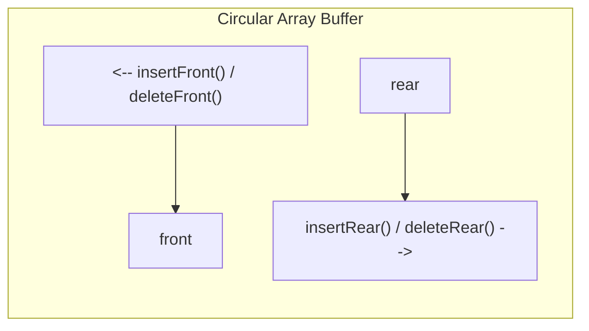

# Real Exam 2023 (IT013IU HK1 Midterm): Complete Solutions & Explanations

---

## Exam Information
- **Course**: Algorithms & Data Structures (IT013IU)
- **Institution**: International University – VNU-HCM (School of Computer Science and Engineering)
- **Exam Date**: 03/04/2023
- **Duration**: 90 minutes
- **Total Marks**: 100 marks (equivalent to 30% of course grade)

---

## Question 1: Sorting (20 Marks)

### Problem Statement
Given array $A$:

| Index | 0 | 1 | 2 | 3 | 4 | 5 | 6 | 7 | 8 | 9 | 10 | 11 | 12 |
| :---: | :---: | :---: | :---: | :---: | :---: | :---: | :---: | :---: | :---: | :---: | :---: | :---: | :---: |
| **Data** | 72 | 4 | 12 | 53 | 15 | 2 | 8 | 16 | 40 | 21 | 7 | 87 | 35 |

Sort the array with **Selection Sort** by filling the table below.

---

### Mechanics of Selection Sort
Selection Sort operates by progressively expanding a sorted prefix on the left:
1. For each position $i$ from $0$ to $n - 2$ (here indices $0$ to $11$):
   - Find the index `min_idx` of the minimum element in the remaining unsorted subarray $A[i \dots 12]$.
   - Swap $A[i]$ with $A[\text{min\_idx}]$.
2. After iteration $i$, the element at index $i$ is guaranteed to be in its final sorted position.

---

### Step-by-Step Selection Sort Execution Table

| Iteration / Action | 0 | 1 | 2 | 3 | 4 | 5 | 6 | 7 | 8 | 9 | 10 | 11 | 12 |
| :--- | :---: | :---: | :---: | :---: | :---: | :---: | :---: | :---: | :---: | :---: | :---: | :---: | :---: |
| **Initial Array** | 72 | 4 | 12 | 53 | 15 | 2 | 8 | 16 | 40 | 21 | 7 | 87 | 35 |
| **Step 1** (Min = 2 @ idx 5 $\leftrightarrow$ Swap $A[0]$) | **2** | 4 | 12 | 53 | 15 | 72 | 8 | 16 | 40 | 21 | 7 | 87 | 35 |
| **Step 2** (Min = 4 @ idx 1 $\leftrightarrow$ Self-swap $A[1]$) | **2** | **4** | 12 | 53 | 15 | 72 | 8 | 16 | 40 | 21 | 7 | 87 | 35 |
| **Step 3** (Min = 7 @ idx 10 $\leftrightarrow$ Swap $A[2]$) | **2** | **4** | **7** | 53 | 15 | 72 | 8 | 16 | 40 | 21 | 12 | 87 | 35 |
| **Step 4** (Min = 8 @ idx 6 $\leftrightarrow$ Swap $A[3]$) | **2** | **4** | **7** | **8** | 15 | 72 | 53 | 16 | 40 | 21 | 12 | 87 | 35 |
| **Step 5** (Min = 12 @ idx 10 $\leftrightarrow$ Swap $A[4]$) | **2** | **4** | **7** | **8** | **12** | 72 | 53 | 16 | 40 | 21 | 15 | 87 | 35 |
| **Step 6** (Min = 15 @ idx 10 $\leftrightarrow$ Swap $A[5]$) | **2** | **4** | **7** | **8** | **12** | **15** | 53 | 16 | 40 | 21 | 72 | 87 | 35 |
| **Step 7** (Min = 16 @ idx 7 $\leftrightarrow$ Swap $A[6]$) | **2** | **4** | **7** | **8** | **12** | **15** | **16** | 53 | 40 | 21 | 72 | 87 | 35 |
| **Step 8** (Min = 21 @ idx 9 $\leftrightarrow$ Swap $A[7]$) | **2** | **4** | **7** | **8** | **12** | **15** | **16** | **21** | 40 | 53 | 72 | 87 | 35 |
| **Step 9** (Min = 35 @ idx 12 $\leftrightarrow$ Swap $A[8]$) | **2** | **4** | **7** | **8** | **12** | **15** | **16** | **21** | **35** | 53 | 72 | 87 | 40 |
| **Step 10** (Min = 40 @ idx 12 $\leftrightarrow$ Swap $A[9]$) | **2** | **4** | **7** | **8** | **12** | **15** | **16** | **21** | **35** | **40** | 72 | 87 | 53 |
| **Step 11** (Min = 53 @ idx 12 $\leftrightarrow$ Swap $A[10]$) | **2** | **4** | **7** | **8** | **12** | **15** | **16** | **21** | **35** | **40** | **53** | 87 | 72 |
| **Step 12** (Min = 72 @ idx 12 $\leftrightarrow$ Swap $A[11]$) | **2** | **4** | **7** | **8** | **12** | **15** | **16** | **21** | **35** | **40** | **53** | **72** | **87** |

#### Final Sorted Array
$$\mathbf{[2, 4, 7, 8, 12, 15, 16, 21, 35, 40, 53, 72, 87]}$$

---

## Question 2: Queue and Stack (20 Marks)

### 2(a) FIFO Queue Trace (10 Marks)

#### Problem Statement
What values are returned after each `dequeue()` during the following sequence of queue operations, if executed on an initially empty queue?
```text
enqueue(0), enqueue(3), dequeue(), enqueue(0), enqueue(4), dequeue(), dequeue(),
enqueue(2), enqueue(0), dequeue(), enqueue(2), enqueue(3), dequeue(), dequeue(),
enqueue(1330), dequeue(), dequeue()
```

#### Behavioral Rule
Standard FIFO (First-In, First-Out). Elements enter at the back (rear) and exit at the front.

#### Step-by-Step Trace

| Step | Operation | Queue State (Front $\to$ Rear) | Returned by `dequeue()` |
| :---: | :--- | :--- | :---: |
| 1 | `enqueue(0)` | `[0]` | — |
| 2 | `enqueue(3)` | `[0, 3]` | — |
| 3 | `dequeue()` | `[3]` | **0** |
| 4 | `enqueue(0)` | `[3, 0]` | — |
| 5 | `enqueue(4)` | `[3, 0, 4]` | — |
| 6 | `dequeue()` | `[0, 4]` | **3** |
| 7 | `dequeue()` | `[4]` | **0** |
| 8 | `enqueue(2)` | `[4, 2]` | — |
| 9 | `enqueue(0)` | `[4, 2, 0]` | — |
| 10 | `dequeue()` | `[2, 0]` | **4** |
| 11 | `enqueue(2)` | `[2, 0, 2]` | — |
| 12 | `enqueue(3)` | `[2, 0, 2, 3]` | — |
| 13 | `dequeue()` | `[0, 2, 3]` | **2** |
| 14 | `dequeue()` | `[2, 3]` | **0** |
| 15 | `enqueue(1330)` | `[2, 3, 1330]` | — |
| 16 | `dequeue()` | `[3, 1330]` | **2** |
| 17 | `dequeue()` | `[1330]` | **3** |

#### Final Sequence of Values Returned by `dequeue()`
$$\mathbf{0, 3, 0, 4, 2, 0, 2, 3}$$

*(Notice the hidden easter egg: `03, 04, 2023` encodes the exact date of the examination: April 3, 2023!)*

---

### 2(b) LIFO Stack Trace (10 Marks)

#### Problem Statement
What values are returned after each `pop()` during the following series of stack operations, if executed upon an initially empty stack?
```text
push(0), push(3), pop(), push(0), push(4), pop(), pop(), push(2), push(0), pop(),
push(2), push(3), pop(), pop(), push(1330), pop(), pop()
```

#### Behavioral Rule
Standard LIFO (Last-In, First-Out). Elements are added and removed from the **top** of the stack.

#### Step-by-Step Trace

| Step | Operation | Stack State (Bottom $\to$ Top) | Top Element | Returned by `pop()` |
| :---: | :--- | :--- | :---: | :---: |
| 1 | `push(0)` | `[0]` | 0 | — |
| 2 | `push(3)` | `[0, 3]` | 3 | — |
| 3 | `pop()` | `[0]` | 0 | **3** |
| 4 | `push(0)` | `[0, 0]` | 0 | — |
| 5 | `push(4)` | `[0, 0, 4]` | 4 | — |
| 6 | `pop()` | `[0, 0]` | 0 | **4** |
| 7 | `pop()` | `[0]` | 0 | **0** |
| 8 | `push(2)` | `[0, 2]` | 2 | — |
| 9 | `push(0)` | `[0, 2, 0]` | 0 | — |
| 10 | `pop()` | `[0, 2]` | 2 | **0** |
| 11 | `push(2)` | `[0, 2, 2]` | 2 | — |
| 12 | `push(3)` | `[0, 2, 2, 3]` | 3 | — |
| 13 | `pop()` | `[0, 2, 2]` | 2 | **3** |
| 14 | `pop()` | `[0, 2]` | 2 | **2** |
| 15 | `push(1330)` | `[0, 2, 1330]` | 1330 | — |
| 16 | `pop()` | `[0, 2]` | 2 | **1330** |
| 17 | `pop()` | `[0]` | 0 | **2** |

#### Final Sequence of Values Returned by `pop()`
$$\mathbf{3, 4, 0, 0, 3, 2, 1330, 2}$$

---

## Question 3: Linked List (30 Marks)

### Problem Statement
Given the 2 classes `Node` and `DoublyLinkList`:
```java
public class DoublyLinkList {
    public Node first;
    public Node last;
}

public class Node {
    public int key;
    public Node next;
    public Node previous;
}
```
- **(5 marks)** Implement function `delete_first` for the doubly linked list.
- **(5 marks)** Implement function `insert_last` for the doubly linked list.
- **(20 marks)** Implement an algorithm to merge two sorted doubly linked lists to make a new sorted linked list.

---

### 3.1 Function `delete_first()` (5 Marks)

#### Logic & Edge Cases
- **Empty List**: If `first == null`, nothing to delete.
- **Single Node** (`first == last`): Set both `first = null` and `last = null`.
- **Multiple Nodes**: Advance `first = first.next`, and sever the reverse link by setting `first.previous = null`.

```java
public void delete_first() {
    if (first == null) {
        return; // Empty list: do nothing
    }
    if (first == last) {
        // Only one node in the list
        first = null;
        last = null;
    } else {
        // Multiple nodes: move head forward and detach back-link
        first = first.next;
        first.previous = null;
    }
}
```
- **Time Complexity**: $\mathcal{O}(1)$ constant time.
- **Space Complexity**: $\mathcal{O}(1)$.

---

### 3.2 Function `insert_last(int key)` (5 Marks)

#### Logic & Edge Cases
- Create a `newNode` with `newNode.key = key`.
- **Empty List** (`first == null`): Both `first` and `last` point to `newNode`.
- **Non-Empty List**:
  - `last.next = newNode;`
  - `newNode.previous = last;`
  - `last = newNode;`

```java
public void insert_last(int key) {
    Node newNode = new Node();
    newNode.key = key;
    newNode.next = null;
    newNode.previous = null;

    if (first == null) {
        // List was empty
        first = newNode;
        last = newNode;
    } else {
        // Attach to current last and update last pointer
        last.next = newNode;
        newNode.previous = last;
        last = newNode;
    }
}
```
- **Time Complexity**: $\mathcal{O}(1)$ constant time (since a direct `last` pointer is maintained).
- **Space Complexity**: $\mathcal{O}(1)$.

---

### 3.3 Algorithm to Merge Two Sorted Doubly Linked Lists (20 Marks)

#### Bioinformatics Mental Model
This operation is the exact mechanical foundation of **Merge Sort** and coordinate-based genomic interval merging (like merging two BAM/CRAM files or sorted VCF variant calls). We have two streams of ordered genomic records; we compare their heads and repeatedly pick the smaller one to build an integrated sorted sequence.

#### Design Decision: Non-Destructive vs. In-Place Splicing
The problem asks to *"make a new sorted linked list"*. Creating a clean `result` list and appending via `insert_last` preserves the integrity of the original lists and eliminates brittle pointer overwriting bugs.

#### Java Implementation
```java
public static DoublyLinkList merge(DoublyLinkList list1, DoublyLinkList list2) {
    DoublyLinkList result = new DoublyLinkList();

    // Guard against null list objects
    if (list1 == null && list2 == null) return result;
    if (list1 == null || list1.first == null) return list2;
    if (list2 == null || list2.first == null) return list1;

    Node p1 = list1.first;
    Node p2 = list2.first;

    // Two-pointer merge: compare current nodes from both lists
    while (p1 != null && p2 != null) {
        if (p1.key <= p2.key) {
            result.insert_last(p1.key);
            p1 = p1.next;
        } else {
            result.insert_last(p2.key);
            p2 = p2.next;
        }
    }

    // Append any remaining elements from list1
    while (p1 != null) {
        result.insert_last(p1.key);
        p1 = p1.next;
    }

    // Append any remaining elements from list2
    while (p2 != null) {
        result.insert_last(p2.key);
        p2 = p2.next;
    }

    return result;
}
```

- **Time Complexity**: $\mathcal{O}(n_1 + n_2)$, strictly linear in the total number of nodes. Each node is inspected once.
- **Space Complexity**: $\mathcal{O}(n_1 + n_2)$ for the newly created merged list.

---

## Question 4: Complexity (20 Marks)

### Problem Statement
Propose the **worst-case complexity** of the following operations in linked-lists:

| Operation | Unsorted, simple (singly) linked list | Sorted simple (singly) linked list | Unsorted, double (doubly) linked list | Sorted double (doubly) linked list |
| :--- | :---: | :---: | :---: | :---: |
| **Search** | $\mathcal{O}(n)$ | $\mathcal{O}(n)$ | $\mathcal{O}(n)$ | $\mathcal{O}(n)$ |
| **Insert a new value** | $\mathcal{O}(1)$ | $\mathcal{O}(n)$ | $\mathcal{O}(1)$ | $\mathcal{O}(n)$ |
| **Delete a given value** | $\mathcal{O}(n)$ | $\mathcal{O}(n)$ | $\mathcal{O}(n)$ | $\mathcal{O}(n)$ |
| **Get minimum** | $\mathcal{O}(n)$ | $\mathcal{O}(1)$ | $\mathcal{O}(n)$ | $\mathcal{O}(1)$ |
| **Get maximum** | $\mathcal{O}(n)$ | $\mathcal{O}(n)$ *(or $\mathcal{O}(1)$ with tail)* | $\mathcal{O}(n)$ | $\mathcal{O}(1)$ |

---

### In-Depth Explanations & Common Exam Pitfalls

#### 1. Search ($\mathcal{O}(n)$ across all four)
- Linked lists are non-contiguous in memory. Unlike arrays, you cannot calculate memory addresses via index arithmetic (`arr[i] = base + i * size`). You cannot jump directly to the middle to perform Binary Search.
- To search for a key, you must follow pointers sequentially from the start.
- Even if the list is sorted, in the worst case (the target element is at the very end or not present at all), you must traverse all $n$ nodes. Hence, all four are **$\mathcal{O}(n)$**.

#### 2. Insert a new value
- **Unsorted Lists ($\mathcal{O}(1)$)**: Because there is no ordering constraint, a new node can simply be inserted at the head of the list in $\mathcal{O}(1)$ constant time (or at the tail in $\mathcal{O}(1)$ if a tail pointer is maintained).
- **Sorted Lists ($\mathcal{O}(n)$)**: To maintain the sorted invariant, you **must first search** for the correct location where the value belongs. Scanning to the correct slot takes $\mathcal{O}(n)$ in the worst case. Once the position is found, pointer rewiring takes $\mathcal{O}(1)$, but the total insertion time is dominated by the search: $\mathcal{O}(n) + \mathcal{O}(1) = \mathbf{\mathcal{O}(n)}$.
  > [!WARNING]
  > **Exam Trap Alert**: Students often mistakenly write $\mathcal{O}(1)$ for sorted list insertion thinking only of pointer splicing. But in a sorted list, you cannot splice until you find *where* to splice, which requires an $\mathcal{O}(n)$ linear scan!

#### 3. Delete a given value ($\mathcal{O}(n)$ across all four)
- The prompt specifies *"Delete a given value"*, not *"Delete a node given its pointer"*.
- To delete a given value, the algorithm must first traverse the list to locate the node containing that value: this search step takes $\mathcal{O}(n)$.
- In a singly linked list, you also need to find the predecessor node to bridge over the deleted node.
- In a doubly linked list, once the node is located, unlinking takes $\mathcal{O}(1)$ using `node.previous` and `node.next`. However, finding that node still took $\mathcal{O}(n)$ search steps. Total: $\mathbf{\mathcal{O}(n)}$.

#### 4. Get minimum
- **Unsorted Lists ($\mathcal{O}(n)$)**: The minimum could be anywhere in the list; you must examine all $n$ nodes to be certain.
- **Sorted Lists ($\mathcal{O}(1)$)**: In ascending order, the minimum is always guaranteed to be the very first node (`first.key`). Reading it takes $\mathbf{\mathcal{O}(1)}$ immediate time.

#### 5. Get maximum
- **Unsorted Lists ($\mathcal{O}(n)$)**: Unpredictable position; requires scanning all $n$ nodes.
- **Sorted Simple (Singly) List**:
  - Without a tail pointer: Must traverse the entire chain of $n$ nodes from `first` to reach the end: **$\mathcal{O}(n)$**.
  - With a tail pointer: If the class maintains a `tail` pointer, accessing `tail.key` is **$\mathcal{O}(1)$**.
- **Sorted Double (Doubly) List ($\mathcal{O}(1)$)**: As defined in the exam (`DoublyLinkList` maintains `public Node last;`), the maximum is immediately accessible via `last.key` in **$\mathcal{O}(1)$** time.

---

## Question 5: Queue (10 Marks)

### Problem Statement
Whereas a stack allows insertion and deletion of elements at only one end, and a queue allows insertion at one end and deletion at the other end, a **deque** (double ended queue, pronounced like "deck") allows insertion and deletion at both ends.

Write **04 (four) $\mathcal{O}(1)$-time procedures** to insert elements into and delete elements from both ends of a deque implemented by an array.

---

### Conceptual Architecture of an Array-Based Deque
We use a circular array `arr[]` of fixed capacity $C$, with variables:
- `front`: Index of the front element (initially $-1$).
- `rear`: Index of the rear element (initially $-1$).
- `size`: Current count of stored elements (initially $0$).



#### Index Movement Rules
- **Moving Forward (Clocks-wise)**: `(idx + 1) % capacity`
- **Moving Backward (Counter-clockwise)**: `(idx - 1 + capacity) % capacity`
  *(Adding `capacity` before modulo ensures the result is never negative in Java)*.

---

### The 4 Required $\mathcal{O}(1)$ Procedures

```java
public class ArrayDeque {
    private int[] arr;
    private int front;
    private int rear;
    private int size;
    private int capacity;

    public ArrayDeque(int capacity) {
        this.capacity = capacity;
        this.arr = new int[capacity];
        this.front = -1;
        this.rear = -1;
        this.size = 0;
    }

    public boolean isFull() {
        return size == capacity;
    }

    public boolean isEmpty() {
        return size == 0;
    }

    // 1. insertFront: Insert element at the front end - O(1)
    public void insertFront(int key) {
        if (isFull()) {
            throw new RuntimeException("Deque Overflow: cannot insert into full deque");
        }
        if (isEmpty()) {
            front = 0;
            rear = 0;
        } else {
            // Decrement front circularly
            front = (front - 1 + capacity) % capacity;
        }
        arr[front] = key;
        size++;
    }

    // 2. insertRear: Insert element at the rear end - O(1)
    public void insertRear(int key) {
        if (isFull()) {
            throw new RuntimeException("Deque Overflow: cannot insert into full deque");
        }
        if (isEmpty()) {
            front = 0;
            rear = 0;
        } else {
            // Increment rear circularly
            rear = (rear + 1) % capacity;
        }
        arr[rear] = key;
        size++;
    }

    // 3. deleteFront: Delete and return element from front end - O(1)
    public int deleteFront() {
        if (isEmpty()) {
            throw new RuntimeException("Deque Underflow: cannot delete from empty deque");
        }
        int removedValue = arr[front];
        if (front == rear) {
            // Only one element was in the deque; reset to empty
            front = -1;
            rear = -1;
        } else {
            // Increment front circularly
            front = (front + 1) % capacity;
        }
        size--;
        return removedValue;
    }

    // 4. deleteRear: Delete and return element from rear end - O(1)
    public int deleteRear() {
        if (isEmpty()) {
            throw new RuntimeException("Deque Underflow: cannot delete from empty deque");
        }
        int removedValue = arr[rear];
        if (front == rear) {
            // Only one element was in the deque; reset to empty
            front = -1;
            rear = -1;
        } else {
            // Decrement rear circularly
            rear = (rear - 1 + capacity) % capacity;
        }
        size--;
        return removedValue;
    }
}
```

### Why Each Procedure is Strictly $\mathcal{O}(1)$
- No elements are shifted or relocated in memory.
- Index adjustments use single arithmetic instructions (`+`, `-`, `%`).
- Memory access is direct through array index addressing (`arr[front]` or `arr[rear]`).
- Time complexity is unconditionally $\mathcal{O}(1)$ in best, average, and worst cases.
