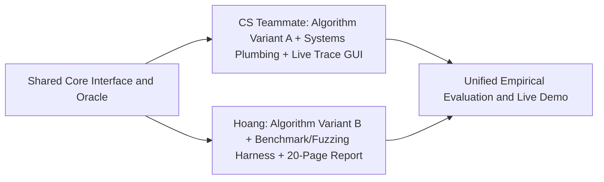

# DSA Course Project (`IT013IU`) — Brainstorm, Language Verdict & Execution Plan

> **Prepared for:** Tran Quoc Hoang (`BTBTWE24036`) & CS Project Teammate
> **Date:** 20 November 2026
> **Course:** `IT013IU` – Algorithms & Data Structures (Instructor: Dr. Hồ Long Vân)
> **Core Constraints:** 2-person team · ~4–6 week window (late Dec 2026 / early Jan 2027) · 24-credit Fall 2026 load · Hard **24 Nov** & **31 Dec 2026** Chondrosarcoma SBDD deadlines

---

## 1. Executive Diagnosis: Why You Feel Stuck & What the Rubric Actually Rewards

You and your teammate currently have **too many big software ideas** (`Mini-RocksDB`, `Gitlet`, `BioJava`) and **not enough clarity** on which one yields the highest grade per hour invested. The confusion disappears once you decode what `IT013IU` actually grades in [final-project_guidelines.md](file:///home/ht2905/projects/dsa-java-2026/final-project/final-project_guidelines.md) and [DSA_Project_Catalog_Many_to_Many_Updated.pdf](file:///home/ht2905/projects/dsa-java-2026/final-project/DSA_Project_Catalog_Many_to_Many_Updated.pdf).

### The 3 Traps to Avoid
1. **The "Feature-Rich Application" Trap (`BioJava`, standard `Gitlet`):**
   - The guidelines explicitly warn: *"Simply adding more interface features or application functions does not necessarily make a project more challenging from a DSA perspective."*
   - **UML class diagrams, database schemas, and ER diagrams are explicitly NOT required.** Building 25 CLI commands for a Git clone or wrapping 15 FASTA/PDB file parsers in a `BioJava` library burns weeks on software engineering boilerplate while scoring poorly on algorithmic depth.
2. **The "GitHub Clone" Trap (`Gitlet`):**
   - UC Berkeley's CS 61B `Gitlet` has thousands of public Java solutions online. Even if written cleanly from scratch, a standard Git clone spends ~70% of its effort on command parsing, object serialization, and basic commit-DAG traversal—leaving very little room for a 20-page empirical performance study.
3. **The "All-At-Once Scope Explosion" Trap (`Mini-RocksDB` as drafted):**
   - Your teammate's draft in [teammates-project-ideas.md](file:///home/ht2905/projects/dsa-java-2026/final-project/teammates-project-ideas.md) stacks **five** heavy subsystems into one project: (a) SkipList vs. LLRB Memtable comparison, (b) append-only WAL crash recovery, (c) custom 4-part binary SSTable format, (d) custom Bloom Filter, and (e) Size-Tiered vs. Leveled Compaction with K-way merge. That is a 12-week graduate systems project—not a safe 4–6 week sprint alongside a 24-credit load and a Dec 31 drug-discovery grant deadline.

### The Winning Formula Across All 40 Catalog Topics
Every topic in the 80-page catalog (`A01`–`A20` and `B01`–`B20`) uses one unified, research-style template:

1. **A Head-to-Head DSA Experiment ($\ge 2$ Competing Approaches):** Implement two genuinely different data structures or policies solving the *exact same problem* under a measurable resource constraint (RAM cap, disk I/O amplification, or frame latency budget).
2. **Oracle Differential Verification:** Prove correctness (or measure recall/relative error) against a simple, trusted reference baseline (e.g., `TreeMap`, exhaustive brute-force scan, or exact `HashSet`) across $10^4$–$10^6$ synthetic and adversarial operations.
3. **"Visible Evidence & Inspectable Trace" GUI:** The guidelines stress *"A simple GUI is sufficient."* You do **not** need polished consumer UI design; you need an interactive **algorithm laboratory** exposing live internal state (nodes visited, blocks reused, Bloom filter false positives, compaction events) alongside real-time telemetry ($p_{50}$ / $p_{95}$ latency, memory bytes, work counters).
4. **~20-Page Research-Style Technical Report + Individual Demo Q&A:** Written like an empirical computer science / bioinformatics methods paper (asymptotic bounds, worst-case adversarial triggers, controlled benchmarks, and clear plots). Every member must understand both core modules deeply enough to defend design decisions individually.

### Your Team's Asymmetric Superpower (The Modular 50/50 Split)
Because you are a Computational Biology / Bioinformatics researcher (Python, R, IELTS 8.5, Quarto/Typst scientific reporting, empirical benchmarking) paired with a CS undergrad focused on software systems, **do not split work horizontally** (e.g., "one person does all code, one writes the report"—which fails the individual Q&A requirement). Split **vertically by competing algorithm**:

- **CS Teammate Owns:** Shared data/serialization contract, **Core DSA Strategy A**, and the interactive **GUI / Trace Visualizer**.
- **Hoang Owns:** **Core DSA Strategy B** (self-contained, mathematically crisp), the **Automated Benchmark & Differential Fuzzing Suite** (generating all CSV/PNG figures), and the **20-Page English Technical Report**.
- **Result:** Both teammates write core DSA code from scratch, both understand the shared interface and oracle tests, and Hoang caps weekly DSA coding at ~4–5 focused hours/week until Dec 31 while producing an elite report.

---

## 2. Language & Architecture Verdict: Java vs. Rust vs. Hybrid

You mentioned wanting **Rust** (used heavily in modern bioinformatics tools and faster/cleaner than C++) or **Java** (the course's native language, which your teammate uses), and preferring a **Hybrid Architecture** (Core DSA engine + CLI benchmarks piped to a lightweight GUI, pending instructor approval).

### The Honest Technical Trade-Off: Java vs. Rust in DSA

| Dimension | Java 17+ | Rust (Safe Stable) | Hybrid (Core Engine + Web GUI) |
| :--- | :--- | :--- | :--- |
| **Course Compliance (`IT013IU`)** | **100% Native.** Zero risk. Matches lecture slides and labs. | **Needs Permission.** Previous slides (`lecture-00_overview.pdf` p. 13) show flexibility (bonus for C#/JS), but verify with Dr. Vân first. | **High** if core is Java; **Verify** if core is Rust. |
| **Pointer-Heavy DSA** (`SkipList`, `LLRB`, `Trie`, `LinkedList`) | **Fast & Painless.** References are trivial; write a SkipList or RB-tree in 1 afternoon. | **High Friction.** Self-referential nodes require `Rc<RefCell<T>>`, raw pointers, or `unsafe`, slowing down a 4-week sprint. | Depends on core language + DSA choice. |
| **Array / Buffer / Bit-Vector DSA** (`CSR Matrix`, `Bloom/HLL`, `BWT/FM-Index`, `HNSW`, `SSTable`) | **Good**, though object headers inflate RAM measurements unless using primitive arrays (`int[]`, `long[]`, `ByteBuffer`). | **Unmatched.** Zero-cost abstractions, exact byte-level RAM tracking (`size_of`), packed `Vec<u8>`/`BitVec`, blistering $10^6$-op benchmarks. | Ideal match if core is Rust on array-backed DSAs! |
| **GUI Effort** | Swing/JavaFX is verbose and clunky for live charts and heatmaps. | `egui`/`eframe` or `iced` has a steep learning curve for first-time Rust users. | **Minimal Effort, Maximum Polish.** Core exposes JSON over local HTTP (`localhost`) or `stdio`; browser UI renders clean HTML/Canvas/SVG traces + charts. |

### Final Language & Architecture Recommendations (Ranked)

1. **Rank #1 — Safest High-Velocity Choice: Pure Java 17+ Core + Embedded Local Web GUI (`com.sun.net.httpserver.HttpServer`)**
   - **Why it wins:** Uses **100% standard JDK** (`java.util`, `java.io`, `com.sun.net.httpserver`), zero external Maven/Gradle/JavaFX headaches, zero permission needed from the instructor, and gives your teammate full freedom to write pointer-heavy or disk-backed structures fast.
   - **How the GUI works:** A single-file `Main.java` starts a built-in JDK `HttpServer` on `http://localhost:8080` serving a static `index.html` + Vanilla JS/Canvas page. Clicking "Run" or "Step" triggers the Java DSA engine directly via REST endpoints (`/api/step`, `/api/benchmark`, `/api/trace`) and renders crisp visualizations without fighting Java Swing `GridBagLayout`.
   - **Report Plots:** The Java CLI benchmark runner dumps clean `.csv` / `.tsv` metrics, and you use **Python/R (`ggplot2` or `matplotlib`)** to generate publication-grade PDF/PNG figures for the 20-page report.

2. **Rank #2 — Best If You Choose an Array/Bitvector Topic & Get Approval: Rust Core Engine + Lightweight Web GUI (`localhost` HTTP or Python/JS Frontend)**
   - **Strict Condition #1:** Send a 2-sentence email to Dr. Hồ Long Vân (`hlvan@hcmiu.edu.vn`) confirming Rust is permitted for the project core if paired with a working GUI and full complexity/code walkthrough.
   - **Strict Condition #2 (The "No Borrow-Checker Trap" Rule):** Only use Rust if your chosen topic uses **index-based arrays, byte buffers, bitsets, or flat graphs** (e.g., Blueprints 2, 3, or 4 below: `CSR Matrix + HNSW`, `MinHash + HyperLogLog`, or `FM-Index / BWT`), where nodes live in a `Vec<Node>` addressed by `usize` indices—**never** pointer-linked trees (`SkipList` / `LLRB`).
   - **Why you gain CV value here:** Writing a production-style Rust crate with `criterion` benchmarks and zero-copy byte layouts directly builds the exact systems skill (`Rust`) listed in Section 10 of your Master Dossier.

3. **Rank #3 — Pure Java 17+ Core + Java Swing / JavaFX:**
   - Use only if the instructor explicitly forbids browser-rendered local GUIs and mandates a pure desktop JVM window. (You can still keep the core decoupled so CLI benchmarks export CSVs for R/`ggplot2` report figures.)

---

## 3. Critical Teardown of Your Teammate's Current Ideas

Before pitching new topics, here is an objective audit of the three ideas currently on your table (`Mini-RocksDB`, `Gitlet`, `BioJava`):

### A. "Mini-RocksDB" — LSM-Tree Storage Engine + Bloom Filter (`B01 × B12 × CS 61B`)
- **Current Fit Score:** **9.5 / 10 (after right-sizing scope)**
- **Why it's strong:** Unlike `Gitlet` or `BioJava`, this is **not** a generic app—it maps natively onto three official catalog specs:
  - **`B01`** (*Write-Optimized Storage Under Heavy Updates* — Memtable, SSTables, compaction comparison)
  - **`B12`** (*Negative Lookup Accelerator for Storage* — Bloom filter avoiding disk seeks on missing keys)
  - **`A05`** (*Persistent Mini Key–Value Database* — `PUT`, `GET`, `DELETE`, `RANGE`, `REOPEN` durability)
- **What makes the report write itself:** The **RUM Conjecture** (Read Amplification vs. Update/Write Amplification vs. Space Amplification). Every chart has a direct theoretical explanation from first principles.
- **The Necessary Scope Fix (Do NOT build 5 competing variants):**
  - Drop the `SkipList` vs. `LLRB` Memtable comparison—standardize on a single clean `SkipList` Memtable (or simple sorted `TreeMap`-backed buffer if time is tight, though a custom `SkipList` is only ~120 lines in Java).
  - Focus 100% of the algorithmic comparison on **Compaction Policy (`STCS` vs. `LCS`)** + **Negative Lookup Filter (`No Filter` vs. `Standard Bloom Filter` vs. `Counting/Blocked Bloom or Cuckoo Filter`)**.

### B. "Gitlet" (CS 61B Java Git Implementation)
- **Current Fit Score:** **5.0 / 10 as standard Gitlet → 8.5 / 10 ONLY if pivoted to `A06 × B09` (Content-Defined Chunking)**
- **Why standard Gitlet is risky:** Too many public solutions exist online, and standard Gitlet treats every file snapshot via whole-file SHA-1 hashing + basic commit-tree BFS/LCA. If you change 1 byte at the top of a 10 MB file, standard Gitlet stores the entire 10 MB again!
- **How to rescue it:** Strip away 80% of Git's CLI commands (`checkout`, `rm-branch`, `rebase`, `status`) and rebuild it specifically around **Catalog `A06` + `B09` (Edit-Resilient Incremental Backup & Deduplication)**—comparing Fixed-Size Chunking vs. Rabin-Karp / FastCDC Rolling-Hash Chunking + Myers $O(ND)$ Diff.

### C. "BioJava" (Java's Version of Bioconductor)
- **Current Fit Score:** **3.0 / 10 as a general toolkit → 9.5 / 10 when narrowed into a Single-Problem Algorithmic Engine**
- **Why "BioJava" fails as pitched:** A broad bioinformatics wrapper library violates the rubric's core rule (*"do not merely add application functions"*), lacks a single testable oracle experiment, and duplicates decades-old open-source libraries.
- **How to transform it:** Don't build "BioJava." Build **one surgical computational biology data-structure engine** that maps 1-to-1 onto an advanced catalog problem (`A13 × B03`, `A14 × B06`, or `A01 × A02 × B04`)—giving you something **genuinely unique in an IT class** while still looking 100% rigorous to a CS grader.

---

## 4. Top 5 Curated Project Blueprints (Across All 3 Directions)

Below are the 5 highest-ROI project designs organized across the three tracks (**Pure CS Systems**, **Bioinformatics DSA**, and **Hybrid Bridge**), each pre-engineered with a clean **50/50 Modular Split**.

---

### Blueprint 1 [Track 1 — Pure CS Systems]: "Mini-RocksDB" — Right-Sized LSM-Tree & Filter Lab
- **Catalog Mapping:** `B01` (Write-Optimized Storage) + `B12` (Negative Lookup Accelerator) + `A05` (Persistent KV Store)
- **Why It's Great:** Directly honors your teammate's strongest idea while fixing its scope bloat. Extremely respected by CS faculty because LSM-trees power RocksDB, LevelDB, Cassandra, and Pebble.
- **Core Data Structures & Competing Experiment:**
  - **Memtable & WAL:** Custom `SkipList` in RAM + append-only Write-Ahead Log for crash recovery (`REOPEN`).
  - **SSTable Binary Format:** Sorted key-value data blocks + tombstones + in-RAM sparse index (binary search) + footer.
  - **Comparison 1 (Compaction):** **Size-Tiered Compaction (`STCS`)** vs. **Leveled Compaction (`LCS`)** using a **$K$-Way Merge `Min-Heap` Iterator**.
  - **Comparison 2 (Negative Lookups):** Direct SSTable scan vs. **Standard Bitset Bloom Filter** vs. **Blocked / Counting Bloom Filter** (or **Cuckoo Filter**).
- **2-Person Modular Split:**
  - **CS Teammate:** `SkipList` Memtable, WAL crash/reopen logic, SSTable binary reader/writer + Sparse Index, **Size-Tiered Compaction (`STCS`)**, and the **Live Level Visualizer GUI** (showing L0–L3 SSTable boxes lighting up green on Bloom filter hits/skips and orange during compaction merges).
  - **Hoang:** **Leveled Compaction (`LCS`)** + $K$-Way Merge `Min-Heap`, **Bloom Filter vs. Counting/Cuckoo Filter (`B12`)**, `TreeMap` **100,000-op Differential Fuzzer** (including random crash injection), **RUM Conjecture Benchmark Harness** (Uniform vs. Zipfian 80/20 + optional 1M DNA $k$-mer trace), and the 20-page report.
- **Best Language:** **Java 17+ Core + Embedded Web GUI** (Java makes `SkipList` + `ByteBuffer` I/O + `TreeMap` oracle fast and clean; Rust works too if `SkipList` is replaced with a sorted `Vec`/BTree buffer).
- **Career Alignment:** Shows strong systems engineering depth for Bonn b-it's Informatics block and industry pipeline roles.

---

### Blueprint 2 [Track 3 — Hybrid CS × Spatial/Single-Cell Bridge]: "ScannEngine" — Sparse Matrix & Approximate Vector Search Workbench
- **Catalog Mapping:** `A13` (Sparse Matrix Computation Engine) + `B03` (Approximate Similarity Search for Data Collections)
- **Elevator Pitch:** Every single-cell RNA-seq / spatial transcriptomics pipeline (`Scanpy`, `Seurat`) and every modern RAG/vector database (`FAISS`, `Milvus`) runs on the exact same two DSA pillars: **Compressed Sparse Matrices** for $10^5 \times 10^4$ zero-heavy data (`A13`) and **Approximate Nearest Neighbor (ANN) Graph/Tree Search** for fast cell/item clustering (`B03`).
- **Why It's Unique:** Out of 50+ groups in an IT DSA class, almost nobody connects Sparse Matrix storage (`A13`) with High-Dimensional Vector Search (`B03`), yet both are official catalog topics! To your CS teammate, it is a pure database/vector-search engine; to your M.Sc. admissions committee (Bonn/FU Berlin/Cologne) and Dr. Lợi's lab, it is a from-scratch single-cell & spatial omics compute engine.
- **Core Data Structures & Competing Experiment:**
  - **Sparse Layer (`A13`):** Unsorted `(row, col, val)` COO triplets merged/deduplicated into **Compressed Sparse Row (`CSR`)** and **Compressed Sparse Column (`CSC`)** without ever allocating a dense $N \times M$ array. Supports `get(i,j)`, `rowSum`, fast `transpose()`, and `SpMV` ($y = Ax$), verified against a dense reference on small matrices and scaled to $10^5$ rows / $10^6$ nonzeros.
  - **Similarity Search Layer (`B03`):** On 5,000–10,000+ vectors in 8D–32D (and 128D stretch) space, compare:
    1. **Exact Brute-Force Oracle** ($O(ND)$ scan — 100% recall).
    2. **Spatial Partitioning Tree (`KD-Tree` or `Random-Projection Vantage-Point Tree`)** — demonstrate the **Curse of Dimensionality** as $D$ grows from $2 \rightarrow 8 \rightarrow 32$.
    3. **Graph-Based ANN (`HNSW` — Hierarchical Navigable Small World Graph)** using tunable `efSearch` beam width (implemented via priority queues / min-heaps).
- **2-Person Modular Split:**
  - **CS Teammate:** **Sparse Matrix Engine (`A13`)** (`COO` $\rightarrow$ `CSR`/`CSC` converter, bucket-sort counting transpose, sparse `SpMV`, on-disk binary I/O under RAM budget) + **GUI** (nonzero sparsity heatmap + 2D UMAP/PCA scatter view highlighting exact vs. approximate $k$-NN neighbors and recall@10 vs. latency curves).
  - **Hoang:** **Vector Search Engine (`B03`)** (Exact Brute-Force Oracle, **KD-Tree / VP-Tree**, and **HNSW multi-layer navigable graph** with priority-queue beam search), benchmark harness across uniform, clustered, and real normalized scRNA-seq PCA embeddings (3,000–10,000 cells $\times$ 32 PCs), plus the 20-page report.
- **Best Language:** **Rust Core (`Vec`-indexed `CSR` + flat-arena `HNSW`—zero borrow-checker pain!) + Web GUI**, OR **Java 17+ Core with primitive arrays (`double[]`, `int[]`) + Web GUI**.

---

### Blueprint 3 [Track 2/3 — Bioinformatics × Streaming Systems]: "PanSketch" — Near-Duplicate & Streaming Cardinality Engine
- **Catalog Mapping:** `A14` (Near-Duplicate Dataset Cleaning Tool) + `B06` (Live Unique-Visitor / Distinct-Element Analytics with Bounded Memory)
- **Elevator Pitch:** Compare exact $O(N^2)$ pairwise Jaccard similarity against **MinHash + Banded Locality-Sensitive Hashing (`LSH`)** (`A14`) and **HyperLogLog (`HLL`)** cardinality estimation within a strict $\le 64\text{ KB}$ RAM cap (`B06`).
- **Why It's Unique & Ultra-Achievable:**
  - This is literally the famous **Mash / sourmash** bioinformatics algorithm (Ondov et al., *Genome Biology* 2016) *and* the deduplication backbone used by web crawlers and LLM pretraining pipelines (e.g., RedPajama/RefinedWeb).
  - **Two Demo Modes, One Codebase:** Run it on **Product/Article CSVs** (exact `A14` catalog demo) *and* toggle a **"Genomic FASTA Mode"** comparing mutated viral/bacterial genomes via DNA $k$-mers ($k = 21$)!
  - **Very Low Code Complexity, Massive Mathematical Depth:** Neither MinHash, Banded LSH, nor HyperLogLog requires complex pointer trees or brittle disk compaction state machines. Everything runs on 64-bit hashes (`MurmurHash3` / `SplitMix64`), fixed integer arrays, and hash buckets—meaning **near-zero debugging risk before your Dec 31 SBDD deadline**.
- **Core Data Structures & Competing Experiment:**
  - **Shingle / $k$-mer Tokenizer:** Rolling-hash 2-bit DNA $k$-mer encoder + word $w$-shingle tokenizer.
  - **Exact Oracle:** Exact `HashSet` Jaccard $J(A, B) = |S_A \cap S_B| / |S_A \cup S_B|$ and exact unique count.
  - **Candidate Discovery (`A14`):** **MinHash Signature Matrix** ($m = 64, 128, 256$ permutations) + **Banded LSH Hash Buckets** ($b$ bands $\times r$ rows, showing the classic S-curve $1 - (1 - s^r)^b$) + **Union-Find (Disjoint Set)** to cluster near-duplicate groups.
  - **Bounded-RAM Distinct Counter (`B06`):** **HyperLogLog (HLL)** register array (configurable 4 KB, 16 KB, 64 KB budgets) estimating distinct $k$-mer/visitor count across $10^6$ streaming tokens with bias correction and empirical vs. theoretical standard error ($1.04 / \sqrt{m}$).
- **2-Person Modular Split:**
  - **CS Teammate:** Streaming tokenizer + **MinHash Signature Matrix + Banded LSH + Union-Find Clustering (`A14`)** + **GUI** (dataset/genome loader, similarity threshold $\tau$ slider, S-curve precision/recall plot, duplicate cluster network, side-by-side shingle/k-mer diff inspector, candidate-pairs-tested vs. $N(N-1)/2$ reduction meter).
  - **Hoang:** **Exact Jaccard / Distinct Oracle + HyperLogLog (`B06`)** + **Bottom-$k$ / FracMinHash containment variant**, synthetic mutation/insertion stress generator + bacterial/viral FASTA benchmark, and the 20-page report.
- **Best Language:** **Rust Core (blazing fast bit-manipulation & `u64` hashing, zero pointer lifetimes) + Web GUI**, OR **Java 17+ Core + Web GUI**.

---

### Blueprint 4 [Track 2 — Hardcore Bioinformatics String Algorithmics]: "FM-Search" — Compressed BWT FM-Index vs. Tolerant Inverted/Seed Index
- **Catalog Mapping:** `A01` (Full-Text Search & Live Autocomplete) + `A02` (Typo-Tolerant Content Search) + `B04` (Offline Autocomplete under a Strict 8 MB RAM Budget)
- **Elevator Pitch:** Build a unified substring & fuzzy search engine comparing a **Compressed Radix Trie / $k$-mer Seed Inverted Index** against a **Burrows-Wheeler Transform (`BWT`) + `FM-Index` (Suffix Array + Backward Search with Rank Checkpoints)** plus **Bounded Edit-Distance / BK-Tree (`A02`)** under a strict 8 MB memory ceiling.
- **Why It's Unique:** Implements the exact algorithmic core behind **BWA** and **Bowtie2** while cleanly satisfying three catalog topics (`A01`, `A02`, `B04`). Visually demonstrating FM-Index *Backward Search* narrowing a `[top, bottom]` suffix-array interval character-by-character in a GUI is unforgettable during a live defense.
- **Core Data Structures & Competing Experiment:**
  - **Index A (Memory-Hungry Baseline vs. Compressed Trie):** Naive Suffix Trie / Uncompressed Inverted Index vs. **Compressed Radix Trie (`B04`)** (for text autocomplete) or **$k$-mer Seed Hash Table** (for DNA/protein FASTA).
  - **Index B (Space-Optimal Core):** **Suffix Array (SA-IS or prefix-doubling $O(N \log N)$)** $\rightarrow$ **BWT** $\rightarrow$ **FM-Index (`Occ` checkpoint table + `C` count array)** achieving exact substring search in $O(|P|)$ independent of corpus size $N$, within $\le 8\text{ MB}$ RAM.
  - **Typo / Mutation Tolerance (`A02`):** **BK-Tree** (metric tree over Levenshtein distance) / **Pigeonhole Seed Filtering + Banded Myers/DP Edit Distance** verifying matches up to $d \le 2$ edits without scanning every word/window.
- **2-Person Modular Split:**
  - **CS Teammate:** **Radix Trie / Seed Inverted Index (`A01`/`B04`) + BK-Tree (`A02`)** + **GUI** (live search box, 8 MB RAM gauge, character-by-character backward-search interval animator, matched text/sequence snippet highlighter).
  - **Hoang:** **Suffix Array + BWT + FM-Index (`Occ` checkpoints & sampled SA)** + Banded Edit Distance verifier + exhaustive brute-force oracle + 100k document / multi-megabase FASTA benchmark + 20-page report.
- **Best Language:** **Rust** (byte slices `&[u8]`, `u32` suffix arrays, packed rank tables—textbook Rust use case) or **Java 17+** (`byte[]`, `int[]`).
- **Warning:** Suffix array + FM-Index boundary indexing (`top`/`bottom` off-by-one bugs) requires rigorous unit testing—higher debugging effort than Blueprint 3.

---

### Blueprint 5 [Track 1/3 — Upgraded Gitlet]: "ChronoDedup" — Edit-Resilient Content-Defined Chunking & Merkle-DAG Store
- **Catalog Mapping:** `A06` (Deduplicated Backup & Restore Utility) + `B09` (Edit-Resilient Incremental Backup)
- **Elevator Pitch:** Take what your teammate *likes* about `Gitlet` (snapshots, content-addressed Merkle DAGs, diffs, restore integrity) and swap out the weak Git CLI boilerplate for the **real DSA engine behind `BorgBackup` / `restic` / `rsync`**: solving the *boundary-shift problem* when bytes are inserted at the front of a file.
- **Core Data Structures & Competing Experiment:**
  - **Chunker A (Baseline):** **Fixed-Size Block Chunking** (4 KB blocks—fails catastrophically when 1 byte is inserted at offset 0).
  - **Chunker B & C (Core DSA):** **Rabin-Karp Polynomial Rolling Hash CDC** vs. **Gear-Hash FastCDC** (with normalized chunking + min/max cut points) storing chunks in a **Content-Addressed Hash Store + Merkle DAG**.
  - **Diff Engine:** **Myers $O(ND)$ Edit Script** vs. **Bottom-Up LCS DP** for small text/sequence diffs.
- **2-Person Modular Split:**
  - **CS Teammate:** Fixed-Size Chunker, **Content-Addressed Chunk Store + Merkle-DAG Snapshot/Restore (`A06`)** with SHA-256 verification + **GUI** (side-by-side block map coloring reused green vs. new orange chunks after prefix/middle/random edits, byte savings bar).
  - **Hoang:** **Rabin-Karp Rolling Hash CDC vs. FastCDC (`B09`)**, **Myers $O(ND)$ Diff**, edit-position sensitivity harness (10 MB text/code/FASTA files under prefix insert, middle delete, and block-reorder workloads), and 20-page report.

---

## 5. Quantitative Decision Matrix & Top Recommendation

Scoring each blueprint (1–10 scale) against your **real priorities** (protecting your Dec 31 Chondrosarcoma SBDD grant deadline, maximizing `IT013IU` grade, passing individual Q&A cleanly, and boosting both CVs):

| Criterion (Weight) | BP 1: Mini-RocksDB (`B01×B12`) | BP 2: ScannEngine (`A13×B03`) | BP 3: PanSketch (`A14×B06`) | BP 4: FM-Search (`A01×A02×B04`) | BP 5: ChronoDedup (`A06×B09`) |
| :--- | :---: | :---: | :---: | :---: | :---: |
| **Catalog Alignment & Grading Safety (20%)** | **10** | **10** | **10** | **9.5** | **9.5** |
| **Uniqueness vs. Classmates (15%)** | **8.0** | **10** | **10** | **9.5** | **8.5** |
| **Clean 50/50 Modular Split (20%)** | **9.0** | **10** | **10** | **8.5** | **9.0** |
| **Low Bug Risk Before Dec 31 SBDD (25%)** | **7.5** | **8.5** | **9.5** | **7.0** | **9.0** |
| **Dual CV Value: CS Systems + CompBio (20%)** | **8.5** | **10** | **9.5** | **9.5** | **8.0** |
| **Weighted Total Score (/ 10.0)** | **8.53** | **9.60** | **9.78** | **8.70** | **8.83** |

### The Verdict: How You and Your Teammate Should Choose Tonight

1. **Best Overall Pick for Speed, Uniqueness & Zero Burnout — Blueprint 3 (`PanSketch`: `A14 × B06` MinHash + LSH + HyperLogLog)**
   - **Why:** Highest feasibility before Dec 31 (**9.5/10**), impossible for classmates to accidentally duplicate, implements a flagship bioinformatics algorithm (*Mash*) AND a classic distributed-systems/data-engineering pipeline (`A14` + `B06`), has **zero pointer-heavy traps** (safe in either **Rust** or **Java**), and lets your teammate shine on LSH/Union-Find/GUI while you own HyperLogLog, exact Jaccard verification, genomic benchmarking, and the 20-page English report.
2. **Best Pick If You Want Your Spatial/Single-Cell Omics Thesis Advantage — Blueprint 2 (`ScannEngine`: `A13 × B03` Sparse Matrix + HNSW/KD-Tree Vector Search)**
   - **Why:** Ties directly into your Year 4 spatial transcriptomics thesis (`USSK5K-30-3`) and high-dimensional omics career vision, while presenting to your CS teammate and grader as a pure **Sparse Matrix + Vector Database (`FAISS`/`Milvus`) engine**. Notice how cleanly the two catalog topics (`A13` and `B03`) divide between the two of you!
3. **Best Pick If Your Teammate Strongly Prefers Databases/Storage — Blueprint 1 (`Mini-RocksDB`: `B01 × B12` Right-Sized)**
   - **Why:** Your teammate already feels energized by this (`teammates-project-ideas.md`). **Condition to say yes:** Only agree to `Mini-RocksDB` if he accepts cutting the `SkipList` vs. `LLRB` duel so you strictly focus on `STCS` vs. `LCS` compaction + `Bloom` vs. `Cuckoo/Blocked Bloom` filters—and keep the core in **Java 17+** (so `SkipList` and file I/O don't stall on Rust lifetimes).

---

## 6. 5-Week Execution Roadmap (Protecting Nov 24 & Dec 31 SBDD Deadlines)

Designed specifically so your DSA workload never jeopardizes your **24 Nov (Meeting 03)** or **31 Dec (Track 1 Taiwan Grant)** Chondrosarcoma SBDD deliverables:

| Week & Window | Hoang's SBDD Priority | CS Teammate's DSA Focus | Hoang's DSA Focus (~4–5 hrs/wk) | Milestone Gate |
| :--- | :--- | :--- | :--- | :--- |
| **Week 1 (Nov 20–26)** | **CRITICAL:** Meeting 03 checkpoint (`hSPS2` gate + pilot SBVS) | Lock topic + confirm language/GUI rules with Dr. Vân; scaffold shared repo & Module A skeleton | Lock shared API interface (`EngineInterface`), write **Exact Reference Oracle** + tiny deterministic unit tests (example input $\rightarrow$ expected output from catalog) | Repo initialized; Oracle tests green on toy examples |
| **Week 2 (Nov 27–Dec 3)** | Track 1 FDA library docking execution | Complete **Core Module A** + start local Web/Desktop GUI shell | Implement **Core Module B** (e.g., HLL + Bottom-$k$, OR HNSW, OR LCS + Bloom/Cuckoo) | Both engines compile and pass small-scale Oracle equality checks |
| **Week 3 (Dec 4–10)** | Track 1 Vina/GNINA rescoring | Connect GUI to live engine + build **"Inspectable Trace"** visualization | Run **100,000-op Randomized Differential Fuzzer** + build automated CSV benchmark script (Python/R plots) | Zero mismatches vs. Oracle; first real $p_{95}$ / RAM / recall CSVs exported |
| **Week 4 (Dec 11–20)** | Track 1 `Sec60`/PLIP auditing & hit curation | Polish GUI interactive scenarios (3-step reproducible live demo from catalog) & error handling | Generate all publication-grade figures (Uniform vs. Skewed vs. Bio workload) + draft Sections 1–4 of **20-page English report** | Complete working app + 50% report draft done before finals/Dec 31 crunch |
| **Week 5 (Dec 21–Early Jan)** | **Dec 31 Grant Handoff** (10–30 prioritized hits) | Integration testing, edge-case hardening, prepare demo script & Q&A slides | Complete Sections 5–8 of **20-page report** (experimental interpretation, limitations, references) + mutual **Q&A Mock Defense** | Submission-ready code, GUI, 20-page PDF report, and both members ready for individual Q&A |

---

## 7. Tóm Tắt Chiến Lược Dành Cho Đồng Đội (Vietnamese Executive Summary & Pitch)

> **Gửi bạn cùng nhóm:** Mình đã đọc kỹ toàn bộ file gợi ý dự án (`Mini-RocksDB`, `Gitlet`, `BioJava`), đối chiếu với **hướng dẫn chấm điểm (`final-project_guidelines.md`)** và **40 đề tài chuẩn trong `DSA_Project_Catalog_Many_to_Many_Updated.pdf`**. Dưới đây là tổng kết nhanh để tụi mình chốt đề tài, chia việc 50/50 chuẩn chỉnh và chọn ngôn ngữ code sao cho vừa **độc lạ**, vừa **ăn trọn điểm DSA**, lại **không bị quá tải** trong 4–6 tuần tới.

### 1. Điểm cốt lõi của môn DSA năm nay (Đừng rơi vào bẫy "làm app lớn")
- File guideline và 40 đề tài trong Catalog cho thấy thầy **không chấm giao diện đẹp hay nhiều tính năng kiểu phần mềm thương mại**, và **không bắt buộc vẽ UML / ER diagram**.
- Để đạt điểm tuyệt đối, mọi đề tài đều phải chứng minh 4 trụ cột:
  1. **So sánh trực diện $\ge 2$ cấu trúc dữ liệu / chiến lược thuật toán** giải quyết cùng một bài toán dưới **giới hạn tài nguyên thực tế** (RAM cap, Disk I/O, hoặc độ trễ từng khung hình).
  2. **Kiểm chứng bằng Oracle (Differential Testing):** Chứng minh thuật toán tối ưu cho kết quả khớp **100%** (hoặc đo chính xác tỷ lệ recall/sai số) so với một thuật toán chuẩn đơn giản trên $10^4$–$10^6$ thao tác.
  3. **GUI dạng "Algorithm Lab" (Visible Evidence):** Không cần màu mè, nhưng phải nhìn thấy được thuật toán đang chạy bên trong (ví dụ: block nào được tái sử dụng, Bloom filter chặn được bao nhiêu lượt đọc ổ cứng, hoặc điểm nào được duyệt trong đồ thị) cùng các chỉ số đo thực tế ($p_{50}/p_{95}$ latency, RAM bytes, số phép so sánh).
  4. **Báo cáo kỹ thuật tiếng Anh (~20 trang) + Vấn đáp cá nhân:** Cả hai thành viên đều phải tự nắm chắc phần code lõi và độ phức tạp Big-O để trả lời vấn đáp riêng.

### 2. Đánh giá thẳng 3 ý tưởng hiện tại của tụi mình
- **`Gitlet` (Clone Git bằng Java):** **Rủi ro cao.** Quá nhiều repo CS 61B trên mạng (dễ trùng lặp), lại tốn 70% thời gian vào parse lệnh CLI và lưu file thay vì đo đạc thuật toán. *(Chỉ nên làm nếu chuyển hẳn sang hướng `A06 × B09`: so sánh Fixed-Size Chunking vs. Content-Defined Rolling Hash FastCDC + Myers Diff).*
- **`BioJava` (Thư viện sinh tin học tổng quát):** **Không đạt tiêu chí DSA.** Xây dựng bộ parser tổng hợp giống Bioconductor sẽ bị vướng đúng lỗi mà guideline cảnh báo (*"thêm nhiều tính năng ứng dụng không làm tăng chiều sâu DSA"*). Nếu làm sinh học, phải thu hẹp thành **một động cơ thuật toán duy nhất** giải bài toán chuẩn của Catalog.
- **`Mini-RocksDB` (LSM-Tree + Bloom Filter — `B01 × B12 × A05`):** **Ý tưởng cực kỳ xuất sắc (9.5/10)** vì đánh trúng 3 đề tài chuẩn trong Catalog và có lý thuyết **RUM Conjecture (Write / Read / Space Amplification)** để viết báo cáo 20 trang cực kỳ thuyết phục.
  - **Điều chỉnh bắt buộc để không bị "ngợp":** Bản nháp hiện tại đang ôm cùng lúc quá nhiều thứ (`SkipList vs. LLRB` + `WAL` + `SSTable nhị phân` + `Bloom Filter` + `STCS vs. LCS`). Để kịp deadline 4–6 tuần, tụi mình nên **chốt cứng Memtable dùng `SkipList`** và tập trung 100% hỏa lực vào cuộc đối đầu **STCS vs. LCS Compaction (`B01`)** + **Bộ lọc tra cứu âm (`B12`: Không filter vs. Bloom vs. Counting/Cuckoo Filter)**.

### 3. Hai phương án "Độc & Chuẩn DSA" khác (Cầu nối CS Systems × Bioinformatics)
Nếu tụi mình muốn một đề tài **ít đụng hàng nhất lớp** (vừa là hệ thống CS thuần túy rất xịn trong mắt giảng viên IT, vừa ứng dụng trực tiếp vào dữ liệu gen/tế bào đơn để làm đẹp CV cho cả hai đứa), hãy cân nhắc 2 lựa chọn sau bên cạnh `Mini-RocksDB`:

1. **Lựa chọn X (`A13 × B03`) — `ScannEngine`: Hệ thống Ma trận Thưa (`CSR/CSC`) & Tìm kiếm Vector Tương đồng Gần đúng (`HNSW` vs. `KD-Tree`)**
   - *Góc nhìn CS Systems:* Chính là lõi toán học của **Vector Database (FAISS/Milvus) + SciPy Sparse Matrix** — chuyển `COO` sang `CSR`/`CSC` cho $10^6$ phần tử khác 0, sau đó so sánh Brute-force Oracle vs. `KD-Tree` vs. đồ thị `HNSW` trên không gian 8–32 chiều (với biểu đồ Recall@10 vs. Latency).
   - *Góc nhìn Sinh Tin học:* Chính là thuật toán nền của mọi pipeline phân tích **Single-Cell & Spatial Transcriptomics** (`Scanpy`/`Seurat`).
2. **Lựa chọn Y (`A14 × B06`) — `PanSketch`: Hệ thống Phát hiện Trùng lặp Gần đúng (`MinHash + LSH`) & Đếm Phần tử Phân biệt Giới hạn RAM (`HyperLogLog`)**
   - *Tại sao cực kỳ đáng chọn:* Độ rủi ro bug thấp nhất trong tất cả các phương án (không có cây con trỏ phức tạp hay crash recovery file nhị phân), hoàn thành gọn trong 4–5 tuần mà vẫn mang tầm vóc công cụ chuẩn nghiên cứu (đây chính là thuật toán của **Mash / sourmash** trong sinh tin học và hệ thống lọc dữ liệu web của Cloudflare/Google). Chạy demo được trên cả **CSV văn bản** (đúng đề `A14`) lẫn **chuỗi DNA FASTA** ($k$-mers).

### 4. Chốt Ngôn Ngữ & Kiến Trúc (Java vs. Rust + Hybrid GUI)
- **Kiến trúc đề xuất:** **Tách rời Core DSA Engine (CLI / Local Server) và GUI.** Giao diện có thể làm bằng **Web UI siêu nhẹ** (`HTML/Canvas/Chart.js` giao tiếp qua `localhost` HTTP hoặc file JSON) hoặc Swing/JavaFX — miễn là thầy Vân xác nhận hợp lệ. Cách này giúp render biểu đồ realtime và visual trace đẹp gấp 10 lần Swing mà tốn cực ít công code giao diện.
- **Java 17+ vs. Rust:**
  - Nếu chọn **`Mini-RocksDB` (`B01 × B12`)** (có `SkipList` nhiều con trỏ và file I/O): **Nên dùng Pure Java 17+** (tận dụng luôn `jdk.httpserver` có sẵn trong JDK, không cần thư viện ngoài). Rust rất hay nhưng viết cấu trúc cây/danh sách liên kết tự trỏ bằng Rust sẽ mất nhiều ngày vật lộn với *borrow checker*.
  - Nếu chọn **`ScannEngine` (`A13 × B03`)** hoặc **`PanSketch` (`A14 × B06`)** (toàn bộ dùng mảng chỉ số `Vec`, bitset và số nguyên `u64` — không dính con trỏ tự trỏ): **Có thể dùng Rust** (nếu thầy Vân đồng ý) hoặc **Java 17+**. Dùng Rust ở 2 bài này cực kỳ mượt, đo RAM chính xác từng byte và chạy benchmark $10^6$ bản ghi nhanh vượt trội.

### 5. Đề xuất Chia Việc 50/50 Công Bằng (Cùng hiểu sâu để qua Vấn Đáp Riêng)
Thay vì chia kiểu "một người code hết, một người viết báo cáo" (rất dễ rớt khi thầy hỏi vấn đáp từng cá nhân), tụi mình chia **theo 2 nhánh thuật toán đối đầu**:
- **Bạn (CS Teammate):**
  - Thiết kế Interface chuẩn + Data Pipeline.
  - Tự code **Nhánh Thuật Toán A** (ví dụ: `STCS` + `SSTable/SkipList` cho Mini-RocksDB; *hoặc* `CSR/CSC` Sparse Matrix cho ScannEngine; *hoặc* `MinHash + LSH + Union-Find` cho PanSketch).
  - Phụ trách chính phần **GUI hiển thị Visual Trace**.
- **Mình (Hoàng):**
  - Tự code **Nhánh Thuật Toán B** (ví dụ: `LCS Compaction + Bloom/Cuckoo Filter` cho Mini-RocksDB; *hoặc* `HNSW + KD-Tree` cho ScannEngine; *hoặc* `HyperLogLog + Exact Oracle` cho PanSketch).
  - Xây dựng toàn bộ **Hệ thống Differential Fuzzing (so khớp Oracle 100%) + Benchmark Harness** (xuất dữ liệu/biểu đồ Uniform, Skewed Zipfian, và tập dữ liệu Sinh Tin học).
  - Chịu trách nhiệm chính biên soạn **Báo cáo Kỹ thuật ~20 trang bằng tiếng Anh chuẩn học thuật** (và cùng review lại toàn bộ code trước khi demo để cả hai trả lời trôi chảy mọi câu hỏi vấn đáp).

**Bước tiếp theo ngay hôm nay:** Tụi mình thống nhất chọn **1 trong 3 phương án** (`Mini-RocksDB rút gọn` vs. `ScannEngine A13×B03` vs. `PanSketch A14×B06`), chốt **Java vs. Rust** (nhắn hỏi nhanh thầy Hồ Long Vân nếu định dùng Rust + Web GUI), rồi chốt API chung trong tuần này!
