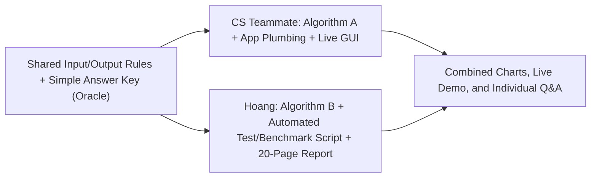

# DSA Course Project (`IT013IU`) — Plain-English Guide & Brainstorm Plan (`v02`)

> **Prepared for:** Tran Quoc Hoang (`BTBTWE24036`) & CS Project Teammate
> **Date:** 20 November 2026
> **Course:** `IT013IU` – Algorithms & Data Structures (Instructor: Dr. Hồ Long Vân)
> **Goal of `v02`:** Translate every intimidating computer-science term into plain English, R/Python analogies, and the exact building blocks from your `IT013IU` lectures—so you understand 100% of every option before choosing.

---

## 1. The Big Picture: What the Professor Actually Wants (In Plain English)

When you look at [teammates-project-ideas.md](file:///home/ht2905/projects/dsa-java-2026/final-project/teammates-project-ideas.md) and the 80-page catalog ([DSA_Project_Catalog_Many_to_Many_Updated.pdf](file:///home/ht2905/projects/dsa-java-2026/final-project/DSA_Project_Catalog_Many_to_Many_Updated.pdf)), it is easy to feel overwhelmed by buzzwords.

The secret is that **your professor is NOT asking you to build a giant, polished software product** like Git or a commercial database. Here is what [final-project_guidelines.md](file:///home/ht2905/projects/dsa-java-2026/final-project/final-project_guidelines.md) actually says:

- **You do NOT need a fancy UI:** *"A simple GUI is sufficient. The quality of your algorithmic solutions, technical investigation, and understanding is more important than the visual appearance."*
- **You do NOT need software-engineering diagrams:** UML class diagrams, database schemas, and ER diagrams are **explicitly NOT required**.
- **Adding more buttons/features does NOT raise your grade:** *"Simply adding more interface features or application functions does not necessarily make a project more challenging from a DSA perspective."*

Instead, **every single one of the 40 topics in the course catalog follows the exact same 4-step science-experiment recipe**:

1. **Build Two Competing Solutions ("Method A vs. Method B"):** Solve the same problem in two ways—usually a simple/classic way versus a clever/memory-saving/fast way—and compare them under a constraint (like a strict RAM limit or slow disk reads).
   - *Bioinformatics analogy:* Just like comparing two alignment or clustering methods on the same dataset to see which is faster, uses less RAM, and where each one breaks down.
2. **Check Your Work Against an "Oracle" (Answer Key):**
   - *"Oracle"* sounds fancy, but it literally just means **a slow, simple, 100%-correct reference program used as an answer key** (for example, a plain Python `dict` / Java `TreeMap`, or a naive `for`-loop checking every single item). You run 10,000–100,000 random test operations on both your clever fast structure and the simple "answer key" to prove your clever code never gives wrong answers (or to measure its exact error rate if it is an approximation).
3. **Show What Happens Inside ("Inspectable Trace GUI"):**
   - Think of the GUI not as an app for customers, but as an **interactive lab dashboard** (like a Shiny app or Jupyter widget). When you click **Run**, the screen shows two things:
     - **A visual peek inside the algorithm:** e.g., which items were checked vs. skipped, or which blocks were merged.
     - **Live numbers:** how many milliseconds it took, how many bytes of RAM it used, and how many operations were avoided compared to brute force.
4. **Write a ~20-Page Technical Report + Answer Individual Questions:**
   - The 20-page report is structured just like a lab paper (Introduction, Background, Algorithm Design, Big-O Time/Space Analysis, Implementation, Experiments/Plots, Discussion).
   - During the live demo, **the professor will question each of you individually** to make sure both teammates actually understand how the data structures work.

### How to Split the Work Fairly (Without Burning Out Before Dec 31)
You have 24 credits this semester plus critical **24 Nov** and **31 Dec 2026** deadlines on your Chondrosarcoma drug discovery project. You cannot spend 150 hours fighting UI bugs, and you also cannot skip writing core DSA code (or you will fail the individual Q&A).

The cleanest fix is a **Vertical 50/50 Split**—instead of one person doing all code and one person doing the report, **each of you codes one of the two competing algorithms**:

- **Why this works for you:** You only have to write **one clean, self-contained algorithm module** plus the **automated test/benchmark script** (~4–5 focused hours/week until Dec 31), and you get to lead the **20-page English report** and **plots** (your strongest skills).
- **Why both of you pass Q&A:** Because you both built a real algorithm plugging into the same shared rules, both of you know every piece of the core math and Big-O complexity.

---

## 2. Java vs. Rust (And the Hybrid GUI Trick) — Explained Simply

You already know Python and R, and you are intrigued by **Rust** because it is fast, modern, and huge in bioinformatics (`sourmash`, `polars`, etc.), while your teammate works in **Java** (the course's official language). Here is the plain-English reality without compiler jargon.

### Why People Say Rust Is Hard for Intro DSA (The "Box Ownership" Rule)
In **Python or Java**, if you build a **Linked List** or **Binary Tree**, multiple variables can freely point to the same node in memory. Java automatically cleans up unused nodes in the background (Garbage Collection).

In **Rust**, there is no background garbage collector. Instead, Rust's compiler enforces a strict safety rule: **only ONE variable is allowed to "own" and modify a piece of memory at a time**.
- **When Rust becomes a nightmare:** In data structures built out of **linked nodes pointing to other nodes** (like Doubly Linked Lists, Red-Black Trees, SkipLists, or traditional pointer Graphs), two pointers often need to touch the same node at once (e.g., `prev.next` and `curr`). Rust's compiler blocks this by default, forcing beginners to wrap everything in ugly boilerplate (`Rc<RefCell<Node>>`) and fight compiler errors for days.
- **When Rust is actually AWESOME and easy:** In data structures built out of **flat lists/arrays of numbers** (`Vec<u8>`, `Vec<u32>`, `Vec<f64>`), where items refer to each other by **array index numbers** (like `parent = 3` instead of a memory pointer). There are zero pointer headaches, and Rust gives you exact byte-level memory sizes and C-level speed!

### What Is a "Hybrid Web GUI"?
In Java, building buttons, plots, and colored grids with old-school desktop tools (`Swing` or `JavaFX`) takes hundreds of lines of painful layout code.

A **Hybrid Web GUI** skips all that pain:
- Your **Java** (or **Rust**) program does 100% of the real DSA work on the backend and starts a tiny built-in local web server (for example, `http://localhost:8080`). Java already includes this out of the box (`com.sun.net.httpserver.HttpServer`)—zero external installs needed.
- Your **GUI** is just a single clean HTML/JavaScript page opened in your browser. When you click a button in the browser, it asks your Java/Rust engine for the answer, gets back plain data (`JSON`), and draws smooth charts and colored grids instantly.
- **Important check:** Send a quick 2-sentence email to Dr. Hồ Long Vân (`hlvan@hcmiu.edu.vn`) before starting: *"May our group implement the DSA core in [Rust / Java] and connect it to a local browser-based HTML/JS GUI served by our program, while writing all data structures from scratch without libraries?"* (Past slides in [lecture-00_overview.pdf](file:///home/ht2905/projects/dsa-java-2026/lecture-slides/lecture-00_overview.pdf) even awarded bonus points for C#/JavaScript, so asking politely first guarantees 100% grading safety.)

### The Simple Rule for Picking Your Language
- **Pick Java 17+ (+ local HTML GUI or Swing)** if your chosen project uses **linked nodes/trees** (like `Mini-RocksDB`'s `SkipList`) OR if Dr. Vân prefers pure Java. Zero learning curve for your teammate, and you already have Java lab setup working in this repo.
- **Pick Rust (+ local HTML GUI)** *only* if Dr. Vân approves it **AND** you choose a project made strictly out of **flat arrays, numbers, and bit checklists** (Options 2, 3, or 4 below).

---

## 3. Plain-English Translation of Your Teammate's 3 Current Ideas

Right now, your teammate's notes ([teammates-project-ideas.md](file:///home/ht2905/projects/dsa-java-2026/final-project/teammates-project-ideas.md)) plus chat mention three options: **`Mini-RocksDB`**, **`Gitlet`**, and **`BioJava`**. Let's decode what each one actually means.

### Idea 1: "Mini-RocksDB" (An LSM-Tree Key-Value Database + Bloom Filter)
Your teammate's AI-written Vietnamese note is packed with systems jargon, **but underneath the fancy names, every piece is just basic `IT013IU` DSA!** Here is the dictionary translating every term in his file:

- **What is a Key-Value Store?** Just a Python `dict` or Java `HashMap`/`TreeMap` (`key -> value`), except it saves data permanently to your hard drive instead of losing everything when the program closes.
- **Why not just keep one giant sorted list on the hard drive?** Because inserting one new item into the middle of a giant sorted file on disk means rewriting millions of bytes (super slow!).
- **How does an LSM-Tree (`Mini-RocksDB`) fix this? (The "Notepad + Filing Cabinet" Analogy):**
  1. **Memtable (The Sticky Note in RAM):** New writes (`PUT`, `DELETE`) are scribbled quickly onto a small sorted list in fast RAM memory.
     - *His note mentions `SkipList` vs. `LLRB Tree`:* A **SkipList** is just a sorted **Linked List** with extra "express lane" jump pointers above it so searching takes `O(log N)` instead of `O(N)`. An **LLRB Tree** is a self-balancing **Binary Search Tree**.
  2. **Write-Ahead Log / WAL (The Backup Diary):** Before putting a write on the RAM sticky note, you also append one line to a plain log file on the hard drive. If someone unplugs the computer (simulated crash), you read that log file on restart to rebuild your sticky note.
  3. **Tombstone (A "Deleted" Sticker):** You don't erase old files on disk when someone runs `DELETE(key)`. You just write a special marker saying `"key = DELETED"` so older files don't resurrect the deleted item later.
  4. **SSTable — Sorted String Table (Filing Cabinet Booklets):** Once the RAM sticky note hits a size limit (say, 1,000 keys), you freeze it and dump it to the hard drive as an **alphabetically sorted file** (`SSTable`). Because it is already sorted, searching inside it is fast using **Binary Search** on a small table of contents (**Sparse Index**).
  5. **Compaction (Merge Sort on Disk!):** After 20 writes batches, you end up with 20 separate sorted files on disk, which slows down searching (`GET`). So periodically, the engine picks several sorted files and combines them into one clean sorted file, throwing away overwritten/deleted keys. **How? Literally the exact `merge()` step from Merge Sort using a Min-Heap (Priority Queue)!**
  6. **Size-Tiered (`STCS`) vs. Leveled (`LCS`) Compaction:** Two simple rules for *when* to merge those disk files:
     - **STCS (Lazy Merging):** Wait until you have 4 files of similar size, then merge them. *Fast to write, slower to read.*
     - **LCS (Strict Alphabetized Shelves):** Organize disk into Levels (`L0`, `L1`, `L2`...), each 10x bigger than the last, and force files in `L1+` to have **non-overlapping key ranges** (e.g., `A–F`, `G–M`, `N–Z`). *Slower to write (more re-copying), super fast to read.*
  7. **Bloom Filter (The "Instant No" Checklist):** Suppose a user searches for `"unicorn"` and `"unicorn"` does not exist anywhere. Without help, you might have to open 10 disk files to be sure. A **Bloom Filter** is a tiny array of `0`s and `1`s in RAM (using a few hash functions, just like Lecture 9 Hash Tables). When you hash `"unicorn"`, if any bit in the checklist is `0`, you know with **100% certainty** `"unicorn"` is NOT in that file—saving you a slow disk read! (If all bits are `1`, it might be there, or it might be a rare "false positive," so you check the file to be sure.)
  8. **RUM Conjecture (Write / Read / Space Amplification):** Simply measuring the three-way tug-of-war:
     - *Write Amplification:* If the user saved 1 MB of data, how many total MBs did the database actually write/rewrite to disk during merges?
     - *Read Amplification:* How many files did `GET` have to check for one lookup?
     - *Space Amplification:* How much wasted disk space is taken up by old overwritten/deleted entries before compaction cleans them up?

- **Verdict on `Mini-RocksDB`:** **9.5 / 10 — It is genuinely awesome and maps directly onto official catalog topics `B01`, `B12`, and `A05`!**
  - **One critical fix:** Right now your teammate's draft tries to compare *too many things at once* (`SkipList` vs. `LLRB` *and* `STCS` vs. `LCS` *and* `WAL` *and* binary file bytes *and* `Bloom Filter`). Simplify by fixing the Memtable to just **one** structure (e.g., a custom `SkipList`), and make the star showdown **STCS vs. LCS Compaction + Bloom Filter On vs. Off**.

### Idea 2: "Gitlet" (Implementing Git in Java)
- **What it is:** A famous UC Berkeley assignment where students rebuild basic `git init`, `add`, `commit`, `checkout`, `branch`, and `merge`.
- **Verdict:** **5.0 / 10 as standard Gitlet (Trap!).** Thousands of complete `Gitlet` repos are already on GitHub, and 70% of the coding work is boring command-line text parsing and saving Java files—leaving very little meat for a 20-page DSA complexity & benchmark report.
- **How to rescue it (if your teammate really loves Git):** Drop all the Git CLI commands and focus *only* on the **Deduplicated Backup & Diff Engine** (Catalog **`A06` + `B09`**—explained in Option 5 below).

### Idea 3: "BioJava" (Java's Version of Bioconductor)
- **What it is:** A toolkit of biology utilities (reading FASTA/FASTQ/PDB files, translating DNA to protein, GC-content calculation).
- **Verdict:** **3.0 / 10 as a general library (Trap!).** Writing file parsers and utility functions violates the course guideline (*"more features do not add DSA depth"*), and you already have Python/R for normal bioinformatics scripting.
- **How to rescue it:** Instead of building a "Swiss Army knife" library, pick **one single hard bioinformatics data-structure problem** that is ALSO an official catalog CS topic (see Options 2, 3, and 4 below!).

---

## 4. The Top 5 Best Project Blueprints (Explained Using Course Basics)

Here are the 5 strongest, most unique, realistically achievable options—spanning **Pure CS Systems**, **Pure Bioinformatics**, and **Hybrid Bridges**—translated into simple `IT013IU` building blocks.

---

### Option 1 [Pure CS Systems]: `Mini-RocksDB` — The Smart Disk Database (`B01 × B12 × A05`)
- **In One Sentence:** Compare two ways of organizing and merging sorted files on disk (`STCS` vs. `LCS`), plus a `0`/`1` hash checklist (`Bloom Filter`) that skips useless disk reads.
- **Built Strictly From These `IT013IU` Basics:**
  - **Linked List (`SkipList`)** for fast sorted writes in RAM.
  - **Binary Search** inside sorted files (`SSTables`).
  - **Merge Sort (`merge` + `Min-Heap`)** to combine multiple sorted files into one clean sorted file.
  - **Hash Functions + Bit Array (`Bloom Filter`)** to rule out missing keys without opening disk files.
- **The Head-to-Head Experiment:** Run 100,000 simulated `PUT` / `GET` / `DELETE` commands (including simulated power crashes!) under both **STCS** and **LCS** compaction, with Bloom Filters turned **ON vs. OFF**, and check every single result against Java's built-in `TreeMap` (our answer key).
- **What the GUI Shows:** A visual rack of memory + disk levels (`Memtable`, `L0`, `L1`, `L2`). Boxes flash **green** when a Bloom Filter instantly blocks a wasted disk read, and **orange** when files merge together—plus live gauges for Read Speed, Write Cost, and Disk Space.
- **Fair 50/50 Split:**
  - **Teammate:** `SkipList` RAM buffer + crash log (`WAL`) + file writer/reader + **STCS** merging + Live Visualizer GUI.
  - **Hoang:** **LCS** level-by-level merging (using a `Min-Heap`) + **Bloom Filter** + automated 100k random fuzzer against `TreeMap` + 20-page report.
- **Best Language:** **Java 17+** (paired with local HTML GUI or Swing). *Why Java?* `SkipList` uses linked-list pointers, which are easy in Java and annoying in Rust.

---

### Option 2 [Hybrid CS × Single-Cell/Spatial Omics]: `ScannEngine` — Sparse Matrix & Fast Neighbor Search (`A13 × B03`)
- **In One Sentence:** Store giant mostly-zero data tables (`100,000 × 10,000`) without wasting RAM on zeros (`A13`), then compare fast ways to find the 10 most similar rows/cells without comparing every single pair (`B03`).
- **Why You Already Understand This Problem (Bioinformatics Connection!):**
  - Think about your **scRNA-seq / Spatial Transcriptomics** count matrices (genes $\times$ cells) that you work on with Dr. Lợi! Around **90–95% of entries are `0`**. If you store `100,000` cells $\times$ `20,000` genes as a regular 2D spreadsheet (`double[][]`), it explodes RAM (`16 GB`!). That is why `Scanpy` (Python) and `Seurat`/`Matrix` (R `dgCMatrix`) store only the **non-zero** values!
  - Next, once each cell is reduced to 8–32 numbers (PCA coordinates), `Scanpy`/`Seurat` has to find each cell's **nearest neighbors** (`k`-NN graph) to run UMAP and clustering. Comparing every cell against every other cell takes forever (`O(N^2)`). Vector databases like `FAISS` and `Milvus` solve this exact same problem for AI embeddings!
- **Built Strictly From These `IT013IU` Basics:**
  - **Part 1 — Sparse Matrix (`A13`, Teammate):** Just **three plain 1D arrays** (`values[]`, `colIndices[]`, and `rowStartPtr[]`)—called **Compressed Sparse Row (`CSR`)**. You store zero `0`s, yet you can still look up any cell, sum a row, multiply by a vector, and transpose the matrix fast using basic array counting!
  - **Part 2 — Fast Nearest-Neighbor Search (`B03`, Hoang):** Compare three ways to find the $k=10$ closest points in 8–32 dimensions:
    1. **Simple Answer Key (Brute Force):** Loop through all 10,000 points and keep the top 10 closest in a Priority Queue (`Heap`). Always 100% right, but slow.
    2. **Space-Splitting Binary Tree (`KD-Tree`):** Splits the map left/right, then up/down like a Binary Search Tree for coordinates. Great in 2D/3D, *fails badly in 32D* ("Curse of Dimensionality")—an awesome finding for your report!
    3. **Shortcut Graph (`HNSW` — Hierarchical Navigable Small World):** Picture an airline route map! Layer 2 has just a few long-distance hub points to jump across the country quickly; Layer 0 connects every point to its nearby neighbors. You hop greedily from hub to hub using a **Priority Queue** until you land near your query—finding ~95–99% of true nearest neighbors while visiting only ~5% of the data!
- **What the GUI Shows:** A heatmap of non-zero entries + a 2D scatter plot showing a clicked query cell/item, the **exact** 10 neighbors vs. **approximate** neighbors found, how many points were visited vs. skipped, and a slider trading off speed vs. accuracy (`Recall@10`).
- **Best Language:** **Rust OR Java 17+** (both work cleanly because CSR and graph node indices live in flat arrays, avoiding Rust's pointer pain!).

---

### Option 3 [Bioinformatics × Streaming Systems — Easiest & Highest Score]: `PanSketch` — Fast Duplicate & Unique-Counter Engine (`A14 × B06`)
- **In One Sentence:** Instantly find near-duplicate articles—or similar bacterial/viral genomes—without comparing full sequences (`A14`), AND count millions of unique items using only **64 KB of RAM** (`B06`).
- **Why This Is Brilliant & Shockingly Easy to Build:**
  - Suppose you have **10,000 documents** (or **10,000 viral/bacterial genomes**). Comparing every pair word-by-word (`10,000 × 10,000 / 2 = 50 million` slow comparisons) takes hours.
  - This project implements the exact idea behind **Mash / sourmash** (one of the most famous algorithms in bioinformatics!) *and* large-scale web/LLM dataset deduplication:
    1. **Chop into $k$-mers / Shingles:** Cut each text or DNA sequence into overlapping small pieces (e.g., 3-word phrases or 21-letter DNA chunks like `ATCG...`).
    2. **Fingerprint via `MinHash` (Array of 100 Minimum Hash Numbers):** Run every chunk through 100 different hash functions (like in Lecture 9!), and for each hash function, keep **only the smallest number** seen. Instead of storing a 5-million-letter genome, you store just **100 integers**! Mathematically, the fraction of matching integers out of 100 equals the true overlap (**Jaccard similarity**) between the two full genomes/texts!
    3. **Fast Grouping via `LSH` (Hash Buckets):** Split those 100 integers into 20 bands of 5 integers each and drop them into regular **Hash Table buckets**. Only pairs that land in the *exact same bucket* at least once get compared—skipping 99% of unrelated pairs! Then group duplicates using **Union-Find** (a tiny tree array tracking connected clusters).
    4. **64 KB Unique Counter (`HyperLogLog`):** How can you estimate how many unique visitors—or unique DNA $k$-mers—passed through a stream of 1,000,000 items without storing a giant `HashSet`?
       - *Coin-flip intuition:* If I flip a coin and get **10 heads in a row** (`00000000001...` in binary), I probably flipped the coin around $2^{10} = 1,024$ times! **HyperLogLog** simply hashes each incoming item into 64 random bits, counts how many leading `0`s it starts with, and keeps the *maximum* zero-run seen across a tiny array of, say, `4,096` small slots (using **under 16–64 KB total RAM**!).
- **Built Strictly From These `IT013IU` Basics:** Hash functions, 1D integer arrays, Hash Table buckets, and Union-Find. **No complex pointer trees, no fragile binary disk formats, almost zero risk of nasty bugs before Dec 31!**
- **What the GUI Shows:** Two instant demo modes (**Text/CSV Documents** per Catalog `A14` + **DNA FASTA Genomes**): a similarity threshold slider, a table showing *"Checked only 4,200 pairs instead of 50,000,000!"*, cluster groups, and a live RAM meter (`16 KB` HyperLogLog estimate vs. exact `HashSet` count showing ~1% error).
- **Fair 50/50 Split:**
  - **Teammate:** Text/DNA tokenizer + **MinHash + Banded LSH Hash Buckets + Union-Find clustering (`A14`)** + GUI.
  - **Hoang:** **Exact `HashSet` Answer Key (Oracle)** + **HyperLogLog 64 KB Counter (`B06`)** + mutated genome / noisy text benchmark harness + 20-page report.
- **Best Language:** **Rust OR Java 17+** (literally pure math, hashing, and arrays—Rust shines here with zero borrow-checker drama!).

---

### Option 4 [Bioinformatics String Search]: `FM-Search` — Autocomplete & Genome Substring Search in 8 MB RAM (`A01 × A02 × B04`)
- **In One Sentence:** Build a search bar that autocompletes words and tolerates typos (`A01` + `A02`) while squeezing a huge text/DNA index inside a strict **8 MB RAM cap** (`B04`).
- **Plain-English Intuition (How `Bowtie2` / `BWA` Search a 3-Billion-Letter Human Genome in ~3 GB RAM):**
  - **Method A (Prefix / Radix Trie — `B04`):** A tree where words sharing prefixes (`"bio"`, `"biology"`, `"bioinformatics"`) share the same upper branches instead of storing `"bio"` 500 times.
  - **Method B (Suffix Array + BWT FM-Index):** Sort all suffixes of a string alphabetically (an integer array of starting positions!), then shuffle the text into its **Burrows-Wheeler Transform (`BWT`)**—the exact trick used in `bzip2` compression and `BWA`/`Bowtie2`—so you can count where any DNA motif or word appears in `O(length of query)` time using a fraction of the RAM!
  - **Typo Handling (`A02`):** Use a **BK-Tree** (a tree organized by number of character edits/typos) or short seed matching + **Edit Distance** (dynamic programming) to still find `"algoritm"` when the user misspells `"algorithm"`.
- **Fair Warning:** Indexing arithmetic in `BWT` / `FM-Index` is famous for subtle off-by-one bugs (`[top, bottom]` bounds). Expect heavier debugging than Options 2 or 3.

---

### Option 5 [Upgraded `Gitlet`]: `ChronoDedup` — Smart Deduplicated Backup Engine (`A06 × B09`)
- **In One Sentence:** Fix why naive backup tools re-upload an entire 10 MB file when you add 1 word at the top, using a **Sliding Window Hash** (Lab 02!).
- **Plain-English Intuition:**
  - Suppose you chop a file into fixed 4,000-byte slices (`[0..3999]`, `[4000..7999]`, ...). If you insert **1 single letter `X`** at the very start of the file, every single letter shifts right by 1! Every slice now looks completely different, so 0% of your backup is reused!
  - **The Fix (Content-Defined Chunking):** Slide a small window (say 48 bytes) across the file and compute a fast **Rolling Hash** (just add the new byte and drop the old byte, like Lab 02 sliding windows!). Whenever the hash ends in, say, `000000000000` in binary, you cut a chunk boundary *there*. Because the cut points depend on the **words inside the file** rather than byte positions `4000, 8000`, adding `X` at the front only changes the *first* chunk—every chunk afterward cuts at the **exact same places** and gets 100% reused!
  - Pair that with a **Diff Algorithm (`Myers O(ND)` vs. classic LCS)** to show exact line-by-line changes.
- **Best Language:** **Java 17+ or Rust** (both work smoothly).

---

## 5. Side-by-Side Comparison & Honest Recommendation

Scoring each option out of 10 based on **what actually matters to you right now**:

| Criteria | Opt 1: `Mini-RocksDB` (`B01×B12`) | Opt 2: `ScannEngine` (`A13×B03`) | Opt 3: `PanSketch` (`A14×B06`) | Opt 4: `FM-Search` (`A01×A02×B04`) | Opt 5: `ChronoDedup` (`A06×B09`) |
| :--- | :---: | :---: | :---: | :---: | :---: |
| **Easy to Understand (Low Jargon/Math Pain)** | 7.5 | 8.5 | **9.5** | 6.5 | **9.0** |
| **Low Bug Risk Before Dec 31 SBDD Deadline** | 7.5 | 8.5 | **9.5** | 7.0 | **9.0** |
| **Clean 50/50 Split (Both Pass Demo Q&A)** | 9.0 | **10** | **10** | 8.5 | 9.0 |
| **Unique in Class + Fits Catalog 100%** | 8.5 | **10** | **10** | 9.5 | 8.5 |
| **Helps Both CVs (CS Systems + Bio/Bonn M.Sc.)** | 8.5 | **10** | **9.5** | 9.5 | 8.0 |
| **Overall Score** | **8.2** | **9.4** | **9.7** | **8.2** | **8.7** |

### Which One Should You Pick? (3 Clear Paths)

1. **Best Overall Pick (Easiest to Master + Most Unique + Lowest Stress): Option 3 (`PanSketch` — `A14 × B06`)**
   - *Why:* You only need to understand **Hash Tables, Arrays, and Set Overlap (`|A ∩ B| / |A ∪ B|`)**—all straightforward concepts! Zero messy disk-file crash bugs, zero tricky pointer trees, runs smoothly in **Rust or Java**, and implements the real-world *Mash* genomics algorithm + Cloudflare-style streaming analytics in one tight package.
2. **Best Pick for Your Year 4 Spatial Transcriptomics Thesis: Option 2 (`ScannEngine` — `A13 × B03`)**
   - *Why:* If you want a project that directly builds intuition for `Scanpy`/`Seurat` sparse matrices (`A13`) and `k`-NN / UMAP neighbor search (`B03`), this is pure gold—and your CS teammate gets to build a genuine Vector Database engine (`FAISS`-style).
3. **Best Pick If Your Teammate Really Wants Databases: Option 1 (`Mini-RocksDB` — Right-Sized)**
   - *Why:* Your teammate already wrote an entire spec for this and sounds excited. Just tell him: *"Yes, let's do Mini-RocksDB, **if** we drop the `SkipList vs. LLRB` comparison, stick to **Java 17+**, and focus 100% on `STCS vs. LCS Compaction` + `Bloom Filter` + `TreeMap Oracle`."*

---

## 6. 5-Week Schedule (Protecting Your Nov 24 & Dec 31 SBDD Deadlines)

How to finish an A+ project while keeping your DSA coding capped at **~4–5 hours/week** during your peak Chondrosarcoma SBDD sprint:

| Week | Your SBDD Research Priority | CS Teammate's DSA Work | Hoang's DSA Work (~4–5 hrs/wk) | Check-In Goal |
| :--- | :--- | :--- | :--- | :--- |
| **Week 1 (Nov 20–26)** | **CRITICAL:** Meeting 03 (`hSPS2` validation & pilot docking) | Ask Dr. Vân about language/Web-GUI; set up shared Git repo & file format | Agree on shared function names (`Interface`); write the **Simple Answer Key (`Oracle`)** + 5 tiny test cases | Repo builds; simple test cases pass |
| **Week 2 (Nov 27–Dec 3)** | Run FDA library docking | Build **Method A** + basic GUI shell | Build **Method B** (e.g., `HyperLogLog`, OR `HNSW`, OR `LCS + Bloom Filter`) | Method A and Method B both run and match the Answer Key on small inputs |
| **Week 3 (Dec 4–10)** | AutoDock Vina / GNINA rescoring | Wire GUI buttons + visual trace animation to live engine | Write **100k-operation stress test** + export timing/RAM numbers to `.csv` | Zero accuracy bugs; real benchmark `.csv` files ready |
| **Week 4 (Dec 11–20)** | `Sec60`/PLIP contact audit & hit selection | Polish the 3-step live demo buttons in GUI | Plot charts in **R (`ggplot2`) or Python**; write first half (Sections 1–4) of **20-page English report** | Full app working + half of report written before finals/Dec 31 |
| **Week 5 (Dec 21–Early Jan)** | **Dec 31 Taiwan Grant Deliverable** | Final bug fixes & edge-case checks | Finish Sections 5–8 of **20-page report** + do a **30-min practice Q&A** explaining each other's code | Ready to submit & defend! |

---

## 7. Tóm Tắt Dễ Hiểu Dành Cho Đồng Đội (Vietnamese Pitch & Alignment)

> **Gửi bạn cùng nhóm:** Mình đã đọc kỹ đề xuất của bạn (`Mini-RocksDB`, `Gitlet`, `BioJava`), đối chiếu với **file hướng dẫn chấm điểm (`final-project_guidelines.md`)** và **40 đề tài chuẩn trong Catalog**. Đây là bản tóm tắt gọn nhất để tụi mình chốt đề tài, chia việc công bằng 50/50 và chọn ngôn ngữ hợp lý trong 4–6 tuần tới.

### 1. Hiểu đúng luật chơi của môn DSA (Để không tốn sức sai chỗ)
- Thầy **không chấm giao diện đẹp hay app nhiều tính năng**, và **không yêu cầu vẽ UML hay ER diagram**.
- Mọi đề tài điểm cao trong Catalog đều xoay quanh 4 việc rõ ràng:
  1. **So sánh 2 cấu trúc dữ liệu / thuật toán** giải cùng 1 bài toán dưới giới hạn tài nguyên (RAM hoặc số lần đọc ổ cứng).
  2. **Kiểm chứng chéo (Oracle):** So sánh kết quả với một thuật toán đơn giản chuẩn xác 100% (như `TreeMap`, `HashSet`, hoặc vòng lặp duyệt hết) trên $10^4$–$10^6$ phép thử.
  3. **GUI dạng phòng thí nghiệm (Inspectable Trace):** Không cần màu mè, chỉ cần thấy được bên trong thuật toán vừa bỏ qua/kiểm tra những phần tử nào, kèm các thông số đo thực tế (thời gian `p95`, dung lượng RAM, số thao tác).
  4. **Báo cáo tiếng Anh ~20 trang + Vấn đáp cá nhân:** Cả hai người đều phải nắm chắc phần lõi để tự trả lời câu hỏi lúc demo.

### 2. Chấm điểm 3 ý tưởng hiện tại của tụi mình
- **`Gitlet` (Clone Git):** **Không nên làm kiểu Git CLI truyền thống** (quá nhiều code mẫu CS 61B trên GitHub, lại mất 70% công parse lệnh CLI). *Chỉ nên giữ lại phần hay nhất của nó nếu chuyển sang hướng `A06 × B09`: so sánh cắt khối cố định vs. Rolling Hash Content-Defined Chunking (FastCDC).*
- **`BioJava` (Thư viện sinh học chung chung):** **Không đạt chuẩn DSA** vì giống làm bộ parser/tiện ích ứng dụng hơn là thử nghiệm thuật toán. Nếu đưa sinh học vào, phải gom gọn vào **1 bài toán thuật toán cụ thể trong Catalog**.
- **`Mini-RocksDB` (`B01 × B12` — Ý tưởng trong file của bạn):** **Rất hay (9.5/10) nếu cắt gọn phạm vi!**
  - *Điểm cần cắt bớt:* Đừng vừa so `SkipList vs. LLRB` vừa so `STCS vs. LCS` cùng lúc kẻo không kịp deadline 4–6 tuần. Chỉ cần chốt cứng Memtable dùng **`SkipList`**, tập trung toàn lực vào màn đối đầu **STCS vs. LCS Compaction (`B01`)** + **Bloom Filter (`B12`)**, kiểm chứng với **`TreeMap` Oracle**.

### 3. Hai phương án "Độc, Dễ Chia 50/50 & Ít Bug" khác (Nếu muốn kết hợp CS + Sinh Tin học)
Bên cạnh `Mini-RocksDB`, mình đề xuất thêm 2 lựa chọn chuẩn Catalog khác mà cả giảng viên IT lẫn dân Sinh Tin học đều đánh giá rất cao:

1. **Phương án `PanSketch` (`A14 × B06`) — Phát hiện Trùng lặp (`MinHash + LSH`) & Đếm Phần tử Phân biệt dưới 64 KB RAM (`HyperLogLog`)**
   - *Tại sao cực kỳ ngon:* Đây là thuật toán nổi tiếng để tìm văn bản/chuỗi gen giống nhau mà **không cần so sánh từng cặp $O(N^2)$**, cộng thêm thuật toán đếm hàng triệu phần tử chỉ bằng mảng thanh ghi nhỏ xíu (< 64 KB RAM). **Ít bug nhất trong mọi đề tài** (chỉ dùng mảng + hàm băm, không có con trỏ cây phức tạp hay lỗi hỏng file nhị phân), demo được cả trên **file CSV văn bản (`A14`)** lẫn **chuỗi DNA FASTA**.
2. **Phương án `ScannEngine` (`A13 × B03`) — Ma trận Thưa (`CSR/CSC`) & Tìm Hàng xóm Gần nhất (`HNSW` vs. `KD-Tree`)**
   - *Tại sao cực kỳ hay:* Chính là lõi của **Vector Database (FAISS/Milvus)** và cũng là lõi của phân tích dữ liệu **tế bào đơn (Single-Cell RNA-seq)** — nơi 95% bảng dữ liệu là số 0. Chia đôi cực kỳ đẹp: bạn làm phần **Ma trận thưa (`A13`) + GUI**, mình làm phần **Tìm kiếm Vector (`B03`: Brute-Force vs. KD-Tree vs. HNSW)**.

### 4. Chốt Ngôn Ngữ & Cách Chia Việc
- **Về GUI nhẹ:** Thay vì vật lộn với Java Swing, tụi mình có thể cho Java/Rust chạy một web server nội bộ nhỏ (`localhost:8080`, dùng luôn `HttpServer` có sẵn trong JDK) và vẽ GUI/biểu đồ bằng HTML/JS đơn giản — *nhưng nên gửi email ngắn xin phép thầy Hồ Long Vân trước cho chắc ăn 100%.*
- **Java 17+ vs. Rust:**
  - Nếu chọn **`Mini-RocksDB`**: **Dùng Java 17+** (vì `SkipList` dùng con trỏ liên kết viết bằng Java rất nhanh, viết bằng Rust dễ kẹt *borrow checker*).
  - Nếu chọn **`PanSketch` (`A14 × B06`)** hoặc **`ScannEngine` (`A13 × B03`)**: Có thể dùng **Java 17+** hoặc **Rust** (nếu thầy Vân đồng ý) vì toàn bộ chỉ dùng mảng chỉ số và phép toán bit, viết bằng Rust rất sạch và chạy benchmark siêu nhanh.
- **Chia việc 50/50 theo Module (Để cả hai cùng qua vấn đáp):**
  - **Bạn:** Viết **Thuật toán A** (`STCS + SkipList/SSTable` hoặc `CSR Matrix` hoặc `MinHash + LSH`) + phần chính **GUI hiển thị Trace**.
  - **Mình (Hoàng):** Viết **Thuật toán B** (`LCS + Bloom Filter` hoặc `HNSW + KD-Tree` hoặc `HyperLogLog + Exact Oracle`) + bộ **Test tự động / Benchmark CSV** + chịu trách nhiệm chính **Báo cáo tiếng Anh 20 trang** (rồi hai đứa ngồi dò code chéo trước buổi bảo vệ).

**Việc cần chốt trong tuần này:** Chọn **1 trong 3** (`Mini-RocksDB rút gọn` vs. `PanSketch A14×B06` vs. `ScannEngine A13×B03`) + nhắn hỏi thầy Vân về Web GUI / Rust nếu cần!
