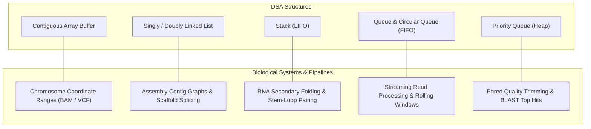

# Midterm Exam Solutions & Comprehensive Review

## Overview & Scope
This directory contains complete, verified solutions and in-depth mechanical explanations for the Data Structures and Algorithms (IT013IU) midterm exam papers:
- **Mock Exam 1** (`mock-exam-01_solution.md`): Focuses on Insertion Sort mechanics, descending order simulation, sorted singly linked list mutations, Max Priority Queue dry runs, and queue reversal using a stack.
- **Mock Exam 2** (`mock-exam-02_solution.md`): Covers stability theory, best-case comparisons vs. swaps, maximum-to-end Selection Sort simulation, linked list node relocations and deduplication, Min Priority Queues, circular array wrap-around queues, and stack sorting with a single auxiliary stack.
- **Real Exam 2023** (`real-exam-2023_midterm-solution.md`): The official Fall 2023 exam, featuring 13-element Selection Sort tracing, standard FIFO queue and LIFO stack date-cipher traces, doubly linked list implementations and two-way sorted merging, a complete linked list complexity matrix, and array-based double-ended queue (deque) design.

---

## Document Index & Cross-Reference

| Exam Paper | Source Path | Solution File | Core Topics Covered |
| :--- | :--- | :--- | :--- |
| **Mock Exam 1** | `midterm-review/mock-exams/Mock_Exam_1.pdf` | [mock-exam-01_solution.md](file:///home/ht2905/projects/dsa-java-2026/midterm-review/exam-solution/mock-exam-01_solution.md) | Insertion Sort, Singly Linked List, Max PQ, Stack, Queue Reversal |
| **Mock Exam 2** | `midterm-review/mock-exams/Mock_Exam_2.docx` | [mock-exam-02_solution.md](file:///home/ht2905/projects/dsa-java-2026/midterm-review/exam-solution/mock-exam-02_solution.md) | Stability, Selection Sort (Max-End), Deduplication, Min PQ, Circular Queue, Stack Sort |
| **Real Exam 2023** | `midterm-review/sample-exams/it013iu_2023_HK1_midterm.pdf` | [real-exam-2023_midterm-solution.md](file:///home/ht2905/projects/dsa-java-2026/midterm-review/exam-solution/real-exam-2023_midterm-solution.md) | 13-element Selection Sort, FIFO/LIFO Tracing, Doubly Linked List Merge, Complexity Matrix, Deque |

---

## Bioinformatics Mental Models for IT Midterm Topics

For biological researchers and bioinformaticians, standard DSA concepts map directly onto high-throughput biological workflows:

### 1. Arrays vs. Linked Lists
- **Arrays**: Fixed contiguous blocks of memory. Excellent for coordinate-indexed lookups (like indexing chromosome 1 from base 1 to $248{,}956{,}422$). Random access is $\mathcal{O}(1)$, but insertion or deletion in the middle requires shifting downstream elements ($\mathcal{O}(n)$).
- **Linked Lists**: Distributed heap nodes connected by pointers. Ideal when splicing or joining sequence fragments (contigs) without re-allocating contiguous memory buffers. Deletion or insertion is $\mathcal{O}(1)$ once the reference node is in hand, but random access is strictly $\mathcal{O}(n)$.

### 2. Stacks vs. Queues
- **Stack (LIFO)**: Models nested structures. In computational RNA biology, Watson-Crick base pairing ($A-U$, $G-C$) forms stems and nested hairpins that cannot cross (pseudoknot-free). Pushing opening bases and popping upon seeing complementary closing bases is the textbook mechanism of secondary structure validation.
- **Queue (FIFO)**: Models streaming pipelines. High-throughput sequencers generate hundreds of millions of reads; worker threads process them in strict arrival order to ensure deterministic file generation.
- **Circular Queue (Ring Buffer)**: Models rolling coverage windows and circular genomes (e.g., mitochondrial DNA, bacterial plasmids) where index increments wrap back around from the end to index 0 using modular arithmetic (`(rear + 1) % capacity`).

### 3. Priority Queues
- Instead of processing by arrival time, items exit according to quality. In read filtering, a Max Priority Queue always yields the read with the highest Phred score first ($\mathcal{O}(\log n)$ extraction).

---

## Midterm Problem Pattern Synthesis

### Recurring Pattern 1: Step-by-Step Sorting Tracing
- **Insertion Sort**: Expands a sorted prefix. Each step takes the current `key` and slides larger elements backward until the correct slot is cleared. On already sorted data, it terminates in $\mathcal{O}(n)$ time.
- **Selection Sort**: Scans the entire unsorted region to find the global extremum, then performs a single swap. It is strictly $\mathcal{O}(n^2)$ in comparisons even on sorted arrays, and is fundamentally unstable due to long-distance swaps.

### Recurring Pattern 2: Pointer Splicing Invariants
- When modifying linked lists:
  1. Never sever a link before securing a pointer to the downstream node (`temp = current.next`).
  2. Handle boundary cases first: empty list (`first == null`) and single-node list (`first.next == null` or `first == last`).
  3. When deleting duplicate values, do not advance your traversal pointer on deletion; the newly adjacent node may also be a duplicate.

### Recurring Pattern 3: LIFO Inversion Principle
- Queues preserve order; Stacks reverse order.
- To reverse a queue prefix of length $k$, pour $k$ elements into a stack, pour them back into the queue, and rotate the remaining $(n - k)$ elements around.
- To sort a stack using one auxiliary stack, keep the auxiliary stack sorted with largest on top; pouring it back into the original stack yields the smallest on top.
