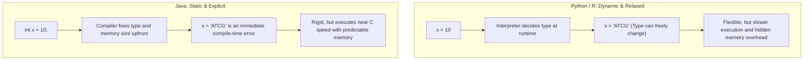
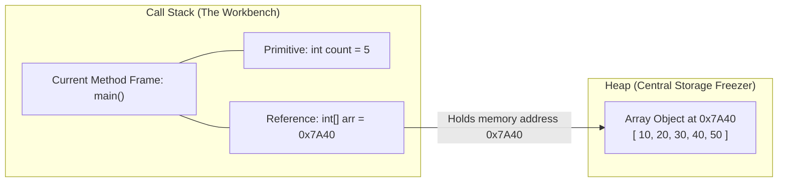
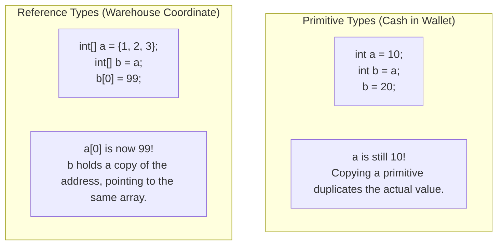

# Chapter 0: Preface — Java Mental Models for Non-Programmers

## 1. Why Bioinformaticians Need Data Structures and Algorithms

In bioinformatics and computational biology, daily work involves processing massive volumes of biological data:
- Hundreds of millions of DNA/RNA reads in FASTQ files.
- Hundreds of thousands of gene expression profiles across single cells.
- Millions of genomic variants mapped along chromosome coordinates.
- Thousands of 3D protein structures with atomic spatial coordinates.

When writing high-level scripts in Python or R using packages like `pandas`, `Biopython`, or `Seurat`, the computer hides memory management and low-level loops behind clean functions. However, if an algorithm uses a naive nested loop ($O(n^2)$) instead of an indexed lookup ($O(\log n)$ or $O(1)$), a job that should finish in 5 seconds will run for 3 weeks or crash your server with an Out-Of-Memory (OOM) error.

Data Structures and Algorithms (DSA) is simply the study of:
1. **How data is organized in physical computer memory** (Data Structures).
2. **How step-by-step procedures manipulate that data efficiently** (Algorithms).

---

## 2. Java vs. Python/R: The Mental Shift

Coming from Python or R, Java feels strict and verbose. Understanding why Java behaves this way makes it much easier to write and read.



### The Test Tube Metaphor
- In **Python/R**, variables are like unlabeled plastic bags. You can put an integer in a bag today, replace it with a text string tomorrow, and append 100 new items whenever you want.
- In **Java**, variables are like calibrated glass laboratory test tubes. When you declare `int x;`, you manufacture a tube specifically molded to hold exactly one 32-bit integer. You cannot put a decimal number or text string into that tube.

### Key Syntax Differences at a Glance

| Feature | Python / R | Java | Why Java Does This |
| :--- | :--- | :--- | :--- |
| **Variable Declaration** | `x = 5` | `int x = 5;` | Memory must be pre-allocated before running. |
| **Code Blocks** | Indentation (whitespace) | Curly braces `{ }` | Explicit boundaries; whitespace does not change logic. |
| **Statement End** | Newline | Semicolon `;` | Tells the compiler exactly where an instruction terminates. |
| **Array Sizing** | Dynamic (`list.append(x)`) | Fixed at creation (`new int[10]`) | Arrays occupy contiguous physical memory slots. |
| **Method Wrapping** | Free functions anywhere | Every function lives inside a `class` | Enforces modular encapsulation. |

---

## 3. Physical Memory: Stack vs. Heap

To write correct code and understand pointers/references, you only need one simple mental model of computer memory: the **Workbench (Stack)** and the **Central Cold Storage (Heap)**.



### 1. The Call Stack (The Lab Workbench)
- The Stack stores variables needed for the method currently executing.
- It is fast, organized, and temporary.
- When a method is called, its workbench (a **Stack Frame**) is created. When the method finishes (`return`), its entire workbench is cleared instantly.

### 2. The Heap (The Central Cold Storage)
- The Heap stores large objects, linked list nodes, and all arrays (`new int[100]`).
- It is large, flexible, and shared across the entire program.
- Objects stay alive in the Heap until no variable on any workbench points to them anymore (then the Java **Garbage Collector** safely recycles them).

---

## 4. Primitives vs. References: Cash vs. Warehouse Address

This is the single most tested concept in beginner Java exams.



### 1. Primitive Variables (Direct Value)
- Types: `int`, `double`, `boolean`, `char`, `long`.
- Stored directly on the Stack.
- **Analogy:** Carrying $10 in cash in your wallet. If you give a copy of that $10 bill to a colleague, and they spend it, your $10 remains in your wallet.

```java
int a = 10;
int b = a;  // b gets a copy of the number 10
b = 20;     // Modifying b has ZERO effect on a
System.out.println(a); // Prints 10
```

### 2. Reference Variables (Memory Address)
- Types: All arrays (`int[]`, `String[]`), all objects (`Node`, `Scanner`, custom classes).
- The variable on the Stack does **not** hold the data. It holds a 64-bit hexadecimal number representing the **physical address** where the object sits in the Heap.
- **Analogy:** Writing the freezer coordinate `"Shelf 4, Box B"` on an index card. If you give a copy of the index card to your lab partner, both of you are looking at the exact same box. If your partner swaps a sample tube inside that box, you will see the change immediately.

```java
int[] a = new int[]{10, 20, 30};
int[] b = a;  // b copies the ADDRESS, not the array! Both point to the same array.
b[0] = 99;    // We change slot 0 through reference b

System.out.println(a[0]); // Prints 99! a and b share the exact same Heap object.
```

---

## 5. Minimal Java Syntax Survival Kit

For exam writing, you only need a handful of core syntax structures. Keep them simple and avoid exotic features.

### 1. Minimal Program Skeleton
Every exam question usually requires writing a method or a standalone class:

```java
public class Solution {
    // Methods are written here
    public static void main(String[] args) {
        // Test code goes here
    }
}
```

### 2. Arrays: Creation and Access
```java
// Option A: Declare and allocate empty array of size 5 (defaults to zeros)
int[] numbers = new int[5];

// Option B: Declare with literal values
int[] values = {10, 25, 40, 55, 70};

// Length of array (NOTE: .length has NO parentheses for arrays)
int size = values.length;

// Accessing slots (indices run from 0 to size - 1)
int first = values[0];
int last = values[values.length - 1];
```

### 3. Loops: The Workhorses
```java
// Standard for-loop (use when you need the index)
for (int i = 0; i < values.length; i++) {
    System.out.println("Index " + i + " contains: " + values[i]);
}

// While-loop (use when termination depends on a condition, e.g., pointers)
int i = 0;
while (i < values.length) {
    // do work
    i++;
}
```

### 4. Swapping Two Elements in an Array
You will write this pattern repeatedly in Bubble Sort, Selection Sort, and Quicksort:

```java
// Swapping values[i] and values[j] requires a temporary variable
int temp = values[i];
values[i] = values[j];
values[j] = temp;
```

---

## 6. How to Read Java Code Without Getting Lost

When inspecting Java code on an exam paper:
1. **Ignore the Class Shell:** Look directly for the method name, its return type, and its input parameters:
   `public static int search(int[] arr, int target)`
   - Takes an integer array `arr` and an integer `target`.
   - Must return a single integer (`int`).
2. **Track Local Variables:** Draw a quick table on scratch paper with columns for each variable (`i`, `j`, `temp`, `swapped`).
3. **Follow Loop Conditions Step-by-Step:** Check initial values, loop boundary checks (`i < n`), and increment steps (`i++`).
