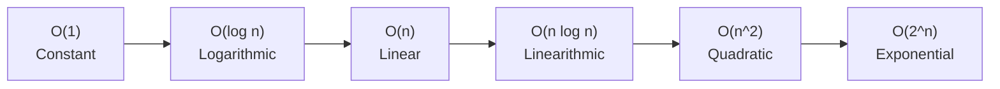
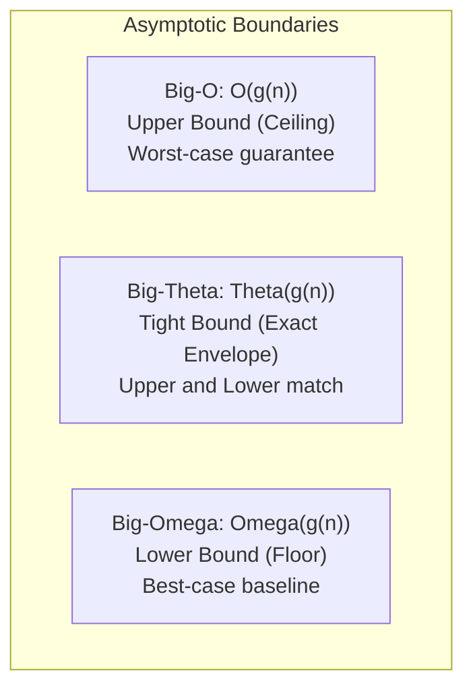

# Chapter 1: Algorithm Analysis, Asymptotics, and Growth Rates

## 1. The Core Question: Why Can't We Just Use a Stopwatch?

When comparing two algorithms in bioinformatics or computer science, why can't we simply run both on our computer and time them using `System.currentTimeMillis()`?

Wall-clock time is misleading because it depends on factors completely unrelated to the algorithm:
1. **Hardware differences:** Running on a 64-core compute cluster vs. an old laptop.
2. **Background operating system load:** Active web browsers, indexing tasks, or other users sharing the server.
3. **Compiler and runtime optimizations:** Just-In-Time (JIT) compilation differences.
4. **Input peculiarities:** Whether the specific test file happens to be small or already sorted.

To compare algorithms objectively, computer scientists use the **Random Access Machine (RAM) Model**:
- We count the **number of fundamental steps** executed as a function of the **input size $n$**.
- A fundamental step is an operation that takes constant time ($O(1)$):
  - Basic math (`+`, `-`, `*`, `/`)
  - Comparisons (`<`, `>`, `==`)
  - Variable assignments (`x = y`)
  - Direct array indexing (`arr[i]`)

---

## 2. What is Input Size $n$? Biological Context

The variable $n$ represents the amount of data your program must process:

| Biological Dataset | Typical Input Size $n$ |
| :--- | :--- |
| Single PCR Primer or Oligo | $n \approx 20\text{ to }30\text{ base pairs}$ |
| Protein Sequence (e.g., Hemoglobin) | $n \approx 300\text{ to }500\text{ amino acids}$ |
| Human Protein-Coding Genes | $n \approx 20{,}000\text{ genes}$ |
| Bacterial Genome (*E. coli*) | $n \approx 4.6 \times 10^6\text{ base pairs}$ |
| Human Genome (Haploid) | $n \approx 3.1 \times 10^9\text{ base pairs}$ |
| High-Throughput Sequencing Run | $n \approx 10^8\text{ to }10^9\text{ short reads}$ |

As $n$ grows from 100 to 1,000,000, the efficiency of an algorithm determines whether your script finishes in milliseconds or runs past your graduation.

---

## 3. The Hierarchy of Growth Rates: From Instant to Impossible

Below is the standard hierarchy of time complexities, ranked from fastest to slowest:

$$O(1) < O(\log n) < O(n) < O(n \log n) < O(n^2) < O(n^3) < O(2^n) < O(n!)$$



### Intuitive Explanations

1. **$O(1)$ — Constant Time:**
   - **Meaning:** Takes the exact same time regardless of whether $n = 10$ or $n = 10{,}000{,}000$.
   - **Analogy:** Grabbing the first tube from a test tube rack. Having 10 tubes or 1,000 tubes in the rack doesn't change how fast your hand reaches slot 0.
   - **Example:** `int first = arr[0];`

2. **$O(\log n)$ — Logarithmic Time:**
   - **Meaning:** Every single step cuts the remaining problem size in half.
   - **Analogy:** Looking up a species name in an alphabetical biological encyclopedia. You open to the middle, see if your target is before or after, and discard half the book.
   - **Scaling Power:** For a human genome of 3 billion bases, $\log_2(3 \times 10^9) \approx 32$ steps!

3. **$O(n)$ — Linear Time:**
   - **Meaning:** Running time is directly proportional to dataset size. If data doubles, time doubles.
   - **Analogy:** Pipetting a reagent into every single well of an $n$-well plate.
   - **Example:** Scanning a DNA sequence end-to-end to count total Guanine bases.

4. **$O(n \log n)$ — Linearithmic Time:**
   - **Meaning:** The gold standard for sorting. It divides data recursively ($\log n$ levels) and does linear work ($n$) across each level.
   - **Analogy:** Merge Sort dividing sequence reads into halves and merging them back in order. Fast enough to handle millions of reads in seconds.

5. **$O(n^2)$ — Quadratic Time:**
   - **Meaning:** A nested loop where every item must be compared against every other item. If data grows by $10\times$, runtime increases by $100\times$!
   - **Analogy:** Building an all-against-all pairwise distance matrix between $n$ patient genomes without indexing. Fine for $n = 100$, but catastrophic for $n = 100{,}000$.

6. **$O(2^n)$ — Exponential Time:**
   - **Meaning:** Doubling the input size squares the runtime.
   - **Analogy:** Trying every possible combination of $n$ molecular switches. For $n = 50$, the operations exceed the number of seconds since the Big Bang.

### Time Comparison on Real Hardware (1 Billion ops/sec)

| Complexity | $n = 100$ | $n = 10{,}000$ | $n = 10^6$ (1 Million) | $n = 10^9$ (1 Billion) |
| :--- | :--- | :--- | :--- | :--- |
| $O(1)$ | $1\text{ ns}$ | $1\text{ ns}$ | $1\text{ ns}$ | $1\text{ ns}$ |
| $O(\log_2 n)$ | $7\text{ ns}$ | $14\text{ ns}$ | $20\text{ ns}$ | $30\text{ ns}$ |
| $O(n)$ | $0.1\ \mu\text{s}$ | $10\ \mu\text{s}$ | $1\text{ ms}$ | $1\text{ second}$ |
| $O(n \log_2 n)$ | $0.7\ \mu\text{s}$ | $140\ \mu\text{s}$ | $20\text{ ms}$ | $30\text{ seconds}$ |
| $O(n^2)$ | $10\ \mu\text{s}$ | $100\text{ ms}$ | $16.7\text{ minutes}$ | $\approx 31.7\text{ years}$ |
| $O(2^n)$ | $4 \times 10^{13}\text{ years}$ | Impossible | Impossible | Impossible |

---

## 4. Asymptotic Notations: Big-O, Big-$\Omega$, and Big-$\Theta$

Exam questions frequently ask you to distinguish between Big-O, Big-Omega, and Big-Theta. Remember them as Ceiling, Floor, and Tight Envelope:



### 1. Big-O ($O$): The Upper Bound ("Ceiling")
- **Definition:** The algorithm will not grow faster than this rate as $n$ grows large.
- **Plain English:** *"Worst case, it will take at most this much time."*
- **Mathematical Form:** $T(n) \le c \cdot g(n)$ for large $n$.
- **Rule of Thumb:** Drop lower-order terms and constant coefficients.
  - If $T(n) = 3n^2 + 50n + 1000$, the dominant term is $n^2$. Thus, $T(n) = O(n^2)$.

### 2. Big-Omega ($\Omega$): The Lower Bound ("Floor")
- **Definition:** The algorithm will require at least this much work.
- **Plain English:** *"Best case, it cannot do better than this baseline."*
- **Mathematical Form:** $T(n) \ge c \cdot g(n)$ for large $n$.
- **Example:** Finding an element in an unsorted array of size $n$ requires checking at least 1 element in the best case ($\Omega(1)$), but any algorithm that checks the entire array has a lower bound of $\Omega(n)$.

### 3. Big-Theta ($\Theta$): The Tight Bound ("Envelope")
- **Definition:** When an algorithm's upper bound and lower bound match, it belongs to $\Theta(g(n))$.
- **Plain English:** *"The algorithm grows at the exact same rate as $g(n)$."*
- **Condition:** $T(n) = \Theta(g(n))$ if and only if $T(n) = O(g(n))$ AND $T(n) = \Omega(g(n))$.

---

## 5. How to Analyze Code Loops: Step-by-Step Rules

On exams, you will be given Java code snippets and asked to state the time complexity. Follow these 4 standard patterns:

### Pattern 1: Single Linear Loop
```java
for (int i = 0; i < n; i++) {
    // 1 constant operation
    count++;
}
```
- **Analysis:** The loop runs $n$ times. Each pass takes $O(1)$. Total = $n \times O(1) = O(n)$.

### Pattern 2: Nested Independent Loops
```java
for (int i = 0; i < n; i++) {
    for (int j = 0; j < n; j++) {
        matrix[i][j] = 0;
    }
}
```
- **Analysis:** Outer loop runs $n$ times. For each outer step, the inner loop runs $n$ times. Total = $n \times n = O(n^2)$.

### Pattern 3: Triangular Nested Loop
```java
for (int i = 0; i < n; i++) {
    for (int j = i + 1; j < n; j++) {
        compare(arr[i], arr[j]);
    }
}
```
- **Analysis:**
  - When $i = 0$, inner loop runs $n - 1$ times.
  - When $i = 1$, inner loop runs $n - 2$ times.
  - When $i = n - 2$, inner loop runs $1$ time.
  - Total steps = $(n - 1) + (n - 2) + \dots + 1 = \frac{n(n - 1)}{2} = \frac{n^2 - n}{2}$.
  - Dropping lower terms and constants: $\Theta(n^2)$.

### Pattern 4: Halving / Doubling Loops (Logarithmic)
```java
int i = 1;
while (i < n) {
    i = i * 2; // Index doubles every step!
}
```
- **Analysis:** $i$ takes values: $1, 2, 4, 8, 16, \dots, 2^k$.
- We stop when $2^k \ge n \implies k = \log_2 n$.
- Total runtime = $O(\log n)$.

---

## 6. Real Example: Maximum Subarray Sum (The 3 Generations)

Given an array of integers (which can include negative numbers), find the contiguous subarray with the largest sum.
Example: `arr = [-2, 1, -3, 4, -1, 2, 1, -5, 4]`. The answer is `[4, -1, 2, 1]` with sum = `6`.

### Generation 1: Naive Cubic $O(n^3)$
Checks all possible starting points $i$, ending points $j$, and adds every number between them.

```java
public static int maxSubarraySumNaive(int[] arr) {
    int n = arr.length;
    int maxSum = Integer.MIN_VALUE;

    for (int i = 0; i < n; i++) {
        for (int j = i; j < n; j++) {
            int currentSum = 0;
            for (int k = i; k <= j; k++) { // 3rd nested loop!
                currentSum += arr[k];
            }
            if (currentSum > maxSum) {
                maxSum = currentSum;
            }
        }
    }
    return maxSum;
}
```
- **Complexity:** 3 nested loops $\implies O(n^3)$. Extremely slow.

### Generation 2: Quadratic $O(n^2)$
Reuses the running sum instead of recounting from scratch.

```java
public static int maxSubarraySumQuadratic(int[] arr) {
    int n = arr.length;
    int maxSum = Integer.MIN_VALUE;

    for (int i = 0; i < n; i++) {
        int currentSum = 0;
        for (int j = i; j < n; j++) {
            currentSum += arr[j]; // Just add the new element
            if (currentSum > maxSum) {
                maxSum = currentSum;
            }
        }
    }
    return maxSum;
}
```
- **Complexity:** 2 nested loops $\implies O(n^2)$. Better, but still too slow for large $n$.

### Generation 3: Kadane's Algorithm $O(n)$ (Optimal)
**The Core Insight:** As you walk through the array, at each number you ask: *"Should I add this number to my existing running streak, or should I throw away the past and start a fresh streak with just this number?"*

```java
public static int maxSubarraySumKadane(int[] arr) {
    int maxSoFar = arr[0];
    int currentStreak = arr[0];

    for (int i = 1; i < arr.length; i++) {
        // Either continue current streak or start fresh at arr[i]
        currentStreak = Math.max(arr[i], currentStreak + arr[i]);
        // Update the best sum seen so far
        maxSoFar = Math.max(maxSoFar, currentStreak);
    }
    return maxSoFar;
}
```
- **Complexity:** Single loop through array $\implies \Theta(n)$ time, $O(1)$ space.
