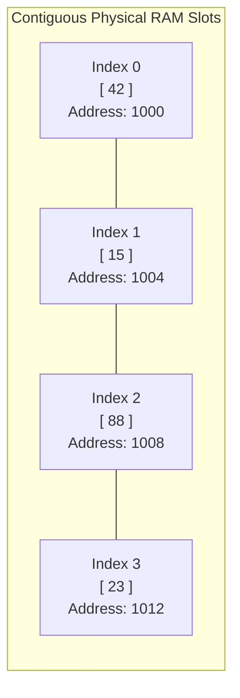
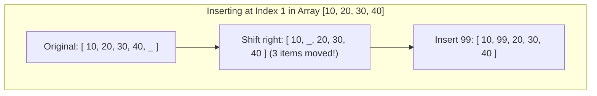

# Chapter 2: Arrays and Memory Contiguity

## 1. What is an Array? The Contiguous Memory Model

An **array** is the most fundamental data structure in computing. In Java, an array is a collection of elements of the same type stored in **contiguous (strictly adjacent) physical memory slots**.



### The 96-Well Microplate Metaphor
Imagine a plastic 96-well PCR plate or pill organizer.
- Every well is the exact same size ($4\text{ bytes}$ for an `int`).
- All wells are welded together in a fixed, continuous row.
- If you know where well 0 is located, you don't have to count through all the wells to find well 50; you simply jump directly to it:

$$\text{Address}(\text{arr}[i]) = \text{Base Address} + (i \times \text{Size of Element})$$

Because multiplication and addition take $1\text{ step}$, **accessing or modifying an element at any index `arr[i]` takes instantaneous $O(1)$ constant time**.

---

## 2. The Array Trade-Off: Instant Access vs. Expensive Shifts

While looking up `arr[i]` is instantaneous, changing the size or inserting into an array is costly:



### Why Insertion and Deletion Take $O(n)$ Time
1. **Inserting at the front (index 0):** You must physically move every existing element one slot to the right to make room. If the array has $1{,}000{,}000$ items, that's $1{,}000{,}000$ copies ($O(n)$).
2. **Deleting at the front (index 0):** You must physically move every remaining element one slot to the left to close the gap ($O(n)$).
3. **Inserting at the end:** If there is empty capacity, appending at the end is $O(1)$ because no elements need to shift.

### Summary of Array Operations

| Operation | Index / Location | Time Complexity | Reason |
| :--- | :--- | :---: | :--- |
| **Lookup / Read** | Any index `arr[i]` | $O(1)$ | Direct address calculation. |
| **Update / Write** | Any index `arr[i]` | $O(1)$ | Overwrites existing memory slot. |
| **Insert at End** | With available space | $O(1)$ | No shifting required. |
| **Insert at Front/Mid** | Index $0$ or middle | $O(n)$ | Must shift downstream elements right. |
| **Delete from Front/Mid**| Index $0$ or middle | $O(n)$ | Must shift downstream elements left. |

---

## 3. Static Array (`int[]`) vs. Dynamic Array (`ArrayList`)

### 1. Static Array (`int[]`)
- Fixed size at birth. If you declare `new int[5]`, it can never hold 6 elements.
- Extremely memory-efficient; zero pointer overhead.
- Safe and predictable for fixed-size datasets (e.g., standard coordinates or fixed window buffers).

### 2. Dynamic Array (`ArrayList` in Java, `list` in Python)
- Appears to grow infinitely.
- **How it actually works under the hood:**
  1. Starts with a small internal static array (e.g., capacity 10).
  2. When you append the 11th item, it allocates a **new array with double the capacity** (capacity 20).
  3. It copies all 10 old items into the new array.
  4. It drops the old array for garbage collection.
- **Amortized Analysis ($O(1)$):**
  Although the doubling step takes $O(n)$ copying work, it happens very infrequently. Across $n$ additions, the total resizing cost is bounded by $2n$. Thus, on average, each append costs only **$O(1)$ amortized time**.

---

## 4. High-Yield Array Templates for the Midterm

These are standard routines that appear frequently in exam questions. Memorize these simple structures.

### Template 1: In-Place Array Reversal (Two-Pointer Technique)
Reverses an array without creating a second array, saving memory:

```java
public static void reverseArray(int[] arr) {
    int left = 0;
    int right = arr.length - 1;

    while (left < right) {
        // Swap elements at left and right
        int temp = arr[left];
        arr[left] = arr[right];
        arr[right] = temp;

        // Move pointers inward
        left++;
        right--;
    }
}
```
- **Time Complexity:** $O(n)$ — visits each element once.
- **Space Complexity:** $O(1)$ — in-place.

### Template 2: Finding Extremes (Min and Max)
```java
public static int findMin(int[] arr) {
    int minVal = arr[0];
    for (int i = 1; i < arr.length; i++) {
        if (arr[i] < minVal) {
            minVal = arr[i];
        }
    }
    return minVal;
}
```
- **Time Complexity:** $O(n)$ — requires exactly $n - 1$ comparisons.

### Template 3: Frequency Array / Histogram (Direct Addressing)
Used when counting occurrences of values in a known range (like nucleotide counts `A, C, G, T` or grades `0` to `100`):

```java
// Count frequencies of numbers in range 0 to maxVal
public static int[] countFrequencies(int[] arr, int maxVal) {
    int[] count = new int[maxVal + 1]; // All slots initialize to 0
    for (int i = 0; i < arr.length; i++) {
        int val = arr[i];
        count[val]++;
    }
    return count;
}
```
- **Time Complexity:** $O(n)$ — single pass.
- **Space Complexity:** $O(K)$ where $K$ is the maximum value.

### Template 4: Prefix Sum Array (Instant Range Queries)
Suppose you have an array and need to answer 10,000 queries asking: *"What is the sum of elements from index $L$ to index $R$?"*
- Naive loop takes $O(n)$ per query $\implies O(Q \cdot n)$ total.
- **Prefix Sum Strategy:** Precompute running totals in $O(n)$ once, then answer each query in $O(1)$:

$$\text{Sum}(L, R) = \text{prefix}[R + 1] - \text{prefix}[L]$$

```java
public static int[] buildPrefixSum(int[] arr) {
    int n = arr.length;
    int[] prefix = new int[n + 1];
    prefix[0] = 0;
    for (int i = 0; i < n; i++) {
        prefix[i + 1] = prefix[i] + arr[i];
    }
    return prefix;
}

public static int queryRangeSum(int[] prefix, int L, int R) {
    return prefix[R + 1] - prefix[L];
}
```
- **Build Time:** $O(n)$.
- **Query Time:** $O(1)$ per query.
