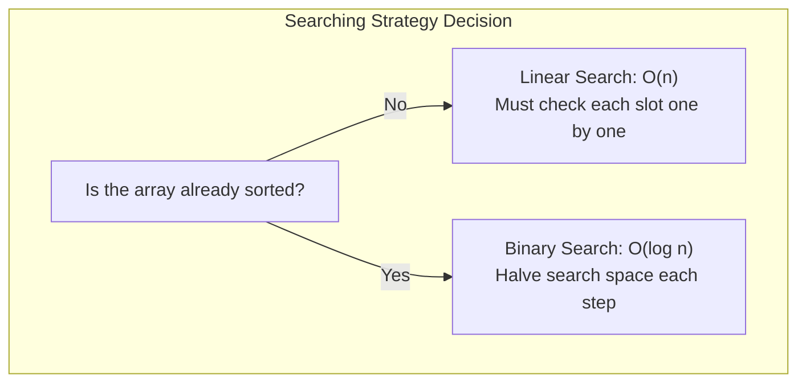
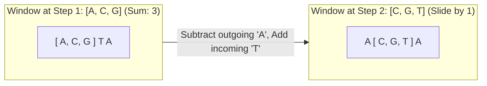

# Chapter 3: Searching Algorithms and Sliding Windows

## 1. Searching: How to Find What You Need

Searching is finding the position of a specific target value (a **key**) inside a collection, or confirming that the key does not exist.

There are two primary paradigms:
1. **Unsorted Data:** You have no choice but to scan elements one by one (**Linear Search**).
2. **Sorted Data:** You can repeatedly eliminate half of the remaining elements at every step (**Binary Search**).



---

## 2. Linear Search and Sentinel Optimization

### 1. Standard Linear Search
- **How it works:** Start at index 0. Compare each element to `target`. If matched, return the index. If the end of the array is reached without finding it, return `-1`.
- **Analogy:** Checking test tubes in an unsorted rack one by one from left to right until you find the sample label.

```java
public static int linearSearch(int[] arr, int target) {
    for (int i = 0; i < arr.length; i++) {
        if (arr[i] == target) {
            return i; // Found at index i
        }
    }
    return -1; // Not found
}
```

- **Time Complexity:**
  - **Best Case:** $\Theta(1)$ (target is at index 0).
  - **Worst Case:** $\Theta(n)$ (target is at the very last index or not present).
  - **Average Case:** $\Theta(n)$ (checks roughly $n/2$ items).
- **Space Complexity:** $O(1)$.

### 2. Sentinel Linear Search (Optimized Linear Search)
On every iteration of a standard `for` loop, the processor performs **two checks**:
1. Check loop boundary: `i < arr.length`
2. Check value: `arr[i] == target`

**The Sentinel Trick:** If we have extra space at the end of the array, we intentionally plant the target value at `arr[n]` (called a **Sentinel**). Now, the target is guaranteed to be found, so we can completely eliminate the `i < n` boundary check from the loop!

```java
// Requires an array of capacity n + 1 where slot n is available
public static int sentinelLinearSearch(int[] arr, int n, int target) {
    // 1. Place sentinel at the end
    arr[n] = target;

    // 2. Loop only checks value match (saves 50% of loop comparisons!)
    int i = 0;
    while (arr[i] != target) {
        i++;
    }

    // 3. Check if we found a real match or hit the sentinel
    if (i < n) {
        return i; // Found genuine match in original array
    }
    return -1;    // Only hit the sentinel; target was not originally present
}
```
- **Asymptotic Complexity:** Still $\Theta(n)$, but runs roughly $1.5\times$ to $2\times$ faster in practice due to half as many branch instructions per iteration.

---

## 3. Binary Search: The Logarithmic Powerhouse

### The Critical Rule
> **Binary Search ONLY works on data that is already SORTED!**
> If you run binary search on an unsorted array, it will return incorrect results because its fundamental assumption is broken.

### How Binary Search Works Step-by-Step
1. Maintain two boundary markers: `low` (start of search region) and `high` (end of search region).
2. Calculate the midpoint: `mid = low + (high - low) / 2`.
3. Compare the value at `arr[mid]` with `target`:
   - If `arr[mid] == target`: Success! Return `mid`.
   - If `arr[mid] < target`: The target must be in the **right half**. Move `low = mid + 1`.
   - If `arr[mid] > target`: The target must be in the **left half**. Move `high = mid - 1`.
4. If `low > high`, the search space has shrunk to zero; the target is not in the array. Return `-1`.

```mermaid
flowchart TD
    subgraph BinarySearchFlow["Binary Search Decision at mid"]
        M["Check arr[mid] vs target"]
        M -->|arr[mid] == target| F["Found! Return mid"]
        M -->|arr[mid] < target| R["Target is larger:\nDiscard left half -> low = mid + 1"]
        M -->|arr[mid] > target| L["Target is smaller:\nDiscard right half -> high = mid - 1"]
    end
```

### Concrete Hand-Trace Example
Search for target `23` in sorted array `[2, 5, 8, 12, 16, 23, 38, 56, 72, 91]` ($n = 10$).

| Iteration | `low` | `high` | `mid` | `arr[mid]` | Comparison | Action Taken |
| :---: | :---: | :---: | :---: | :---: | :---: | :--- |
| **Pass 1** | $0$ | $9$ | $4$ | $16$ | $16 < 23$ | Target is in right half $\implies$ `low = 5` |
| **Pass 2** | $5$ | $9$ | $7$ | $56$ | $56 > 23$ | Target is in left half $\implies$ `high = 6` |
| **Pass 3** | $5$ | $6$ | $5$ | $23$ | $23 == 23$ | **Match found! Return index 5.** |

In only **3 comparisons**, we found the answer in a list of 10 items.

### The Integer Overflow Trap: Why Not `(low + high) / 2`?
In Java, 32-bit `int` values have a maximum limit of $2{,}147{,}483{,}647$.
If `low` and `high` are both large (e.g., $1.5\text{ billion}$), adding `low + high` overflows into a negative number, causing an `ArrayIndexOutOfBoundsException`.
- **Unsafe:** `int mid = (low + high) / 2;`
- **Safe:** `int mid = low + (high - low) / 2;`

### Standard Binary Search Template (Iterative)
```java
public static int binarySearch(int[] arr, int target) {
    int low = 0;
    int high = arr.length - 1;

    while (low <= high) { // Notice '<=' not '<'
        int mid = low + (high - low) / 2;

        if (arr[mid] == target) {
            return mid; // Target found
        } else if (arr[mid] < target) {
            low = mid + 1;  // Search right half
        } else {
            high = mid - 1; // Search left half
        }
    }
    return -1; // Target not found
}
```

- **Time Complexity:**
  - **Best Case:** $\Theta(1)$ (middle element is target on first try).
  - **Worst Case:** $\Theta(\log_2 n)$ (halves search space until 1 element remains).
  - **Average Case:** $\Theta(\log_2 n)$.
- **Space Complexity:** $O(1)$ (in-place iterative).

---

## 4. Exam Variations: First and Last Occurrences

When an array contains **duplicate values** (e.g., `[2, 4, 4, 4, 7, 9]`), standard binary search might return any of the matching indices. Exam questions often ask for the **first (leftmost)** or **last (rightmost)** occurrence.

### First Occurrence (Lower Bound)
When `arr[mid] == target`, don't return immediately! Record `mid` as a candidate, and continue searching in the **left half** (`high = mid - 1`):

```java
public static int findFirstOccurrence(int[] arr, int target) {
    int low = 0, high = arr.length - 1;
    int result = -1;

    while (low <= high) {
        int mid = low + (high - low) / 2;
        if (arr[mid] == target) {
            result = mid;       // Record candidate index
            high = mid - 1;     // Keep searching left for earlier occurrence!
        } else if (arr[mid] < target) {
            low = mid + 1;
        } else {
            high = mid - 1;
        }
    }
    return result;
}
```

### Last Occurrence (Upper Bound)
When `arr[mid] == target`, record `mid` and continue searching in the **right half** (`low = mid + 1`):

```java
public static int findLastOccurrence(int[] arr, int target) {
    int low = 0, high = arr.length - 1;
    int result = -1;

    while (low <= high) {
        int mid = low + (high - low) / 2;
        if (arr[mid] == target) {
            result = mid;       // Record candidate index
            low = mid + 1;      // Keep searching right for later occurrence!
        } else if (arr[mid] < target) {
            low = mid + 1;
        } else {
            high = mid - 1;
        }
    }
    return result;
}
```

---

## 5. The Sliding Window Technique

### The Biological Concept
In genome analysis, computing GC-content across a chromosome is typically done using a **sliding window of fixed width $k$** (e.g., 100 bp window moving 1 base at a time).



### The $O(1)$ Window Update
- **Naive approach:** For each window position, sum all $k$ elements from scratch. Total time = $O(n \cdot k)$.
- **Sliding Window insight:** When the window slides right by 1 position, only **two elements change**:
  1. The leftmost element leaves the window (**subtract** it).
  2. The new rightmost element enters the window (**add** it).
  3. All elements in the middle stay the same!
- Total time drops from $O(n \cdot k)$ to **$O(n)$**.

### Fixed Sliding Window Template: Maximum Sum Subarray of Size $k$
```java
public static int maxSumWindow(int[] arr, int k) {
    int n = arr.length;
    if (n < k) return -1;

    // 1. Calculate sum of the first window of size k
    int windowSum = 0;
    for (int i = 0; i < k; i++) {
        windowSum += arr[i];
    }

    int maxSum = windowSum;

    // 2. Slide the window from index k to the end
    for (int i = k; i < n; i++) {
        windowSum += arr[i] - arr[i - k]; // Add incoming, subtract outgoing
        if (windowSum > maxSum) {
            maxSum = windowSum;
        }
    }
    return maxSum;
}
```
- **Time Complexity:** $O(n)$ — visits each array element at most twice.
- **Space Complexity:** $O(1)$ — only stores running sum variables.
