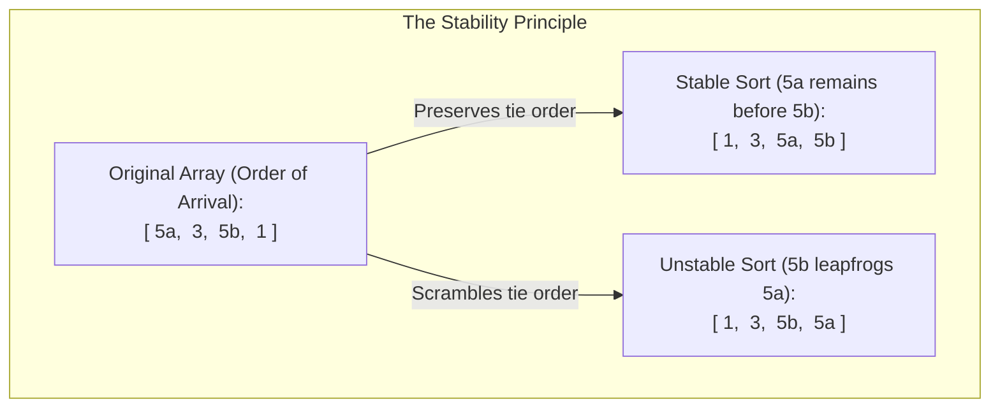
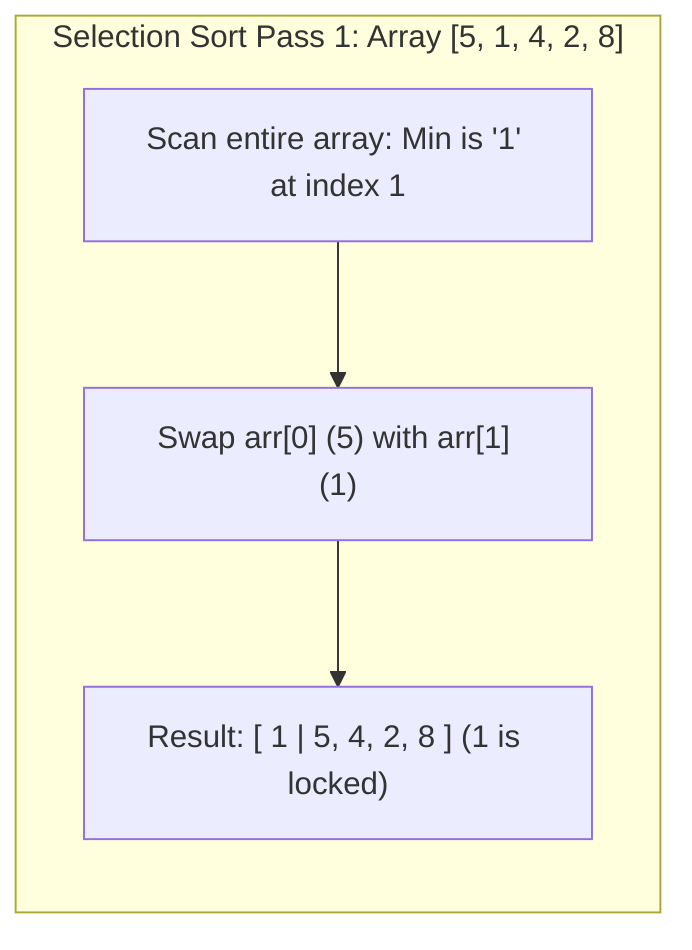
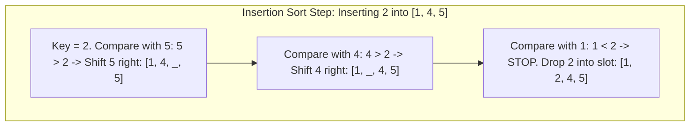

# Chapter 4: Elementary Sorting Algorithms (Bubble, Selection, Insertion)

## 1. Why Sorting Matters & The Concept of Stability

Sorting arranges elements in a specified order (ascending or descending).
In biological pipelines and data science, sorting is the crucial step that enables:
- Fast $O(\log n)$ binary searching.
- Duplicate detection and coordinate-based genome alignment.
- Identifying top scoring BLAST hits or Phred quality percentiles.



### What is Sorting Stability?
An algorithm is **Stable** if elements with identical keys retain their original relative order after sorting.
- **Why it matters:** Suppose you sort genomic reads first by sample ID, and then sort by chromosomal start coordinate. A **stable** sort guarantees that reads at the same coordinate remain grouped by sample ID. An **unstable** sort scrambles that grouping.
- **Stable Sorts:** Bubble Sort, Insertion Sort, Merge Sort.
- **Unstable Sorts:** Selection Sort, Quick Sort, Heap Sort.

---

## 2. Bubble Sort: Adjacent Pairwise Swaps

### How It Works Step-by-Step
1. Walk through the array from left to right.
2. Compare each adjacent pair: `arr[j]` and `arr[j + 1]`.
3. If the left item is strictly greater than the right item (`arr[j] > arr[j + 1]`), **swap them**.
4. After Pass 1, the **largest element** has "bubbled up" to the very end of the array.
5. In Pass 2, repeat the process for all elements except the last one (which is already locked in place).
6. Continue for $n - 1$ passes.

### Hand-Trace Example
Input array: `[5, 1, 4, 2, 8]` ($n = 5$)

- **Pass 1:**
  - Compare $(5, 1) \implies 5 > 1$, swap $\implies [1, 5, 4, 2, 8]$
  - Compare $(5, 4) \implies 5 > 4$, swap $\implies [1, 4, 5, 2, 8]$
  - Compare $(5, 2) \implies 5 > 2$, swap $\implies [1, 4, 2, 5, 8]$
  - Compare $(5, 8) \implies 5 < 8$, no swap $\implies [1, 4, 2, 5, 8]$
  - *End of Pass 1: `8` is permanently locked at index 4.*
- **Pass 2:**
  - Compare $(1, 4) \implies$ no swap
  - Compare $(4, 2) \implies$ swap $\implies [1, 2, 4, 5, 8]$
  - Compare $(4, 5) \implies$ no swap
  - *End of Pass 2: `5` is permanently locked at index 3.*
- **Pass 3:**
  - Compare $(1, 2) \implies$ no swap
  - Compare $(2, 4) \implies$ no swap
  - *No swaps occurred in this entire pass $\implies$ Array is already sorted! Terminate early.*

### The Early-Exit Optimization
By tracking `boolean swapped = false`, if a pass completes without a single swap, the array is verified to be fully sorted. We can break out immediately, achieving **$O(n)$ best-case time**.

```java
public static void bubbleSort(int[] arr) {
    int n = arr.length;
    for (int i = 0; i < n - 1; i++) {
        boolean swapped = false;

        // Inner loop runs up to n - 1 - i because end elements are already locked
        for (int j = 0; j < n - 1 - i; j++) {
            if (arr[j] > arr[j + 1]) { // Strict '>' preserves stability
                int temp = arr[j];
                arr[j] = arr[j + 1];
                arr[j + 1] = temp;
                swapped = true;
            }
        }

        // If no two elements were swapped, array is sorted
        if (!swapped) break;
    }
}
```

- **Time Complexity:**
  - **Best Case:** $\Theta(n)$ (already sorted with early-exit).
  - **Worst Case:** $\Theta(n^2)$ (reverse sorted).
  - **Average Case:** $\Theta(n^2)$.
- **Swaps:** Best = $0$, Worst = $\frac{n(n - 1)}{2}$.
- **Space:** $O(1)$ (in-place).
- **Stability:** **Stable**.

---

## 3. Selection Sort: Finding Extremes with Minimum Swaps

### How It Works Step-by-Step
1. Divide the array conceptually into a **sorted prefix** (left) and an **unsorted suffix** (right).
2. Scan the entire unsorted region to find the **index of the absolute minimum element**.
3. **Swap** that minimum element with the first element of the unsorted region.
4. Expand the sorted region by one slot and repeat until the array is fully sorted.



### Hand-Trace Example
Input array: `[5, 1, 4, 2, 8]`

- **Pass 1:** Unsorted `[5, 1, 4, 2, 8]`. Minimum is `1` at index 1. Swap with index 0 $\implies$ `[1 | 5, 4, 2, 8]`
- **Pass 2:** Unsorted `[5, 4, 2, 8]`. Minimum is `2` at index 3. Swap with index 1 $\implies$ `[1, 2 | 4, 5, 8]`
- **Pass 3:** Unsorted `[4, 5, 8]`. Minimum is `4` at index 2. Swap with index 2 (itself) $\implies$ `[1, 2, 4 | 5, 8]`
- **Pass 4:** Unsorted `[5, 8]`. Minimum is `5` at index 3. Swap with index 3 $\implies$ `[1, 2, 4, 5, 8]`

### Exam Variation: Minimum-to-Front vs. Maximum-to-End
- **Standard (Min-to-Front):** Scans for minimum and swaps to `arr[i]`.
- **Exam Variation (Max-to-End):** Scans for maximum and swaps to `arr[n - 1 - i]` (tested in Mock Exam 2).

### Standard Selection Sort Template (Min-to-Front)
```java
public static void selectionSort(int[] arr) {
    int n = arr.length;
    for (int i = 0; i < n - 1; i++) {
        int minIdx = i;

        // Scan unsorted suffix to find smallest item
        for (int j = i + 1; j < n; j++) {
            if (arr[j] < arr[minIdx]) {
                minIdx = j;
            }
        }

        // Swap the found minimum into position i (at most 1 swap per pass!)
        if (minIdx != i) {
            int temp = arr[i];
            arr[i] = arr[minIdx];
            arr[minIdx] = temp;
        }
    }
}
```

### Selection Sort Variation (Max-to-End)
```java
public static void selectionSortMaxToEnd(int[] arr) {
    int n = arr.length;
    for (int i = n - 1; i > 0; i--) {
        int maxIdx = 0;
        for (int j = 1; j <= i; j++) {
            if (arr[j] > arr[maxIdx]) {
                maxIdx = j;
            }
        }
        // Swap maximum to current end position i
        int temp = arr[i];
        arr[i] = arr[maxIdx];
        arr[maxIdx] = temp;
    }
}
```

### Why Selection Sort is Fundamentally UNSTABLE
Consider the array `[ 2a, 2b, 1 ]`:
1. The minimum is `1` at index 2.
2. We swap `arr[0]` (`2a`) with `arr[2]` (`1`).
3. The array becomes `[ 1, 2b, 2a ]`.
4. `2a` has leapfrogged over `2b`! Their original relative order is broken $\implies$ **Unstable**.

- **Time Complexity:** $\Theta(n^2)$ in ALL cases (Best, Worst, Average) because it always scans all remaining elements to verify the minimum.
- **Swaps:** At most $n - 1$ swaps (extremely low write overhead).
- **Space:** $O(1)$.
- **Stability:** **Unstable**.

---

## 4. Insertion Sort: The Card Player's Algorithm

### How It Works Step-by-Step
1. Imagine holding a hand of playing cards.
2. The first card (`arr[0]`) is considered already sorted.
3. Pick up the next card (`key = arr[i]`).
4. Compare `key` with cards in your sorted hand from right to left.
5. As long as a card in your hand is strictly larger than `key`, **shift it one slot to the right**.
6. When you find a card smaller than or equal to `key`, drop `key` into the open slot.
7. Repeat for all remaining cards.



### Hand-Trace Example
Input array: `[5, 1, 4, 2, 8]`

- **Pass 1 ($i = 1$):** `key = 1`. Compare with 5: $5 > 1 \implies$ shift 5 $\implies$ insert 1 at index 0 $\implies$ `[1, 5 | 4, 2, 8]`
- **Pass 2 ($i = 2$):** `key = 4`. Compare with 5: $5 > 4 \implies$ shift 5 $\implies$ compare with 1: $1 < 4 \implies$ insert 4 at index 1 $\implies$ `[1, 4, 5 | 2, 8]`
- **Pass 3 ($i = 3$):** `key = 2`. Compare with 5 (shift), compare with 4 (shift), compare with 1 ($1 < 2$) $\implies$ insert 2 at index 1 $\implies$ `[1, 2, 4, 5 | 8]`
- **Pass 4 ($i = 4$):** `key = 8`. Compare with 5: $5 < 8 \implies$ 0 shifts! $\implies$ `[1, 2, 4, 5, 8]`

### Standard Insertion Sort Template (Ascending Order)
```java
public static void insertionSort(int[] arr) {
    int n = arr.length;
    for (int i = 1; i < n; i++) {
        int key = arr[i];
        int j = i - 1;

        // Shift elements of arr[0..i-1] that are greater than key to one position ahead
        while (j >= 0 && arr[j] > key) {
            arr[j + 1] = arr[j]; // Shift right
            j--;
        }
        arr[j + 1] = key; // Place key in vacated slot
    }
}
```

### Exam Variation: Insertion Sort in Descending Order (Mock Exam 1)
To sort in descending order (largest first), simply flip the inner condition from `arr[j] > key` to `arr[j] < key`:

```java
public static void insertionSortDescending(int[] arr) {
    int n = arr.length;
    for (int i = 1; i < n; i++) {
        int key = arr[i];
        int j = i - 1;

        // Shift elements smaller than key to make room for larger value
        while (j >= 0 && arr[j] < key) {
            arr[j + 1] = arr[j];
            j--;
        }
        arr[j + 1] = key;
    }
}
```

- **Time Complexity:**
  - **Best Case:** $\Theta(n)$ (already sorted; inner loop condition fails immediately on each pass, requiring 0 shifts).
  - **Worst Case:** $\Theta(n^2)$ (reverse sorted; every item shifts all the way to the front).
  - **Average Case:** $\Theta(n^2)$.
- **Space:** $O(1)$.
- **Stability:** **Stable** (strict inequality `arr[j] > key` never shifts equal elements).

---

## 5. Master Comparison: Elementary Sorting Algorithms

| Metric | Bubble Sort (Early Exit) | Selection Sort | Insertion Sort |
| :--- | :---: | :---: | :---: |
| **Best-Case Time** | $\Theta(n)$ | $\Theta(n^2)$ | $\Theta(n)$ |
| **Average-Case Time**| $\Theta(n^2)$ | $\Theta(n^2)$ | $\Theta(n^2)$ |
| **Worst-Case Time** | $\Theta(n^2)$ | $\Theta(n^2)$ | $\Theta(n^2)$ |
| **Best-Case Comparisons** | $n - 1$ | $\frac{n(n - 1)}{2}$ | $n - 1$ |
| **Worst-Case Swaps / Shifts** | $\frac{n(n - 1)}{2}$ swaps | **$n - 1$ swaps** | $\frac{n(n - 1)}{2}$ shifts |
| **Auxiliary Space** | $O(1)$ | $O(1)$ | $O(1)$ |
| **Stability** | **Stable** | **UNSTABLE** | **Stable** |
| **Best Use Case** | Academic demonstration | When writing to memory is very expensive | **Nearly-sorted data** or small arrays ($n < 20$) |
