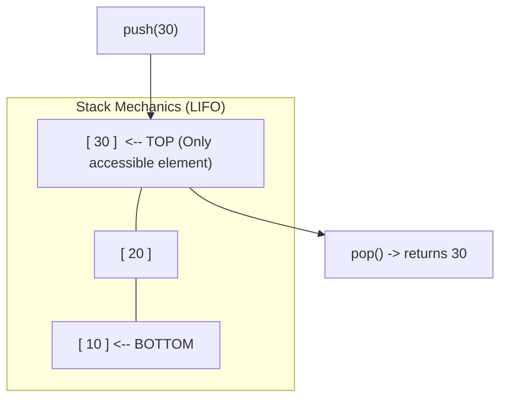

# Chapter 5: Stacks (LIFO), Applications, and Monotonic Patterns

## 1. The Stack ADT: Last-In, First-Out (LIFO)

A **Stack** is a linear data structure that follows the **Last-In, First-Out (LIFO)** principle:
- The last element added is always the first element removed.
- **Physical Analogy:** A spring-loaded cafeteria plate dispenser or a vertical stack of laboratory Petri dishes. You can only place a new dish onto the top, and you can only remove the dish currently on top. You cannot pull a dish from the middle or bottom without toppling the stack.



### The Stack Contract

| Method | Behavior | Time Complexity |
| :--- | :--- | :---: |
| `push(x)` | Adds item $x$ to the top of the stack | $O(1)$ |
| `pop()` | Removes and returns the top item | $O(1)$ |
| `peek()` | Inspects the top item without removing it | $O(1)$ |
| `isEmpty()` | Returns `true` if stack contains 0 items | $O(1)$ |
| `size()` | Returns current number of items | $O(1)$ |

### Boundary Errors
- **Stack Underflow:** Calling `pop()` or `peek()` when the stack is empty (`isEmpty() == true`).
- **Stack Overflow:** Calling `push()` on a fixed-capacity array stack that is already full.

---

## 2. Implementations: Array Stack vs. Linked Stack

### 1. Fixed-Array Stack Implementation
Uses a simple array `data[]` and an integer `top` tracking the index of the uppermost element.
- When empty: `top = -1`.
- When pushed: `data[++top] = x`.
- When popped: `return data[top--]`.

```java
public class ArrayStack {
    private int[] data;
    private int top;
    private int capacity;

    public ArrayStack(int capacity) {
        this.capacity = capacity;
        this.data = new int[capacity];
        this.top = -1; // Empty state
    }

    public void push(int val) {
        if (top == capacity - 1) {
            throw new RuntimeException("Stack Overflow: Stack is full");
        }
        data[++top] = val; // Increment top first, then store
    }

    public int pop() {
        if (isEmpty()) {
            throw new RuntimeException("Stack Underflow: Stack is empty");
        }
        return data[top--]; // Return value, then decrement top
    }

    public int peek() {
        if (isEmpty()) {
            throw new RuntimeException("Stack Underflow: Stack is empty");
        }
        return data[top];
    }

    public boolean isEmpty() {
        return top == -1;
    }

    public int size() {
        return top + 1;
    }
}
```

---

## 3. High-Yield Exam Applications

### Application 1: RNA Secondary Structure & Balanced Parentheses
In molecular biology, an RNA strand folds back onto itself. Stems are formed by complementary base pairs (e.g., `( )` or `[ ]`). A valid RNA stem-loop must never have crossing or unclosed base pairings (pseudoknot-free).

**Algorithm:**
1. Traverse the string character by character.
2. If you see an opening bracket `(`, `[`, `{`, **push** it onto the stack.
3. If you see a closing bracket `)`, `]`, `}`:
   - If the stack is empty $\implies$ **Unbalanced** (closing bracket without opener).
   - Pop the top character from the stack. If it does not match the closing bracket $\implies$ **Unbalanced** (mismatched pair).
4. At the end of the string, if the stack is completely empty $\implies$ **Balanced**; otherwise **Unbalanced** (unclosed opener remaining).

```java
public static boolean isBalanced(String s) {
    java.util.Stack<Character> stack = new java.util.Stack<>();

    for (int i = 0; i < s.length(); i++) {
        char ch = s.charAt(i);

        if (ch == '(' || ch == '[' || ch == '{') {
            stack.push(ch);
        } else if (ch == ')' || ch == ']' || ch == '}') {
            if (stack.isEmpty()) return false; // Extra closing bracket

            char top = stack.pop();
            if (ch == ')' && top != '(') return false;
            if (ch == ']' && top != '[') return false;
            if (ch == '}' && top != '{') return false;
        }
    }
    return stack.isEmpty(); // Must be empty at end
}
```
- **Time Complexity:** $O(n)$ — single pass through string.
- **Space Complexity:** $O(n)$ — worst-case all openers.

---

### Application 2: Reversing a Sequence Using a Stack
Because a stack is LIFO, pouring data into a stack and popping it out naturally reverses the order:

```java
public static void reverseSequence(int[] arr) {
    java.util.Stack<Integer> stack = new java.util.Stack<>();

    // Push all elements into stack
    for (int num : arr) {
        stack.push(num);
    }

    // Pop back into array; order is now reversed
    for (int i = 0; i < arr.length; i++) {
        arr[i] = stack.pop();
    }
}
```

---

### Application 3: Evaluating Postfix (Reverse Polish) Expressions
In normal arithmetic (infix), operators sit between numbers (`3 + 4`). In postfix notation, operators follow numbers (`3 4 +`). Postfix is unambiguous and requires zero parentheses.

**Algorithm:**
1. Tokenize expression from left to right.
2. If token is a **number**, push it onto stack.
3. If token is an **operator** (`+`, `-`, `*`, `/`):
   - Pop operand 2: `b = stack.pop()`.
   - Pop operand 1: `a = stack.pop()`.
   - Compute `result = a op b` (notice order: $a$ is left operand, $b$ is right!).
   - Push `result` back onto stack.
4. Final answer is the last number on the stack.

```java
public static int evaluatePostfix(String[] tokens) {
    java.util.Stack<Integer> stack = new java.util.Stack<>();

    for (String token : tokens) {
        if (token.equals("+")) {
            int b = stack.pop();
            int a = stack.pop();
            stack.push(a + b);
        } else if (token.equals("-")) {
            int b = stack.pop();
            int a = stack.pop();
            stack.push(a - b); // a - b, NOT b - a!
        } else if (token.equals("*")) {
            int b = stack.pop();
            int a = stack.pop();
            stack.push(a * b);
        } else if (token.equals("/")) {
            int b = stack.pop();
            int a = stack.pop();
            stack.push(a / b);
        } else {
            stack.push(Integer.parseInt(token)); // Push number
        }
    }
    return stack.pop();
}
```

---

### Application 4: Sorting a Stack Using One Auxiliary Stack (Exam Classic)
> **Problem (from Mock Exam 2):** Given a stack `s1`, sort its elements in ascending order (smallest element at the top) using **only one additional auxiliary stack `s2`**. You may not use any other data structures (no arrays, no lists).

**The Mechanism:**
- Think of `s2` as maintaining a sorted tower with the **largest element at the bottom and smallest element at the top** (or vice versa).
- While `s1` is not empty:
  1. Pop the top element from `s1` and store in temporary variable `temp = s1.pop()`.
  2. While `s2` is not empty AND `s2.peek() > temp`:
     - Pop from `s2` and push back into `s1`! (Move obstacles out of the way).
  3. Push `temp` onto `s2`.
- When `s1` is empty, `s2` is sorted with the largest element on top. Pour `s2` back into `s1`, and `s1` now has the smallest element on top!

```java
public static void sortStack(java.util.Stack<Integer> s1) {
    java.util.Stack<Integer> s2 = new java.util.Stack<>();

    while (!s1.isEmpty()) {
        int temp = s1.pop();

        // While temporary element is smaller than s2's top,
        // move elements from s2 back to s1
        while (!s2.isEmpty() && s2.peek() > temp) {
            s1.push(s2.pop());
        }

        s2.push(temp);
    }

    // Transfer back to s1 so smallest is on top
    while (!s2.isEmpty()) {
        s1.push(s2.pop());
    }
}
```
- **Time Complexity:** $O(n^2)$ worst-case (behaves similarly to Insertion Sort).
- **Space Complexity:** $O(n)$ for the single auxiliary stack.

---

### Application 5: Min-Stack ($O(1)$ Minimum Lookup)
Design a stack that supports `push`, `pop`, `peek`, and `getMin()` all in **$O(1)$ time**.

**Mechanism:** Maintain an auxiliary `minStack`.
- On `push(x)`: push $x$ to `mainStack`. Push `Math.min(x, minStack.peek())` to `minStack`.
- On `pop()`: pop from both stacks.
- On `getMin()`: simply call `minStack.peek()`.

```java
public class MinStack {
    private java.util.Stack<Integer> data = new java.util.Stack<>();
    private java.util.Stack<Integer> minStack = new java.util.Stack<>();

    public void push(int val) {
        data.push(val);
        if (minStack.isEmpty() || val <= minStack.peek()) {
            minStack.push(val);
        } else {
            minStack.push(minStack.peek());
        }
    }

    public int pop() {
        minStack.pop();
        return data.pop();
    }

    public int getMin() {
        return minStack.peek();
    }
}
```
