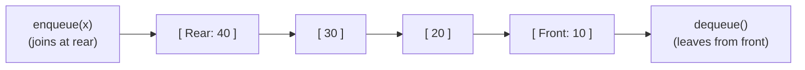
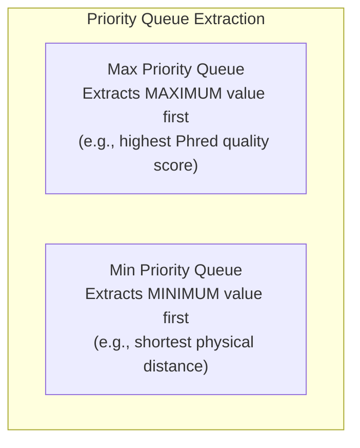

# Chapter 6: Queues (FIFO), Circular Queues, Deques, and Priority Queues

## 1. The Queue ADT: First-In, First-Out (FIFO)

A **Queue** is a linear data structure that follows the **First-In, First-Out (FIFO)** principle:
- The first element added is the first element removed.
- **Physical Analogy:** A line of people waiting at a pharmacy counter or a batch of sequencing jobs waiting for alignment on a server. New arrivals join the **rear (tail)**, and the person served first leaves from the **front (head)**.



### The Queue Contract

| Method | Behavior | Time Complexity |
| :--- | :--- | :---: |
| `enqueue(x)` | Appends item $x$ to the rear of the queue | $O(1)$ |
| `dequeue()` | Removes and returns the item at the front | $O(1)$ (with proper design) |
| `peek()` | Inspects front item without removing it | $O(1)$ |
| `isEmpty()` | Returns `true` if queue has 0 elements | $O(1)$ |
| `size()` | Returns current number of elements | $O(1)$ |

---

## 2. The Naive Array Queue Flaw: The $O(n)$ Dequeue Penalty

If you implement a queue with a standard array by appending at `arr[size++]`:
- `enqueue` is fast ($O(1)$).
- But `dequeue` removes `arr[0]`. To keep the remaining elements at the front of the array, you must **shift every remaining element one position to the left** ($O(n)$).
- Doing $n$ dequeues results in **$O(n^2)$ total work**, which is unacceptable.

---

## 3. The Circular Array Queue (Ring Buffer)

To eliminate shifting and achieve **$O(1)$ time for both enqueue and dequeue**, we allow the `front` and `rear` pointers to advance forward through the array. When a pointer hits the end of the array, it wraps back around to index 0 using the **modulo operator (`%`)**.

```mermaid
flowchart TD
    subgraph RingBuffer["Circular Array Concept (Capacity = 5)"]
        direction LR
        S0["Index 0\n[ 50 (Rear) ]"] --- S1["Index 1\n[ _ ]"]
        S1 --- S2["Index 2\n[ 20 (Front) ]"]
        S2 --- S3["Index 3\n[ 30 ]"]
        S3 --- S4["Index 4\n[ 40 ]"]
        S4 -.->|wraps around via (rear + 1) % 5| S0
    end
```

### The Modulo Wrap-Around Formulas
- Moving rear forward: `rear = (rear + 1) % capacity;`
- Moving front forward: `front = (front + 1) % capacity;`

### Disambiguating Full vs. Empty: The `count` Strategy
When `front == rear`, does it mean the queue is completely empty or completely full?
The easiest, most bulletproof way to avoid ambiguity on an exam is to maintain an explicit variable: `int count = 0;`.
- **Empty:** `count == 0`
- **Full:** `count == capacity`

### Complete Circular Queue Template
```java
public class CircularQueue {
    private int[] data;
    private int front;
    private int rear;
    private int count;
    private int capacity;

    public CircularQueue(int capacity) {
        this.capacity = capacity;
        this.data = new int[capacity];
        this.front = 0;
        this.rear = 0;
        this.count = 0;
    }

    public boolean enqueue(int val) {
        if (isFull()) {
            System.out.println("Queue Overflow: Queue is full");
            return false;
        }
        data[rear] = val;
        rear = (rear + 1) % capacity; // Wrap around to index 0 if at end
        count++;
        return true;
    }

    public int dequeue() {
        if (isEmpty()) {
            throw new RuntimeException("Queue Underflow: Queue is empty");
        }
        int removed = data[front];
        front = (front + 1) % capacity; // Advance front pointer
        count--;
        return removed;
    }

    public int peek() {
        if (isEmpty()) {
            throw new RuntimeException("Queue is empty");
        }
        return data[front];
    }

    public boolean isEmpty() {
        return count == 0;
    }

    public boolean isFull() {
        return count == capacity;
    }

    public int size() {
        return count;
    }
}
```

### Hand-Tracing a Circular Queue (Mock Exam 2 Style)
Suppose capacity = 5. Initially `front = 0`, `rear = 0`, `count = 0`. Array: `[ _, _, _, _, _ ]`.

| Operation | Value Stored at Index | `front` | `rear` | `count` | Array State |
| :--- | :---: | :---: | :---: | :---: | :--- |
| `enqueue(10)` | `data[0] = 10` | 0 | 1 | 1 | `[ 10, _, _, _, _ ]` |
| `enqueue(20)` | `data[1] = 20` | 0 | 2 | 2 | `[ 10, 20, _, _, _ ]` |
| `enqueue(30)` | `data[2] = 30` | 0 | 3 | 3 | `[ 10, 20, 30, _, _ ]` |
| `dequeue()` | Returns `data[0]` (10) | 1 | 3 | 2 | `[ _, 20, 30, _, _ ]` |
| `enqueue(40)` | `data[3] = 40` | 1 | 4 | 3 | `[ _, 20, 30, 40, _ ]` |
| `enqueue(50)` | `data[4] = 50` | 1 | 0 (wrapped!) | 4 | `[ _, 20, 30, 40, 50 ]` |
| `enqueue(60)` | `data[0] = 60` | 1 | 1 | 5 (FULL) | `[ 60, 20, 30, 40, 50 ]` |

---

## 4. Linked Queue: Dynamic Memory with Two Pointers

When capacity is unknown, a linked queue avoids fixed-size limitations:
- `head` pointer: points to front node (dequeue takes from here in $O(1)$).
- `tail` pointer: points to rear node (enqueue attaches here in $O(1)$).

```java
public class LinkedQueue {
    private static class Node {
        int val;
        Node next;
        Node(int val) { this.val = val; }
    }

    private Node head = null;
    private Node tail = null;
    private int size = 0;

    public void enqueue(int val) {
        Node newNode = new Node(val);
        if (isEmpty()) {
            head = tail = newNode;
        } else {
            tail.next = newNode;
            tail = newNode;
        }
        size++;
    }

    public int dequeue() {
        if (isEmpty()) throw new RuntimeException("Empty Queue");
        int val = head.val;
        head = head.next;
        if (head == null) tail = null; // List became empty
        size--;
        return val;
    }

    public boolean isEmpty() { return head == null; }
}
```

---

## 5. High-Yield Exam Applications

### Application 1: Reversing an Entire Queue Using a Stack
Because queues preserve order and stacks invert order, pouring a queue into a stack and back into the queue completely reverses it!

```java
public static void reverseQueue(java.util.Queue<Integer> q) {
    java.util.Stack<Integer> s = new java.util.Stack<>();

    // 1. Dequeue all elements into stack
    while (!q.isEmpty()) {
        s.push(q.remove());
    }

    // 2. Pop all elements back into queue
    while (!s.isEmpty()) {
        q.add(s.pop());
    }
}
```
- **Time Complexity:** $O(n)$
- **Space Complexity:** $O(n)$

### Application 2: Reversing the First $k$ Elements of a Queue
> **Problem:** Given a queue `[10, 20, 30, 40, 50]` and $k = 3$, reverse only the first 3 elements so the queue becomes `[30, 20, 10, 40, 50]`.

**Algorithm:**
1. Dequeue first $k$ elements and push them onto a stack.
2. Pop all elements from stack and enqueue them back to the queue (they are now at the rear in reversed order).
3. Dequeue the remaining $(n - k)$ elements from the front and immediately re-enqueue them at the rear!

```java
public static void reverseFirstK(java.util.Queue<Integer> q, int k) {
    if (q.isEmpty() || k <= 0 || k > q.size()) return;

    java.util.Stack<Integer> stack = new java.util.Stack<>();

    // 1. Push first k elements onto stack
    for (int i = 0; i < k; i++) {
        stack.push(q.remove());
    }

    // 2. Enqueue back from stack to rear
    while (!stack.isEmpty()) {
        q.add(stack.pop());
    }

    // 3. Move remaining (n - k) elements to the rear
    int remaining = q.size() - k;
    for (int i = 0; i < remaining; i++) {
        q.add(q.remove());
    }
}
```

---

## 6. Priority Queues & Heaps: Priority Over Arrival

Unlike a standard FIFO queue where elements exit by arrival time, a **Priority Queue (PQ)** removes elements based on **priority (key value)**.



### Core Operations
- `insert(x)`: Adds item $x$ ($\Theta(\log n)$ using binary heap).
- `extractMax()` or `extractMin()`: Removes and returns the highest priority item ($\Theta(\log n)$).
- `peek()`: Inspects highest priority item without removing it ($\Theta(1)$).

### Exam Tracing Rules
On midterm exams (such as Mock Exam 1 & Mock Exam 2), you will be asked to trace values exiting a PQ:
- In a **Max Priority Queue**, whenever you call `extractMax()`, scan all active items and remove the largest number.
- In a **Min Priority Queue**, whenever you call `extractMin()`, scan all active items and remove the smallest number.
