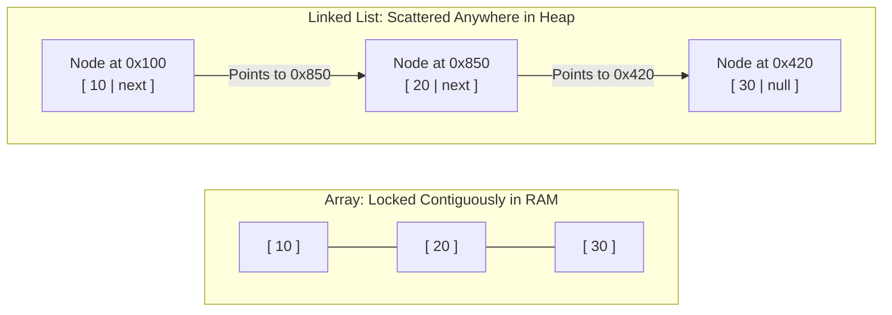
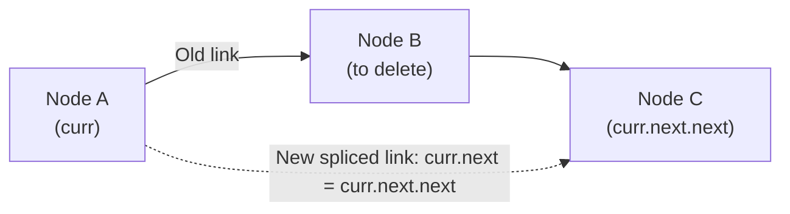
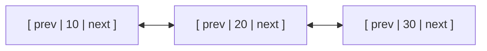

# Chapter 7: Linked Lists in Depth: Nodes, Pointers, and Invariants

## 1. Why Linked Lists? The Non-Contiguous Memory Model

In an array, all items must sit in contiguous (strictly adjacent) physical memory slots.
While this guarantees instantaneous $O(1)$ indexing, it has severe drawbacks:
1. Resizing requires allocating a brand-new array and copying all elements ($O(n)$).
2. Inserting or deleting at the front requires shifting every element downstream ($O(n)$).
3. If computer memory is fragmented into small chunks, allocating a 2 GB contiguous array may fail even if total free RAM exceeds 8 GB.

A **Linked List** completely abandons contiguous memory.
- Items are stored in independent memory containers called **Nodes**.
- Each node lives wherever free space exists in the Heap.
- Nodes are linked together into a sequence by storing the memory address of the next node (**the `next` pointer/reference**).



### The Train Car Metaphor
Think of freight train cars.
- Each car can carry cargo (`val`).
- Cars do not need to be manufactured in a single giant solid block of steel.
- Each car simply has a coupling hook (`next`) connected to the front of the next car.
- To insert a new car into the middle of a train, you don't need to rebuild or move the entire train; you simply uncouple one hook and attach two new hooks ($O(1)$ pointer splice).

---

## 2. Array vs. Linked List: The Fundamental Trade-Offs

| Property | Array (`int[]`) | Singly Linked List |
| :--- | :--- | :--- |
| **Physical Memory** | Contiguous block in RAM | Scattered Heap nodes connected by references |
| **Random Access (`get(i)`)** | **$O(1)$** (instant formula) | **$O(n)$** (must walk from head node-by-node) |
| **Insert / Delete at Front** | $O(n)$ (must shift all items) | **$O(1)$** (update head pointer) |
| **Insert / Delete at Tail** | $O(1)$ (if capacity exists) | $O(1)$ (with tail pointer), $O(n)$ (without) |
| **Insert / Delete in Middle** | $O(n)$ (shifting) | **$O(1)$** (once pointer to node is in hand) |
| **Memory Overhead** | Minimal (pure data) | High (extra 8-byte pointer per node) |
| **Binary Search Support** | **Yes** ($O(\log n)$) | **NO!** (cannot jump to middle in $O(1)$) |

---

## 3. Singly Linked List Mechanics

### The Node Class
```java
public class Node {
    public int val;     // The data payload
    public Node next;   // Reference to the next Node (null if last node)

    public Node(int val) {
        this.val = val;
        this.next = null;
    }

    public Node(int val, Node next) {
        this.val = val;
        this.next = next;
    }
}
```

### Traversal Pattern (The Standard Loop)
To visit every node in a linked list, start at `head` and advance until `curr == null`:

```java
public static void printList(Node head) {
    Node curr = head;
    while (curr != null) {
        System.out.print(curr.val + " -> ");
        curr = curr.next; // Advance to next node
    }
    System.out.println("null");
}
```

### Inserting at the Head ($O(1)$)
1. Create a new node.
2. Point `newNode.next` to the current `head`.
3. Update `head` to point to `newNode`.

```java
public static Node insertAtHead(Node head, int val) {
    Node newNode = new Node(val);
    newNode.next = head;
    head = newNode;
    return head;
}
```

### Deleting a Node by Value
To delete a node with target value:
- If target is at `head`: advance `head = head.next`.
- Otherwise, traverse using a pointer `curr`. Stop when `curr.next.val == target`.
- Splice around the node: `curr.next = curr.next.next;`.



---

## 4. The Sentinel (Dummy Head) Node: Eliminating Edge Cases

One of the biggest causes of bugs on coding exams is forgetting edge cases:
- Inserting into an empty list (`head == null`).
- Deleting the very first node (`head`).
- Updating the list when only 1 node exists.

**The Sentinel Technique:** Create a dummy node with dummy data (`new Node(-1)`) whose `next` points to the real `head`.
- Now, the list is **never empty**, and the real head is simply `dummy.next`!
- Every node in the list (even the first real node) now has a valid node before it.
- After operations finish, simply return `dummy.next`.

```java
public static Node deleteValueWithSentinel(Node head, int target) {
    Node dummy = new Node(-1);
    dummy.next = head;
    Node curr = dummy;

    while (curr.next != null) {
        if (curr.next.val == target) {
            curr.next = curr.next.next; // Delete node
            break; // Stop after first match
        } else {
            curr = curr.next;
        }
    }
    return dummy.next; // Return true head
}
```

---

## 5. Doubly Linked Lists: Two-Way Navigation

A **Doubly Linked List** adds a `prev` reference to every node:
- `next`: Points to subsequent node.
- `prev`: Points to preceding node.



### The Superpower of Doubly Linked Lists
If you are handed a direct reference to a `Node target`, you can delete it in **$O(1)$ time** without traversing from the head, because the node itself knows its predecessor:
```java
public static void deleteNode(Node target) {
    if (target.prev != null) target.prev.next = target.next;
    if (target.next != null) target.next.prev = target.prev;
}
```

---

## 6. High-Yield Exam Templates

### Template 1: Reversing a Singly Linked List (3-Pointer Dance)
> **Problem:** Reverse a linked list in-place in $O(n)$ time and $O(1)$ memory.

**Mental Model:** Maintain 3 pointers:
1. `prev` (tracks node behind, starts as `null`).
2. `curr` (current node being flipped, starts as `head`).
3. `next` (saves remaining list before we sever the link).

```java
public static Node reverseList(Node head) {
    Node prev = null;
    Node curr = head;

    while (curr != null) {
        Node nextTemp = curr.next; // 1. Save next node
        curr.next = prev;          // 2. Reverse arrow!
        prev = curr;               // 3. Move prev forward
        curr = nextTemp;           // 4. Move curr forward
    }
    return prev; // prev is now the new head!
}
```
- **Time Complexity:** $O(n)$.
- **Space Complexity:** $O(1)$.

---

### Template 2: Removing Duplicates from a Sorted Linked List (Mock Exam 2)
> **Problem:** Given a sorted linked list `1 -> 1 -> 2 -> 3 -> 3 -> null`, remove all duplicate values so each element appears only once.

**Algorithm:**
- While `curr != null && curr.next != null`:
  - If `curr.val == curr.next.val`: splice out `curr.next` (`curr.next = curr.next.next`). **Do NOT advance `curr`** (the newly connected node might also be a duplicate!).
  - Else: advance `curr = curr.next`.

```java
public static Node removeDuplicates(Node head) {
    Node curr = head;
    while (curr != null && curr.next != null) {
        if (curr.val == curr.next.val) {
            curr.next = curr.next.next; // Skip duplicate node
        } else {
            curr = curr.next;           // Advance only when values differ
        }
    }
    return head;
}
```
- **Time Complexity:** $O(n)$.
- **Space Complexity:** $O(1)$.

---

### Template 3: Merging Two Sorted Linked Lists (Real Exam 2023)
> **Problem:** Given two sorted lists `L1` and `L2`, merge them into a single sorted list without creating new nodes.

**Algorithm:**
- Use a `dummy` sentinel node.
- Compare `l1.val` and `l2.val`. Attach smaller node to `curr.next` and advance that list.
- When one list is exhausted, attach the remainder of the other list directly!

```java
public static Node mergeTwoLists(Node l1, Node l2) {
    Node dummy = new Node(-1);
    Node curr = dummy;

    while (l1 != null && l2 != null) {
        if (l1.val <= l2.val) {
            curr.next = l1;
            l1 = l1.next;
        } else {
            curr.next = l2;
            l2 = l2.next;
        }
        curr = curr.next;
    }

    // Attach remaining elements
    if (l1 != null) curr.next = l1;
    if (l2 != null) curr.next = l2;

    return dummy.next;
}
```
- **Time Complexity:** $O(n + m)$ where $n, m$ are the lengths of the two lists.
- **Space Complexity:** $O(1)$ auxiliary (reuses existing nodes).

---

### Template 4: Detecting Cycles (Floyd's Tortoise and Hare)
> **Problem:** Determine if a linked list contains a loop (cycle).

**Algorithm:**
- Send two pointers: `slow` moves 1 step at a time, `fast` moves 2 steps at a time.
- If `fast` or `fast.next` hits `null`, there is no cycle.
- If there is a cycle, `fast` will eventually lap `slow` and they will point to the exact same node (`slow == fast`).

```java
public static boolean hasCycle(Node head) {
    if (head == null || head.next == null) return false;

    Node slow = head;
    Node fast = head;

    while (fast != null && fast.next != null) {
        slow = slow.next;         // 1 step
        fast = fast.next.next;    // 2 steps

        if (slow == fast) {
            return true; // Cycle detected!
        }
    }
    return false; // Reached end of list; no cycle
}
```
- **Time Complexity:** $O(n)$.
- **Space Complexity:** $O(1)$.
