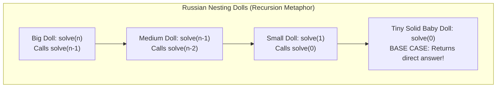
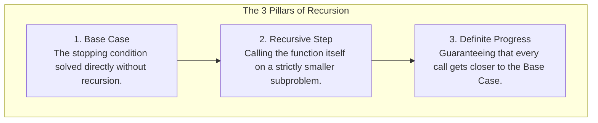
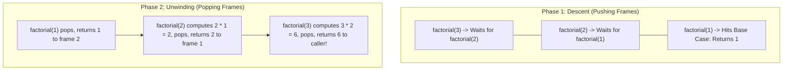
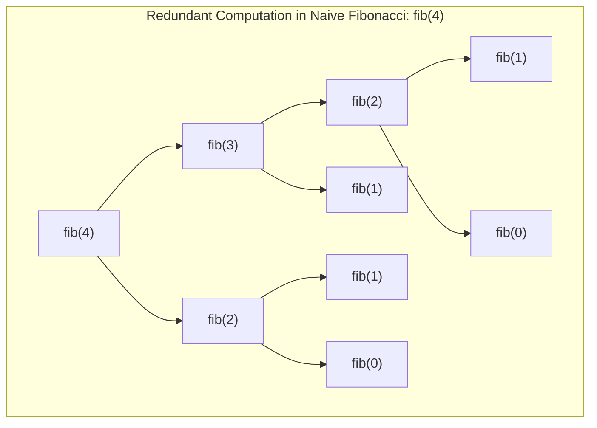
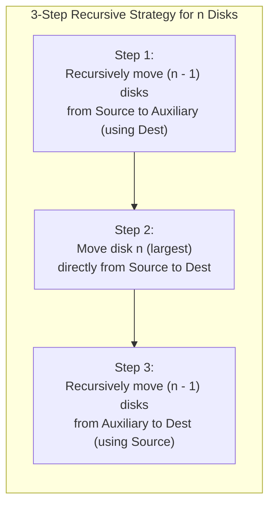

# Chapter 8: Recursion & The Call-Stack Mechanics

## 1. The Recursive Mental Model: Self-Similarity and Contracts

**Recursion** is a technique where a method solves a larger problem by calling itself to solve smaller instances of the exact same problem.



### The Matryoshka (Russian Doll) Metaphor
Imagine opening a wooden nesting doll. Inside, you find an identical doll, only slightly smaller. You keep opening dolls until you reach the smallest, solid baby doll. That baby doll cannot be opened further (the **Base Case**). You then put the wooden shells back together in reverse order, returning to the outside.

### The Contract Mindset
When writing or reading a recursive method on an exam:
1. **Define the Contract:** Clearly state what `solve(input)` promises to return.
2. **Trust the Subproblem:** Assume `solve(smallerInput)` **already works correctly**.
3. **Combine:** Ask yourself: *"If someone gives me the solution to the smaller input, how do I compute the solution for the current input?"*

---

## 2. The Three Mandatory Rules of Recursion

Every valid recursive algorithm must fulfill three rules:



- If you omit the base case, or if the recursive call does not reduce the problem size (e.g., calling `f(n)` instead of `f(n - 1)`), the program loops forever until the JVM runs out of call stack memory and crashes with a **`StackOverflowError`**.

---

## 3. Under the Hood: The JVM Call Stack

How does the computer keep track of all these nested calls?
Every time a Java method is called, the JVM creates a **Stack Frame** (activation record) on top of the **Call Stack**.

### What Lives Inside a Stack Frame?
1. The method's parameters (e.g., `n = 3`).
2. Local variables.
3. The return address (where to jump back to when this method completes).



### Execution Has Two Distinct Phases:
1. **Descent (Diving Down):** Pushing frames onto the Call Stack until the base case is reached.
2. **Unwinding (Bubbling Up):** Popping frames off the Call Stack in reverse order, calculating return values and returning them to the caller.

---

## 4. Classic Recursive Examples & Walkthroughs

### Example 1: Factorial ($n!$)
Mathematical definition:
- Base case: $0! = 1$
- Recursive step: $n! = n \times (n - 1)!$

```java
public static int factorial(int n) {
    // 1. Base Case
    if (n <= 1) {
        return 1;
    }
    // 2. Recursive Step with definite progress (n - 1)
    return n * factorial(n - 1);
}
```
- **Time Complexity:** $O(n)$ — makes $n$ total calls.
- **Space Complexity:** $O(n)$ — creates $n$ stack frames simultaneously.

---

### Example 2: Fibonacci Numbers — The Exponential Danger
Mathematical definition:
- $F(0) = 0, \quad F(1) = 1$
- $F(n) = F(n - 1) + F(n - 2)$

```java
public static int fib(int n) {
    if (n == 0) return 0;
    if (n == 1) return 1;
    return fib(n - 1) + fib(n - 2); // 2 recursive branches!
}
```



### Why Naive Fibonacci is $O(2^n)$
Every single call branches into two sub-calls. Notice how `fib(2)` is computed multiple times independently!
- **Call Tree Shape:** Binary tree of depth $n$.
- **Total Calls:** Approximately $2^n$ calls $\implies$ **Exponential $O(2^n)$ time**.
- For $n = 50$, naive recursion takes days. An iterative loop or dynamic programming array solves it in $O(n)$ time!

---

### Example 3: Binary Search (Recursive Implementation)
```java
public static int binarySearchRecursive(int[] arr, int target, int low, int high) {
    // Base Case 1: Search region exhausted
    if (low > high) {
        return -1;
    }

    int mid = low + (high - low) / 2;

    // Base Case 2: Target found
    if (arr[mid] == target) {
        return mid;
    }

    // Recursive Step: Search appropriate half
    if (arr[mid] < target) {
        return binarySearchRecursive(arr, target, mid + 1, high);
    } else {
        return binarySearchRecursive(arr, target, low, mid - 1);
    }
}
```
- **Time Complexity:** $O(\log_2 n)$.
- **Space Complexity:** $O(\log_2 n)$ auxiliary space on the Call Stack.

---

## 5. Towers of Hanoi: The Masterclass in Recursion

### The Problem
You have 3 pegs: **Source ($S$)**, **Destination ($D$)**, and **Auxiliary ($A$)**.
There are $n$ disks of varying sizes stacked on $S$, sorted by size with the smallest disk on top.
- **Rules:**
  1. Only one disk can be moved at a time.
  2. A larger disk may never be placed on top of a smaller disk.
  3. Move all $n$ disks from $S$ to $D$ using $A$.



### The Java Code
```java
public class Hanoi {
    public static void solveHanoi(int n, char source, char dest, char aux) {
        // Base Case: 1 disk can be moved directly
        if (n == 1) {
            System.out.println("Move disk 1 from " + source + " to " + dest);
            return;
        }

        // Step 1: Move top n - 1 disks from source to aux peg
        solveHanoi(n - 1, source, aux, dest);

        // Step 2: Move the nth (largest) disk directly to dest
        System.out.println("Move disk " + n + " from " + source + " to " + dest);

        // Step 3: Move the n - 1 disks from aux to dest peg
        solveHanoi(n - 1, aux, dest, source);
    }
}
```

### Tracing $n = 3$ Disks (Total $2^3 - 1 = 7$ Moves)
1. Move disk 1 from S to D
2. Move disk 2 from S to A
3. Move disk 1 from D to A
4. Move disk 3 from S to D *(Largest disk reaches final destination!)*
5. Move disk 1 from A to S
6. Move disk 2 from A to D
7. Move disk 1 from S to D

### Complexity Analysis
- **Recurrence Relation:** $T(n) = 2T(n - 1) + 1$
- **Total Moves:** $2^n - 1$ moves.
- **Time Complexity:** $\Theta(2^n)$ (Exponential).
- **Space Complexity:** $\Theta(n)$ (maximum depth of Call Stack).
