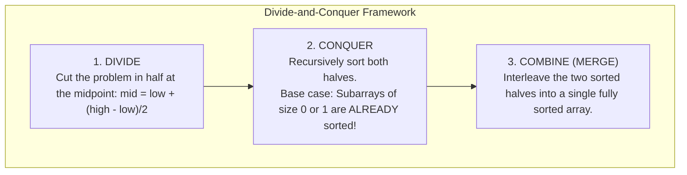
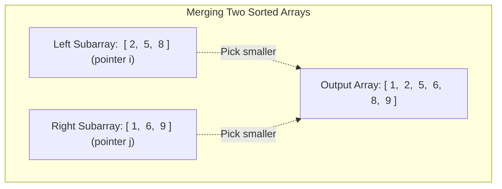
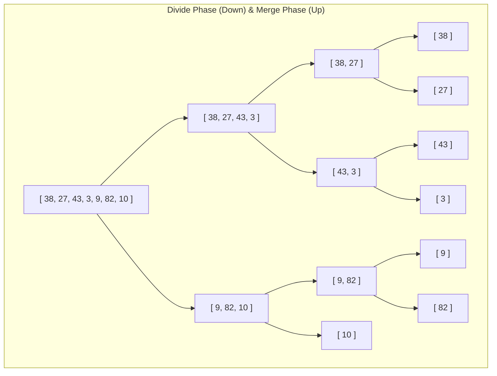

# Chapter 9: Merge Sort: The Divide-and-Conquer Masterclass

## 1. The Divide-and-Conquer Paradigm

Elementary sorting algorithms (Bubble, Selection, Insertion) have quadratic $\Theta(n^2)$ worst-case running times. If you have $10{,}000{,}000$ sequencing reads, an $O(n^2)$ algorithm would take hours or days.

To break past the quadratic barrier, computer science uses the **Divide-and-Conquer** strategy:



In Merge Sort:
- The **Divide** step is effortless (just calculating `mid`).
- The **Conquer** step is recursive.
- The **Combine (Merge)** step does all the actual heavy lifting!

---

## 2. The Core Merging Engine: Interleaving Two Sorted Halves in $O(n)$

### The Two Card Piles Metaphor
Imagine you are holding two piles of lab assay cards. Both piles are **already sorted** in ascending order:
- Pile $L$: `[2, 5, 8]`
- Pile $R$: `[1, 6, 9]`

How do you merge them into a single sorted pile?
1. Look at the top card of both piles: compare $2$ and $1$.
2. Take the smaller card ($1$ from Pile $R$), place it face down in the output pile, and expose the next card in Pile $R$ ($6$).
3. Compare $2$ and $6$. Take $2$, place it in output.
4. Repeat until one pile is empty, then pour all remaining cards from the other pile directly into the output!



Because every comparison places at least one element into its final position, merging two subarrays of total size $n$ takes strictly **$O(n)$ linear time**.

---

## 3. Merge Implementations: Standard vs. Sentinel Method

### Method 1: Standard Two-Pointer Merge (Recommended for Exams)
This is the most intuitive and robust implementation to write by hand on an exam:

```java
public static void merge(int[] arr, int low, int mid, int high) {
    // 1. Calculate lengths of left and right subarrays
    int n1 = mid - low + 1;
    int n2 = high - mid;

    // 2. Allocate temporary scratchpad arrays
    int[] left = new int[n1];
    int[] right = new int[n2];

    // 3. Copy data to temporary arrays
    for (int i = 0; i < n1; i++) left[i] = arr[low + i];
    for (int j = 0; j < n2; j++) right[j] = arr[mid + 1 + j];

    // 4. Interleave elements back into arr[low..high]
    int i = 0, j = 0, k = low;
    while (i < n1 && j < n2) {
        if (left[i] <= right[j]) { // '<=' ensures stability!
            arr[k] = left[i];
            i++;
        } else {
            arr[k] = right[j];
            j++;
        }
        k++;
    }

    // 5. Copy any remaining elements of left[]
    while (i < n1) {
        arr[k++] = left[i++];
    }

    // 6. Copy any remaining elements of right[]
    while (j < n2) {
        arr[k++] = right[j++];
    }
}
```

### Method 2: The Sentinel Method (CLRS & Class Exercise)
In the CLRS textbook (taught in Session 5), to avoid writing the leftover cleanup `while` loops, a **Sentinel value** ($\infty$, represented by `Integer.MAX_VALUE`) is placed at the end of both temporary arrays.

Because $\infty$ is larger than any real number, when one array runs out of real elements, the comparison `left[i] <= right[j]` will naturally pick all remaining elements from the other array:

```java
public static void mergeSentinel(int[] arr, int low, int mid, int high) {
    int n1 = mid - low + 1;
    int n2 = high - mid;

    // Allocate arrays with +1 slot for sentinel
    int[] left = new int[n1 + 1];
    int[] right = new int[n2 + 1];

    for (int i = 0; i < n1; i++) left[i] = arr[low + i];
    for (int j = 0; j < n2; j++) right[j] = arr[mid + 1 + j];

    // Place sentinels at the ends
    left[n1] = Integer.MAX_VALUE;
    right[n2] = Integer.MAX_VALUE;

    int i = 0, j = 0;
    for (int k = low; k <= high; k++) {
        if (left[i] <= right[j]) {
            arr[k] = left[i++];
        } else {
            arr[k] = right[j++];
        }
    }
}
```

---

## 4. The Complete Merge Sort Method

The recursive sorting method itself is remarkably short and elegant:

```java
public static void mergeSort(int[] arr, int low, int high) {
    // Base Case: If subarray has 0 or 1 element, it is already sorted!
    if (low >= high) {
        return;
    }

    // 1. Divide: Find midpoint (preventing overflow)
    int mid = low + (high - low) / 2;

    // 2. Conquer: Recursively sort left and right halves
    mergeSort(arr, low, mid);
    mergeSort(arr, mid + 1, high);

    // 3. Combine: Merge the two sorted halves together
    merge(arr, low, mid, high);
}
```

---

## 5. Visualizing the Recursion Tree

Trace on array `[38, 27, 43, 3, 9, 82, 10]` ($n = 7$):



### Unwinding and Merging Back Up:
- `[38]` and `[27]` merge $\implies [27, 38]$
- `[43]` and `[3]` merge $\implies [3, 43]$
- `[27, 38]` and `[3, 43]` merge $\implies [3, 27, 38, 43]$
- `[9]` and `[82]` merge $\implies [9, 82]$
- `[9, 82]` and `[10]` merge $\implies [9, 10, 82]$
- Final merge: `[3, 27, 38, 43]` and `[9, 10, 82]` $\implies [3, 9, 10, 27, 38, 43, 82]$

---

## 6. Mathematical Analysis & Invariants

### 1. Why Time Complexity is $\Theta(n \log_2 n)$ in ALL Cases
- **Tree Depth:** Each step cuts array size in half: $n \to n/2 \to n/4 \to \dots \to 1$. The depth of the recursion tree is strictly **$\log_2 n$ levels**.
- **Work Per Level:** At any single level of the tree, merging all the subarrays at that level touches every element in the array once $\implies \mathbf{O(n)}$ work per level.
- **Total Work:** $(\text{Levels}) \times (\text{Work per level}) = \log_2 n \times n = \mathbf{\Theta(n \log_2 n)}$.
- **No Best or Worst Case Variation:** Unlike Quick Sort or Bubble Sort, Merge Sort divides blindly in half and merges every single time. Its best, average, and worst cases are all strictly **$\Theta(n \log n)$**.

### 2. Space Complexity: Why Merge Sort Needs $\Theta(n)$ Auxiliary Space
Unlike Bubble Sort, Selection Sort, or Insertion Sort which run in-place ($O(1)$ space), Merge Sort requires temporary arrays (`left[]` and `right[]`) to hold values during merging.
- Total extra memory allocated at the widest merge step is equal to $n$.
- Thus, **Auxiliary Space Complexity is $\Theta(n)$**.

### 3. Stability Proof
Merge Sort is **Stable** as long as you use `left[i] <= right[j]` in the merge loop.
- When two values are equal, the tie is broken by taking the element from `left[]` first.
- Since elements in `left[]` originally appeared before elements in `right[]`, their original relative order is preserved.
