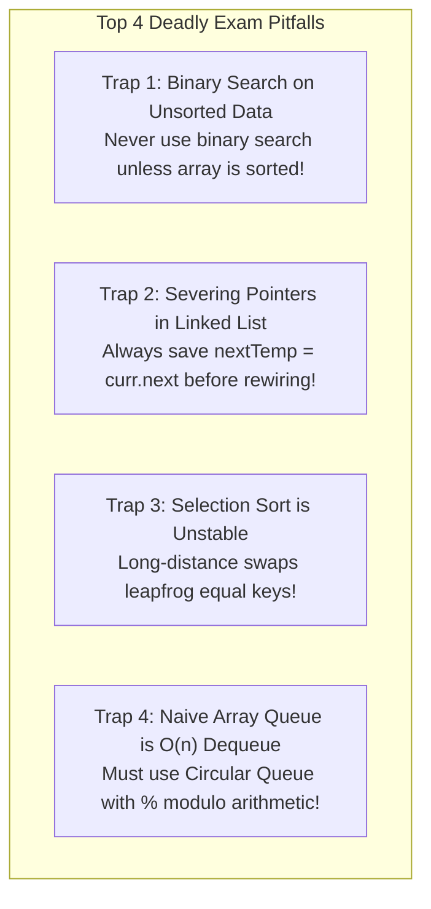
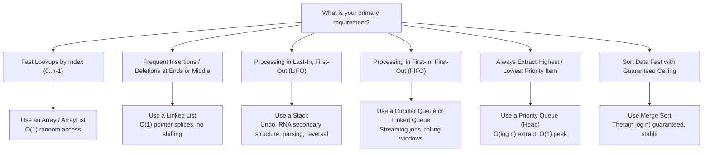

# Chapter 10: Midterm Synthesis, Master Tables, and Decision Trees

## 1. Master Complexity Reference Tables

### Table 1: Sorting Algorithms Side-by-Side
| Algorithm | Best Time | Average Time | Worst Time | Comparisons (Worst) | Swaps / Shifts (Worst) | Auxiliary Space | Stable? | When to Use |
| :--- | :---: | :---: | :---: | :---: | :---: | :---: | :---: | :--- |
| **Bubble Sort (Early Exit)** | $\Theta(n)$ | $\Theta(n^2)$ | $\Theta(n^2)$ | $\frac{n(n-1)}{2}$ | $\frac{n(n-1)}{2}$ swaps | $O(1)$ | **Yes** | Academic tracing; nearly sorted data. |
| **Selection Sort** | $\Theta(n^2)$ | $\Theta(n^2)$ | $\Theta(n^2)$ | $\frac{n(n-1)}{2}$ | **$n - 1$ swaps** | $O(1)$ | **NO** | When writing to memory is extremely slow/expensive. |
| **Insertion Sort** | $\Theta(n)$ | $\Theta(n^2)$ | $\Theta(n^2)$ | $\frac{n(n-1)}{2}$ | $\frac{n(n-1)}{2}$ shifts | $O(1)$ | **Yes** | Small lists ($n < 20$) or **nearly-sorted datasets**. |
| **Merge Sort** | $\Theta(n \log n)$ | $\Theta(n \log n)$ | $\Theta(n \log n)$ | $\approx n \log_2 n$ | Merging buffer | **$\Theta(n)$** | **Yes** | Large datasets where guaranteed $O(n \log n)$ is needed. |

---

### Table 2: Searching Algorithms Side-by-Side
| Algorithm | Best Time | Worst Time | Space | Preconditions / Requirements |
| :--- | :---: | :---: | :---: | :--- |
| **Linear Search** | $\Theta(1)$ | $\Theta(n)$ | $O(1)$ | Works on completely unsorted data. |
| **Sentinel Linear Search** | $\Theta(1)$ | $\Theta(n)$ | $O(1)$ | Saves boundary comparisons by planting target at index $n$. |
| **Binary Search (Iterative)** | $\Theta(1)$ | $\Theta(\log n)$ | $O(1)$ | **Must be SORTED and support $O(1)$ indexing (Arrays).** |
| **Binary Search (Recursive)** | $\Theta(1)$ | $\Theta(\log n)$ | $\Theta(\log n)$ | Consumes call stack frames. |
| **First / Last Occurrence** | $\Theta(\log n)$ | $\Theta(\log n)$ | $O(1)$ | Handles duplicate elements in sorted arrays. |

---

### Table 3: Linear Data Structures Side-by-Side
| Data Structure | Access `get(i)` | Insert at Front | Insert at End | Delete at Front | Delete at End | Search Value | Space Overhead |
| :--- | :---: | :---: | :---: | :---: | :---: | :---: | :--- |
| **Static Array (`int[]`)** | **$O(1)$** | $O(n)$ | $O(1)$ (if open) | $O(n)$ | $O(1)$ | $O(n)$ | Zero pointer overhead |
| **Dynamic Array (`ArrayList`)**| **$O(1)$** | $O(n)$ | **$O(1)$ amortized**| $O(n)$ | $O(1)$ | $O(n)$ | Occasional resize copying |
| **Singly Linked List (no tail)**| $O(n)$ | **$O(1)$** | $O(n)$ | **$O(1)$** | $O(n)$ | $O(n)$ | 1 pointer (`next`) per node |
| **Singly Linked List (with tail)**| $O(n)$ | **$O(1)$** | **$O(1)$** | **$O(1)$** | $O(n)$ | $O(n)$ | 1 pointer per node + tail |
| **Doubly Linked List** | $O(n)$ | **$O(1)$** | **$O(1)$** | **$O(1)$** | **$O(1)$** | $O(n)$ | 2 pointers (`prev`, `next`) |
| **Array Stack (LIFO)** | Top: $O(1)$ | Push: $O(1)$ | — | Pop: $O(1)$ | — | $O(n)$ | Fixed capacity |
| **Circular Queue (FIFO)** | Front: $O(1)$| Enqueue: $O(1)$| — | Dequeue: $O(1)$| — | $O(n)$ | Modulo arithmetic |

---

## 2. The 10 Classic Midterm Traps Exposed

These 10 mistakes account for the vast majority of lost marks on DSA exams. Memorize them to avoid falling into them:

1. **The Binary Search Unsorted Trap:**
   - Attempting binary search on unsorted data gives wrong answers. If data is unsorted, either use linear search ($O(n)$) or sort first ($O(n \log n)$).
2. **The Integer Overflow Mid Trap:**
   - Writing `int mid = (low + high) / 2;` overflows when `low + high > 2,147,483,647`.
   - **Fix:** Always write `int mid = low + (high - low) / 2;`.
3. **The Selection Sort Instability Trap:**
   - Selection sort is **unstable** because swapping the global minimum with `arr[i]` can cause equal elements to leapfrog over each other (e.g., `[2a, 2b, 1]` becomes `[1, 2b, 2a]`).
4. **The Naive Array Queue Dequeue Penalty:**
   - Removing from index 0 of an array requires shifting $n - 1$ items left ($O(n)$). A true queue must be either a **Circular Array (Ring Buffer)** using `% capacity` or a **Linked Queue**.
5. **The Lost Pointer in Linked List Insertion:**
   - When inserting node `N` between `A` and `B`:
     - Wrong: `A.next = N; N.next = A.next;` (You just lost `B` forever!).
     - Correct: First connect `N.next = A.next;` then connect `A.next = N;`.
6. **The Premature Advancement Trap in Deduplication:**
   - When deleting duplicates in a sorted linked list: if you delete `curr.next`, **do not advance `curr = curr.next` in that same iteration**! The newly connected neighbor may also be a duplicate.
7. **The Missing Base Case in Recursion:**
   - Forgetting `if (n <= 1) return ...;` causes infinite recursion and throws `StackOverflowError`.
8. **The Object Equality Trap in Java (`==` vs. `.equals()`):**
   - In Java, `==` compares **memory addresses**, not contents!
   - `s1 == s2` checks if they are the exact same object in the Heap.
   - `s1.equals(s2)` checks if the text contents match.
9. **The Postfix Operator Operand Inversion:**
   - In postfix evaluation:
     - First popped item is the **right operand** (`b = stack.pop()`).
     - Second popped item is the **left operand** (`a = stack.pop()`).
     - For subtraction and division, compute `a - b` and `a / b` (NOT `b - a` or `b / a`!).
10. **The Circular Queue Capacity Disambiguation:**
    - When `front == rear`, the queue could be completely empty OR completely full.
    - **Fix:** Maintain an explicit `int count = 0;` variable to know immediately.

---

## 3. Algorithmic Decision Tree: What Should You Use?

Use this decision tree when answering exam design questions:

---

## 4. Midterm Tracing Templates

When asked to trace an algorithm step-by-step on an exam, use these clean formats on your exam paper:

### Tracing Selection Sort (Min-to-Front)
| Pass $i$ | Unsorted Region | Index of Min | Swap Operation | Array State After Pass |
| :---: | :---: | :---: | :---: | :--- |
| **0** | `[ 5, 2, 4, 1 ]` | 3 (val: 1) | Swap `arr[0]` (5) with `arr[3]` (1) | `[ 1 | 2, 4, 5 ]` |
| **1** | `[ 2, 4, 5 ]` | 1 (val: 2) | Swap `arr[1]` (2) with `arr[1]` (2) | `[ 1, 2 | 4, 5 ]` |
| **2** | `[ 4, 5 ]` | 2 (val: 4) | Swap `arr[2]` (4) with `arr[2]` (4) | `[ 1, 2, 4 | 5 ]` |

### Tracing Insertion Sort
| Pass $i$ | `key` | Comparisons with Sorted Hand | Elements Shifted Right | Array State After Insertion |
| :---: | :---: | :---: | :---: | :--- |
| **1** | 2 | Compare with 5 ($5 > 2$) | 5 shifts to index 1 | `[ 2, 5 | 4, 1 ]` |
| **2** | 4 | Compare with 5 ($5 > 4$), compare with 2 ($2 < 4$) | 5 shifts to index 2 | `[ 2, 4, 5 | 1 ]` |
| **3** | 1 | Compare with 5, 4, 2 (all larger) | 5, 4, 2 all shift right | `[ 1, 2, 4, 5 ]` |

### Tracing Circular Queue Operations
| Operation | Value | `front` | `rear` | `count` | Array Contents `[0, 1, 2, 3]` |
| :--- | :---: | :---: | :---: | :---: | :--- |
| Initial | — | 0 | 0 | 0 | `[ _, _, _, _ ]` |
| `enqueue(10)` | 10 | 0 | 1 | 1 | `[ 10, _, _, _ ]` |
| `enqueue(20)` | 20 | 0 | 2 | 2 | `[ 10, 20, _, _ ]` |
| `dequeue()` | Returns 10 | 1 | 2 | 1 | `[ _, 20, _, _ ]` |
| `enqueue(30)` | 30 | 1 | 3 | 2 | `[ _, 20, 30, _ ]` |
| `enqueue(40)` | 40 | 1 | 0 (wrap!) | 3 | `[ _, 20, 30, 40 ]` |
| `enqueue(50)` | 50 | 1 | 1 (wrap!) | 4 (Full) | `[ 50, 20, 30, 40 ]` |
