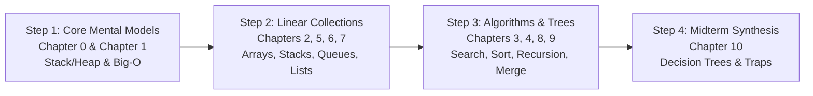

# Data Structures and Algorithms: Midterm Review Master Guide (v02)

## A First-Principles, Intuitive Reference for Bioinformaticians and Non-Java Programmers
### Covering Curriculum from Week 00 through Week 06 (Recursion & Merge Sort)

---

## 1. Overview & Design Philosophy

This guide is tailored specifically for bioinformaticians, computational biologists, and researchers coming from Python/R who need a clear, rigorous understanding of Data Structures and Algorithms (DSA) without getting bogged down in low-level Java boilerplate.

Rather than presenting dry mathematical proofs or language-specific trivia, this v02 review book emphasizes:
1. **Physical Computer Memory Models:** Understanding the difference between contiguous RAM blocks (Arrays) and scattered Heap objects (Linked Lists, Nodes, Objects).
2. **Computational Scaling:** Why algorithm complexity determines whether an analysis on a 3-billion-base human genome completes in 3 seconds ($O(n)$) or takes centuries ($O(n^2)$).
3. **Biological Analogies:** Mapping abstract concepts directly to sequencing reads, chromosome coordinates, RNA secondary structures, and alignment pipelines.
4. **Copy-Pasteable Exam Templates:** Minimal, straightforward Java templates without confusing generics or unnecessary object-oriented hierarchies.
5. **How Each Algorithm Works:** Step-by-step mechanical explanations and hand-tracing walkthroughs for exam questions.

---

## 2. Chapter Directory & Table of Contents

The complete handbook is divided into modular, focused chapter documents:

| Part / Chapter | Document Link | Core Topics & Focus Areas |
| :--- | :--- | :--- |
| **Chapter 0** | [chapter-00_preface-java-mental-models.md](file:///home/ht2905/projects/dsa-java-2026/midterm-review/review-guide/chapters/chapter-00_preface-java-mental-models.md) | Java vs. Python/R, Stack (workbench) vs. Heap (storage), Primitive vs. Reference semantics ("Cash vs. Warehouse Address"), Minimal Java syntax survival kit. |
| **Chapter 1** | [chapter-01_algorithm-analysis-and-asymptotics.md](file:///home/ht2905/projects/dsa-java-2026/midterm-review/review-guide/chapters/chapter-01_algorithm-analysis-and-asymptotics.md) | Why wall-clock time lies (RAM model), Growth hierarchy ($O(1)$ to $O(2^n)$), Big-O / Omega / Theta (Ceiling, Floor, Tight Bound), How to analyze code loops, Maximum Subarray Sum (3 generations). |
| **Chapter 2** | [chapter-02_arrays-and-memory-contiguity.md](file:///home/ht2905/projects/dsa-java-2026/midterm-review/review-guide/chapters/chapter-02_arrays-and-memory-contiguity.md) | Contiguous RAM layout (96-well plate metaphor), $O(1)$ address formula, Array shifting penalties on insert/delete, Static vs. Dynamic arrays (`ArrayList`), High-yield array templates. |
| **Chapter 3** | [chapter-03_searching-and-sliding-windows.md](file:///home/ht2905/projects/dsa-java-2026/midterm-review/review-guide/chapters/chapter-03_searching-and-sliding-windows.md) | Linear search vs. Sentinel linear search, Binary search step-by-step mechanics, Safe midpoint calculation without overflow, First and last occurrence variants, Fixed-width sliding windows ($O(1)$ update). |
| **Chapter 4** | [chapter-04_elementary-sorting-algorithms.md](file:///home/ht2905/projects/dsa-java-2026/midterm-review/review-guide/chapters/chapter-04_elementary-sorting-algorithms.md) | Stability concept & why it matters to data integrity, Bubble Sort (early-exit optimization), Selection Sort (min-to-front vs. max-to-end; why it is unstable), Insertion Sort (card player's algorithm; ascending vs. descending), Master sorting comparison table. |
| **Chapter 5** | [chapter-05_stacks-and-monotonic-stacks.md](file:///home/ht2905/projects/dsa-java-2026/midterm-review/review-guide/chapters/chapter-05_stacks-and-monotonic-stacks.md) | Stack ADT (LIFO), Array stack vs. Linked stack, Balanced parentheses & RNA secondary stem-loop matching, Reversing sequences, Postfix evaluation, Sorting a stack with one auxiliary stack, Min-Stack. |
| **Chapter 6** | [chapter-06_queues-and-deques.md](file:///home/ht2905/projects/dsa-java-2026/midterm-review/review-guide/chapters/chapter-06_queues-and-deques.md) | Queue ADT (FIFO), The naive array queue shifting flaw, Circular array ring buffer with modulo arithmetic (`%`), Linked queues with head and tail pointers, Reversing queues and first $k$ elements, Priority Queue & Heap tracing. |
| **Chapter 7** | [chapter-07_linked-lists-in-depth.md](file:///home/ht2905/projects/dsa-java-2026/midterm-review/review-guide/chapters/chapter-07_linked-lists-in-depth.md) | Non-contiguous memory (train car metaphor), Array vs. Linked list trade-offs, Singly linked list operations, The Sentinel (Dummy Head) pattern, Doubly linked lists ($O(1)$ deletion), High-yield templates (reversal, deduplication, merging two sorted lists, cycle detection). |
| **Chapter 8** | [chapter-08_recursion-and-call-stack.md](file:///home/ht2905/projects/dsa-java-2026/midterm-review/review-guide/chapters/chapter-08_recursion-and-call-stack.md) | Russian nesting doll metaphor, The 3 Pillars of Recursion, JVM call stack frames (descent vs. unwinding), StackOverflowError, Factorial, Fibonacci tree redundancy, Recursive binary search, Towers of Hanoi walkthrough. |
| **Chapter 9** | [chapter-09_merge-sort-divide-and-conquer.md](file:///home/ht2905/projects/dsa-java-2026/midterm-review/review-guide/chapters/chapter-09_merge-sort-divide-and-conquer.md) | Divide-and-Conquer strategy, The merging engine (two sorted card piles), Standard merge vs. Sentinel merge (CLRS), Full recursion tree trace, $\Theta(n \log n)$ proof, $\Theta(n)$ auxiliary space explanation, Stability proof. |
| **Chapter 10** | [chapter-10_midterm-synthesis-and-decision-trees.md](file:///home/ht2905/projects/dsa-java-2026/midterm-review/review-guide/chapters/chapter-10_midterm-synthesis-and-decision-trees.md) | Master complexity matrices (sorting, searching, data structures), The 10 Classic Midterm Traps Exposed, Algorithmic decision trees, Clean hand-tracing templates for exam sheets. |

---

## 3. Recommended Exam Study Pathway

1. **Quick Conceptual Alignment:** Start with [Chapter 10](file:///home/ht2905/projects/dsa-java-2026/midterm-review/review-guide/chapters/chapter-10_midterm-synthesis-and-decision-trees.md) to review the master complexity tables and the 10 classic midterm traps.
2. **Algorithm Mechanics & Tracing:** Review [Chapter 4](file:///home/ht2905/projects/dsa-java-2026/midterm-review/review-guide/chapters/chapter-04_elementary-sorting-algorithms.md) and [Chapter 9](file:///home/ht2905/projects/dsa-java-2026/midterm-review/review-guide/chapters/chapter-09_merge-sort-divide-and-conquer.md) for step-by-step sorting traces.
3. **Pointers & Data Structures:** Review [Chapter 5](file:///home/ht2905/projects/dsa-java-2026/midterm-review/review-guide/chapters/chapter-05_stacks-and-monotonic-stacks.md), [Chapter 6](file:///home/ht2905/projects/dsa-java-2026/midterm-review/review-guide/chapters/chapter-06_queues-and-deques.md), and [Chapter 7](file:///home/ht2905/projects/dsa-java-2026/midterm-review/review-guide/chapters/chapter-07_linked-lists-in-depth.md) for stack/queue algorithms, circular buffer math, and linked list pointer splicing.
