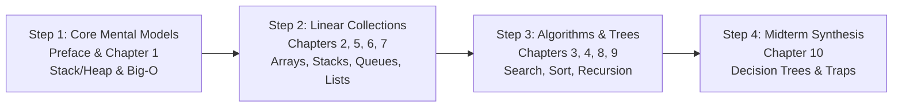

# Data Structures and Algorithms: Midterm Review Master Guide

## A First-Principles, Intuitive Reference for Bioinformaticians and Non-Java Programmers
### Covering Curriculum from Week 00 through Week 06 (Recursion & Merge Sort)

---

## Overview & Design Philosophy

This guide is tailored specifically for bioinformaticians, computational biologists, and researchers coming from Python/R who need a clear, rigorous understanding of Data Structures and Algorithms (DSA) without getting bogged down in low-level Java boilerplate.

Rather than presenting dry mathematical proofs or language-specific trivia, this material emphasizes:
1. **Physical Computer Memory Models:** Understanding the difference between contiguous RAM blocks (Arrays) and scattered Heap objects (Linked Lists, Nodes, Objects).
2. **Computational Scaling:** Why algorithm complexity determines whether an analysis on a 3-billion-base human genome completes in 3 seconds ($O(n)$) or takes centuries ($O(n^2)$).
3. **Biological Analogies:** Mapping abstract concepts directly to sequencing reads, chromosome coordinates, RNA secondary structures, and alignment pipelines.
4. **Readability & CLRS Standards:** Prioritizing clean, self-documenting code following Cormen, Leiserson, Rivest, Stein (CLRS) conventions.

---

## Chapter Directory & Table of Contents

The complete handbook is divided into modular, focused chapter documents:

| Part / Chapter | Document Link | Core Topics & Invariants |
| :--- | :--- | :--- |
| **Preface** | [`chapter-00_preface-java-mental-models.md`](midterm-review/chapter-00_preface-java-mental-models.md) | Java vs. Python/R, Stack vs. Heap, Reference Semantics ("Street Address" analogy), Minimal Java anatomy. |
| **Chapter 1** | [`chapter-01_algorithm-analysis-and-asymptotics.md`](midterm-review/chapter-01_algorithm-analysis-and-asymptotics.md) | RAM model, Growth hierarchy, Big-O / Omega / Theta ceilings and floors, Amortized analysis, Maximum Subsequence Sum (4 Generations). |
| **Chapter 2** | [`chapter-02_arrays-and-memory-contiguity.md`](midterm-review/chapter-02_arrays-and-memory-contiguity.md) | Contiguous memory addressing, Array shifting penalties, Homopolymers, Suffix maximums, Bitwise XOR missing number, Contribution technique. |
| **Chapter 3** | [`chapter-03_searching-and-sliding-windows.md`](midterm-review/chapter-03_searching-and-sliding-windows.md) | Linear search, Binary search invariant & overflow safety, First/Last occurrences, Fixed windows, Two-pointer caterpillar, Monotonicity trap. |
| **Chapter 4** | [`chapter-04_elementary-sorting-algorithms.md`](midterm-review/chapter-04_elementary-sorting-algorithms.md) | Loop invariants, Sorting stability on biological metadata, Bubble Sort (early exit), Selection Sort (flash writes), Insertion Sort (nearly-sorted data), Java `Comparable`. |
| **Chapter 5** | [`chapter-05_stacks-and-monotonic-stacks.md`](midterm-review/chapter-05_stacks-and-monotonic-stacks.md) | Stack ADT (LIFO), Fixed vs. Linked stacks, Sequence reversal, RNA secondary structure & delimiter matching, Postfix evaluation, Min-Stack, Monotonic Stacks ($O(n)$ amortized). |
| **Chapter 6** | [`chapter-06_queues-and-deques.md`](midterm-review/chapter-06_queues-and-deques.md) | Queue ADT (FIFO), Naive array queue shifting flaw, Circular array ring buffers (`%`), Linked queues with tail pointers, Deques, Monotonic Deque for sliding window maximum. |
| **Chapter 7** | [`chapter-07_linked-lists-in-depth.md`](midterm-review/chapter-07_linked-lists-in-depth.md) | Non-contiguous node memory, Singly linked lists, Sentinel node pattern (`SLList`), Doubly linked lists ($O(1)$ node removal), Cycle detection (Floyd's Tortoise and Hare), Why binary search fails on linked lists. |
| **Chapter 8** | [`chapter-08_recursion-and-call-stack.md`](midterm-review/chapter-08_recursion-and-call-stack.md) | Contract mental model, The 3 Pillars (Base, Recursive, Progress), JVM call stack frames, Call descent vs. return ascent unwinding, 64-bit integer overflow, Towers of Hanoi. |
| **Chapter 9** | [`chapter-09_merge-sort-divide-and-conquer.md`](midterm-review/chapter-09_merge-sort-divide-and-conquer.md) | Divide-Conquer-Combine paradigm, Linear merging engine (Sentinel method vs. Standard), Complete recursion tree walkthrough, $\Theta(n \log n)$ proof, $\Theta(n)$ auxiliary space, Stability proof. |
| **Chapter 10** | [`chapter-10_midterm-synthesis-and-decision-trees.md`](midterm-review/chapter-10_midterm-synthesis-and-decision-trees.md) | Master complexity tables (Sorting, Searching, Arrays, Collections), 10 Classic Midterm Traps Exposed, Algorithmic Technique Decision Trees, Course Glossary. |

---

## Executive Summaries by Chapter

### [Preface: Java Survival Kit & Mental Models](midterm-review/chapter-00_preface-java-mental-models.md)
- **Mental Shift:** Java's static typing and class structure enforce deterministic memory allocation and C-like speed via JIT compilation.
- **Reference Semantics:** Primitive variables hold direct values (cash in hand). Object variables hold 64-bit memory addresses (street address written on a card). Passing an object reference shares the address, not a clone.
- **Memory Split:** Fast, transient Call Stack (method frames, local variables) vs. large, shared Heap (objects, arrays, managed by Garbage Collection).

### [Chapter 1: Algorithm Analysis & Asymptotics](midterm-review/chapter-01_algorithm-analysis-and-asymptotics.md)
- **RAM Model:** Evaluates operational steps independent of hardware clock speeds.
- **Asymptotic Envelope:** Big-O is an upper ceiling ($T(n) \le c \cdot g(n)$); Big-Omega is a lower floor ($T(n) \ge c \cdot g(n)$); Big-Theta is a tight envelope matching both.
- **Amortized Analysis:** `ArrayList` doubling costs $O(n)$ occasionally, but averages $O(1)$ amortized across $n$ operations.
- **Four Generations:** Demonstrates moving from $O(n^3)$ brute force to $O(n)$ Kadane's algorithm for maximum subarray sum.

### [Chapter 2: Arrays & Memory Contiguity](midterm-review/chapter-02_arrays-and-memory-contiguity.md)
- **Address Arithmetic:** $a[i] = \text{Base} + i \times S$ enables instantaneous $O(1)$ indexed reads.
- **Shifting Cost:** Inserting or deleting at the front requires shifting downstream elements, costing $O(n)$ like a frameshift mutation.
- **Patterns:** Explores homopolymer block counting, reverse suffix precomputation, bitwise XOR cancellation for missing numbers, and mathematical contribution for subarray sums.

### [Chapter 3: Searching, Two Pointers & Sliding Windows](midterm-review/chapter-03_searching-and-sliding-windows.md)
- **Binary Search Invariant:** Target guaranteed within `[low, high]`. Safe midpoint calculation: `low + (high - low) / 2`.
- **First/Last Occurrence:** Continue searching left/right even after finding a candidate match to resolve duplicates in $O(\log n)$.
- **Sliding Window:** Subtract outgoing element and add incoming element to update sums in $O(1)$ per shift.
- **Monotonicity Precondition:** The two-pointer caterpillar requires all non-negative numbers ($arr[i] \ge 0$). If negative values exist, use Prefix Sums + Hash Map.

### [Chapter 4: Elementary Sorting Algorithms](midterm-review/chapter-04_elementary-sorting-algorithms.md)
- **Sorting Invariants:** Bubble locks the largest at the right end; Selection locks the smallest at the left end; Insertion keeps the left prefix sorted unto itself.
- **Stability:** Stable sorts preserve relative order of equal keys (essential for genomic coordinate sorting). Selection Sort is unstable due to long-distance swaps.
- **Algorithm Niches:** Insertion Sort dominates nearly-sorted data ($\Theta(n)$); Selection Sort minimizes memory writes ($O(n)$ swaps total).

### [Chapter 5: Stacks & Monotonic Stacks](midterm-review/chapter-05_stacks-and-monotonic-stacks.md)
- **LIFO Contract:** `push`, `pop`, `peek` in $\Theta(1)$ constant time.
- **Applications:** Delimiter matching mirrors nested RNA hairpin stem loops ($A-U$, $G-C$). Postfix arithmetic removes operator precedence ambiguities.
- **Monotonic Stacks:** Resolves Next Greater Element in $O(n)$ amortized time because each element index is pushed and popped at most once.

### [Chapter 6: Queues, Circular Queues & Deques](midterm-review/chapter-06_queues-and-deques.md)
- **FIFO Contract:** First in, first out. Naive array queue has an $O(n)$ dequeue shifting penalty.
- **Circular Queue (Ring Buffer):** Uses modular arithmetic (`%`) to wrap pointers in $O(1)$ without memory shifting.
- **Monotonic Deque:** Computes maximums in sliding windows of width $k$ in $O(n)$ amortized time by discarding elements that can never become the maximum.

### [Chapter 7: Linked Lists in Depth](midterm-review/chapter-07_linked-lists-in-depth.md)
- **Non-Contiguous Nodes:** Elements linked by 64-bit reference pointers. Eliminates memory fragmentation and array resize copying.
- **Sentinel Pattern (`SLList`):** Dummy header node eliminates null-pointer branch checks.
- **Doubly Linked Lists:** Bidirectional links permit $O(1)$ detachment of any known node without predecessor traversal.
- **Key Exam Trap:** Binary search is impossible on linked lists ($O(n)$ midpoint traversal breaks logarithmic halving).

### [Chapter 8: Recursion & Call-Stack Mechanics](midterm-review/chapter-08_recursion-and-call-stack.md)
- **Contract Thinking:** Assume smaller recursive calls succeed; focus only on combining results with the current step.
- **Three Pillars:** Base Case, Recursive Step, Definite Progress.
- **Stack Frames:** Call descent consumes $O(\text{depth})$ stack memory; return ascent propagates values upward during unwinding.
- **64-bit Overflow:** Factorials exceed signed 64-bit `long` capacity past $n = 20$.

### [Chapter 9: Merge Sort Masterclass](midterm-review/chapter-09_merge-sort-divide-and-conquer.md)
- **Divide-Conquer-Combine:** Subarray halving until size 1, followed by linear merging.
- **Universal $\Theta(n \log n)$:** Recursion tree depth is $\log_2 n$ levels, each doing $c \cdot n$ merging work, regardless of input distribution.
- **Memory & Stability:** Requires $\Theta(n)$ auxiliary scratch array memory. Stability is guaranteed by the `<=` merge comparison rule.

### [Chapter 10: Midterm Synthesis & Decision Trees](midterm-review/chapter-10_midterm-synthesis-and-decision-trees.md)
- **Synthesis Tables:** Complete side-by-side matrices comparing sorting, searching, and collection complexities.
- **10 Midterm Traps:** Direct refutations of common misconceptions (e.g., nested loops, linked list binary search, tail deletions, recursion speed).
- **Decision Trees:** Visual Mermaid workflows for choosing the optimal data structure and algorithmic technique under exam constraints.

---

## Recommended Exam Study Pathway

1. **Fast Conceptual Review:** Start directly with [Chapter 10](midterm-review/chapter-10_midterm-synthesis-and-decision-trees.md) to inspect the Decision Trees and the 10 Midterm Traps.
2. **Deep Algorithmic Preparation:** Review [Chapter 3 (Searching & Windows)](midterm-review/chapter-03_searching-and-sliding-windows.md) and [Chapter 9 (Merge Sort)](midterm-review/chapter-09_merge-sort-divide-and-conquer.md) to master linear-time window invariants and divide-and-conquer trees.
3. **Memory & Pointer Mechanics:** Review [Preface](midterm-review/chapter-00_preface-java-mental-models.md), [Chapter 5](midterm-review/chapter-05_stacks-and-monotonic-stacks.md), and [Chapter 7](midterm-review/chapter-07_linked-lists-in-depth.md) for stack frame lifecycles, sentinel nodes, and pointer manipulation patterns.
