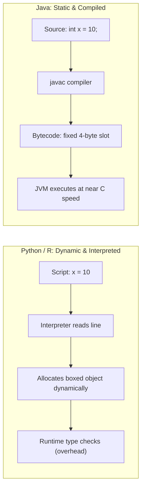
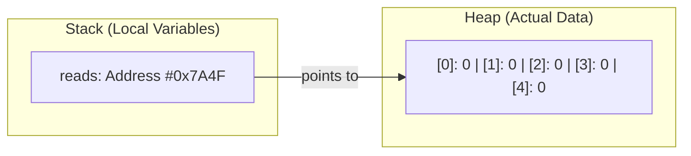
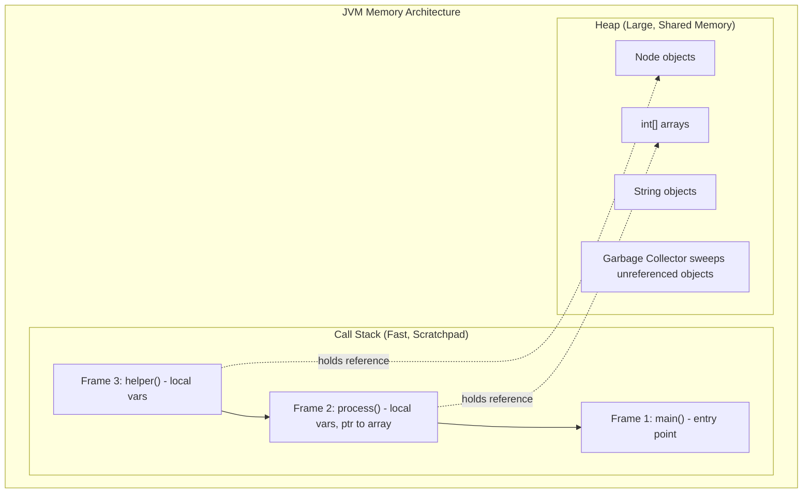

# Preface: Java Survival Kit and Mental Models for Bioinformaticians

## 1.1 Why Bioinformaticians Need Data Structures and Algorithms

In bioinformatics, daily workflows revolve around massive biological datasets:
- Hundreds of millions of short reads in FASTQ files from Illumina platforms.
- Millions of genomic variants cataloged in VCF files.
- Protein structures with tens of thousands of atomic coordinates from PDB.
- High-throughput RNA-seq expression matrices spanning thousands of single cells.

When writing high-level scripts in Python or R using libraries like `pandas`, `Biopython`, or `GenomicRanges`, the underlying memory management and computational mechanics are hidden behind convenient abstractions. However, when an analysis script takes days to finish because of an unintended quadratic loop ($O(n^2)$), or crashes a high-performance computing node with an out-of-memory error because arrays are duplicated silently, biological research hits a computational wall.

Data Structures and Algorithms (DSA) provides the mechanical understanding of how data sits in physical computer memory and how computational procedures scale.

### Bioinformatics Mental Anchors

The fundamental structures of DSA map directly to everyday biological computing:

| DSA Concept | Biological / Bioinformatics Equivalent |
| :--- | :--- |
| **Array** | A contiguous chromosome strand stored in indexed physical coordinates (`chr1:1000..2000`). |
| **Sliding Window** | A rolling reading frame or sliding window calculating GC-content across a genome. |
| **Stack** | RNA secondary structure folding, where hairpin loops and stems follow strict nested base-pairing ($A-U$, $G-C$). |
| **Queue** | An alignment pipeline buffer where incoming sequencing reads wait in arrival order for an aligner worker thread. |
| **Linked List** | Overlapping sequence contigs in an assembly graph connected by directed references. |
| **Recursion and Merge Sort** | Divide-and-conquer de novo assembly, sorting millions of reads by coordinate in $O(n \log n)$ time. |

---

## 1.2 Java vs. Python/R: The Mental Shift

Coming from Python or R, Java often feels rigid and verbose. However, this verbosity exists because Java forces explicit specification of memory layout and types before execution.



### Core Differences

| Concept | Python / R | Java | Purpose in Java |
| :--- | :--- | :--- | :--- |
| **Type System** | Dynamic (`x = 10`, later `x = "ATCG"`) | Static (`int x = 10;`, `String s = "ATCG";`) | The compiler determines the exact byte size of every variable before the program runs. |
| **Execution** | Interpreted line by line | Compiled to bytecode (`.class`), executed on the JVM | Just-In-Time (JIT) compilation produces optimized machine code approaching C performance. |
| **Array Sizing** | Resizes automatically (`list.append(x)`) | Fixed size upon creation (`new int[10]`) | Eliminates hidden memory allocations and forces conscious resource allocation. |
| **Syntax** | Indentation-sensitive, minimal punctuation | Braces `{}` define blocks; semicolons `;` terminate statements | Code structure is explicit to the parser, independent of whitespace. |
| **Structure** | Script-based or functional | Class-based (every function belongs to a class) | Modular encapsulation and predictable memory references. |

---

## 1.3 Anatomy of a Minimal Java Program

In Java, code cannot run as a standalone script. Every executable program requires a class definition and an explicit entry-point method:

```java
// File name must match the class name exactly: HelloDsa.java
public class HelloDsa {

    // The entry point: the JVM looks specifically for this method signature
    public static void main(String[] args) {
        // System.out.println prints a line to standard output
        System.out.println("Data Structures and Algorithms for Bioinformaticians");
    }
}
```

### Keyword Deconstruction

1. `public`: Accessible from any class or package in the project.
2. `class HelloDsa`: In Java, a class defines the blueprint for data and behavior. Think of it like a plasmid vector map or a GFF annotation specification.
3. `static`: The method belongs to the class itself, not to a specific instantiated object. The JVM can call `main()` immediately without creating an instance.
4. `void`: The method returns no value to the caller upon completion.
5. `main(String[] args)`: The entry-point identifier. `String[] args` holds command-line arguments passed to the application (such as file paths to a FASTA input).

---

## 1.4 Primitives vs. Object References: The "Street Address" Analogy

Understanding the distinction between primitive values and object references is essential for debugging Java programs.

### 1. Primitive Types (Direct Storage)

Java provides primitive types that store values directly in their assigned memory slots:
- `int`: 32-bit signed integer (approx. $-2 \times 10^9$ to $+2 \times 10^9$).
- `long`: 64-bit signed integer (approx. $-9 \times 10^{18}$ to $+9 \times 10^{18}$). Used for large sequence coordinates or totals exceeding 2 billion.
- `double`: 64-bit floating-point number (used for ratios, probabilities, and p-values).
- `boolean`: `true` or `false`.

When declaring `int count = 42;`, the raw binary representation of `42` is placed directly in the memory slot named `count`.

### 2. Object References (Address Pointers)

Every non-primitive entity in Java—including arrays (`int[]`), strings (`String`), and custom classes—is an **Object**.

When declaring an array:
```java
int[] reads = new int[5];
```

The variable `reads` does **not** hold the 5 numbers. Instead, `reads` stores a 64-bit reference address pointing to a location on the Heap where the 5 integers reside.



### The Address Analogy

- **A primitive variable** is like cash in your wallet: you carry the physical value directly.
- **An object reference** is like an address written on a card: *"Lab 302, Building B"*.
- If you pass an array to a method (`processReads(reads)`), you do not copy the array. You pass the card with the address written on it. If the method changes a value at that address (`reads[0] = 99;`), the original data at that location changes permanently.

---

## 1.5 Memory Architecture: The JVM Call Stack vs. The Heap

The Java Virtual Machine organizes memory into two primary regions:



### The Call Stack
- Manages active function execution in Last-In, First-Out (LIFO) order.
- Each function call creates an isolated **Stack Frame** storing method arguments and local primitive variables.
- When the method finishes execution, its stack frame is discarded immediately.
- Memory allocation here is fast, but space is limited (typically 1 to 2 MB). Excessive recursive depth exhausts this region and triggers a `StackOverflowError`.

### The Heap
- Holds all objects and arrays instantiated with `new`.
- Objects remain alive as long as at least one active reference in a stack frame or another object points to them.
- When all references to an object are dropped, the Java **Garbage Collector (GC)** eventually reclaims that memory automatically.

---

## 1.6 How Java Allocates Arrays

In Java, an array is an object holding a fixed number of elements of a single uniform type:

```java
// Allocation of an integer array of size 4
int[] reads = new int[4];
reads[0] = 100;
reads[1] = 250;
reads[2] = 80;
reads[3] = 410;

// Length property: note that .length is an attribute, not a method
int n = reads.length; // n is 4

// Direct literal initialization
int[] bases = {2, 5, 8, 12};
```

### Fundamental Array Rules
1. **Zero-Indexed:** The first element is `reads[0]`, and the last is `reads[n - 1]`.
2. **Bounds Checking:** Accessing `reads[-1]` or `reads[4]` terminates execution with an `ArrayIndexOutOfBoundsException`.
3. **Fixed Size:** Once created, an array cannot expand or shrink. To store additional elements, a new, larger array must be allocated, and existing elements copied over manually or via `System.arraycopy()`.
