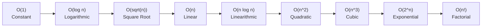
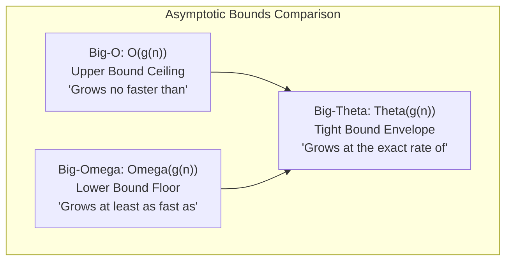

# Chapter 1: Algorithm Analysis, Asymptotics, and Growth Rates

## 2.1 The Philosophy: Program = Algorithms + Data Structures

In 1976, computer scientist Niklaus Wirth published the classic book *Algorithms + Data Structures = Programs*.
- A **Data Structure** is the architectural layout of data in physical computer memory.
- An **Algorithm** is the step-by-step procedure of computational operations designed to solve a problem by manipulating that data.

A high-performance algorithm running on an ill-suited data structure will be slow. Similarly, an optimal data structure is ineffective if navigated by a slow or naive algorithm.

---

## 2.2 Why Wall-Clock Time Lies: The RAM Computational Model

Why can't we simply benchmark two programs using a stopwatch or `System.currentTimeMillis()`?
Wall-clock runtime is unreliable for theoretical evaluation because it depends on external variables:
1. Processor architecture and clock speed (comparing a supercomputer to a laptop).
2. Background operating system activities (compiler jobs, file system I/O, other processes).
3. Programming language runtime overhead and JIT compiler optimizations.
4. Specific input characteristics (whether test data is already sorted or reversed).

To evaluate algorithms objectively, computer science uses the **Random Access Machine (RAM) Model**:
- We assume a standardized single-processor machine.
- Each **primitive operation** executes in **1 constant time unit ($O(1)$)**:
  - Arithmetic operations (`+`, `-`, `*`, `/`, `%`)
  - Value comparisons (`<`, `>`, `==`, `<=`, `>=`)
  - Variable assignments (`x = y`)
  - Direct array indexing (`a[i]`)
- Algorithm runtime $T(n)$ is expressed as a mathematical function of the **input size $n$** (such as the number of sequence reads, base pairs, or table records).

---

## 2.3 The Hierarchy of Growth Rates

As the input size $n$ increases, the fastest-growing term dictates the overall performance. The standard complexity hierarchy in DSA is:

$$O(1) < O(\log n) < O(\sqrt{n}) < O(n) < O(n \log n) < O(n^2) < O(n^3) < O(2^n) < O(n!)$$



### Computational Impact at Biological Scale

Assuming a standard processor executing approximately $10^9$ primitive operations per second (1 GHz):

| Complexity Class | Common Name | $n = 100$ | $n = 1{,}000$ (Gene fragment) | $n = 10^6$ (Bacterial genome) | $n = 3 \times 10^9$ (Human genome) |
| :--- | :--- | :---: | :---: | :---: | :---: |
| $O(1)$ | Constant | $1\text{ ns}$ | $1\text{ ns}$ | $1\text{ ns}$ | $1\text{ ns}$ |
| $O(\log_2 n)$ | Logarithmic | $7\text{ ns}$ | $10\text{ ns}$ | $20\text{ ns}$ | $32\text{ ns}$ |
| $O(\sqrt{n})$ | Square Root | $10\text{ ns}$ | $32\text{ ns}$ | $1\ \mu\text{s}$ | $55\ \mu\text{s}$ |
| $O(n)$ | Linear | $100\text{ ns}$ | $1\ \mu\text{s}$ | $1\text{ ms}$ | $3\text{ seconds}$ |
| $O(n \log_2 n)$ | Linearithmic | $664\text{ ns}$ | $10\ \mu\text{s}$ | $20\text{ ms}$ | $95\text{ seconds}$ |
| $O(n^2)$ | Quadratic | $10\ \mu\text{s}$ | $1\text{ ms}$ | $16.7\text{ minutes}$ | $\approx 285\text{ years}$ |
| $O(n^3)$ | Cubic | $1\text{ ms}$ | $1\text{ second}$ | $\approx 31{,}700\text{ years}$ | Impractical |
| $O(2^n)$ | Exponential | $4 \times 10^{13}\text{ years}$ | Impractical | Impractical | Impractical |

### Bioinformatics Perspective
- Scanning a human genome of 3 billion bases with an $O(n)$ linear scan requires only a few seconds.
- An $O(n^2)$ all-versus-all pairwise comparison across the entire human genome requires roughly $9 \times 10^{18}$ operations, which would take centuries without indexing, heuristic filters (like BLAST seeds), or divide-and-conquer strategies.

---

## 2.4 Asymptotic Notations: Big-O, Big-Omega, and Big-Theta

Rather than focusing on low-level arithmetic, asymptotic notation describes how an algorithm behaves as the dataset grows arbitrarily large.



### 1. Big-O Notation ($O$): The Asymptotic Upper Bound ("Ceiling")
- **Conceptual Meaning:** An upper bound on the growth rate. It guarantees that the function will not grow faster than a constant multiple of $g(n)$ once $n$ is large enough.
- **Plain English:** *"In the worst-case scaling, the algorithm's work is capped by $g(n)$."*
- **Example:** If $T(n) = 4n^2 + 7n + 15$, the dominant term is $n^2$. Thus, $T(n) = O(n^2)$. It is also mathematically true that $T(n) = O(n^3)$, because $n^3$ acts as a valid upper ceiling, but $O(n^2)$ is the tightest informative ceiling.

### 2. Big-Omega Notation ($\Omega$): The Asymptotic Lower Bound ("Floor")
- **Conceptual Meaning:** A lower bound on the growth rate. The function grows at least as fast as a constant multiple of $g(n)$ for large inputs.
- **Plain English:** *"The algorithm requires at least $g(n)$ operations; it cannot perform asymptotically better than this floor."*
- **Example:** Searching an unsorted array of size $n$ for an arbitrary key requires checking every position in the worst case, so any general linear search is $\Omega(n)$.

### 3. Big-Theta Notation ($\Theta$): The Asymptotically Tight Bound ("Envelope")
- **Conceptual Meaning:** When a function is simultaneously bounded above by $O(g(n))$ and below by $\Omega(g(n))$, it belongs to $\Theta(g(n))$.
- **Plain English:** *"The algorithm scales at the exact same rate as $g(n)$, within constant factor multipliers."*
- **Relation:** $T(n) = \Theta(g(n))$ if and only if $T(n) = O(g(n))$ and $T(n) = \Omega(g(n))$.

### 4. Little-o Notation ($o$): Strict Upper Bound
- **Conceptual Meaning:** An upper bound where the function grows strictly slower than the bounding function.
- **Example:** $5n = o(n^2)$ because $n$ is strictly eclipsed by $n^2$ as $n \to \infty$. However, $5n^2$ is not $o(n^2)$ because they grow at the same quadratic rate.

---

## 2.5 Input Cases: Best, Average, Worst, and Amortized Time

It is important not to confuse the **nature of the input** with the **asymptotic notation**:

- **Best-Case:** The minimum number of steps executed on the most favorable possible input of size $n$ (for example, finding a search target located at index 0 on the first check).
- **Worst-Case:** The maximum number of steps executed on the most adversarial input of size $n$ (for example, searching for an element not present in the array). This provides an absolute upper performance guarantee.
- **Average-Case:** The expected number of steps averaged over all probable inputs of size $n$, assuming a given probability distribution (such as uniform randomness).
- **Amortized Time:** The average cost per operation over a long sequence of operations, even when an occasional single step is expensive.

### Amortized Example: Dynamic Array Expansion (`ArrayList`)

In Java, an `ArrayList` starts with a default fixed capacity (e.g., 4 slots). When elements are added:
1. When empty capacity remains, inserting takes $O(1)$ constant time.
2. When the internal array fills up, a new array of double the size ($2 \times \text{capacity}$) is allocated, and all existing elements are copied over. This single resize takes $O(n)$ time.
3. Because capacity doubled, the next $n$ insertions are guaranteed to take $O(1)$ without resizing.

Across $n$ continuous insertions:
- The total copying work during all intermediate doublings sums to:
  $$\text{Copying Work} = \frac{n}{2} + \frac{n}{4} + \frac{n}{8} + \dots + 1 < n$$
- Combining the $n$ regular insertions with the $< n$ total resize copies gives $< 2n$ total operations.
- The average cost per insertion is therefore $\frac{2n}{n} = O(1)$ **amortized** time.

---

## 2.6 Space Complexity: Stored Data vs. Auxiliary Space vs. Call Stack

When evaluating memory usage, DSA exams distinguish between three memory categories:

1. **Input Data Space:** The memory required to hold the initial input dataset (for example, an array of $n$ sequence reads occupies $\Theta(n)$ memory).
2. **Auxiliary Space:** The **extra** temporary memory allocated by the algorithm itself to perform computation, excluding input and output buffers:
   - An algorithm that uses only a few primitive loop counters runs in $O(1)$ auxiliary space (**in-place**).
   - An algorithm that allocates an extra buffer of size $n$ to store intermediate calculations uses $O(n)$ auxiliary space.
3. **Call-Stack Space:** Memory consumed on the JVM call stack by active recursive function calls. A recursive routine that reaches depth $n$ uses $\Theta(n)$ stack space.

---

## 2.7 Rules for Counting Loops from Code

### Rule 1: The Rule of Sums (Consecutive Blocks)
When code blocks execute consecutively, sum their runtimes and keep the dominant term:
```java
for (int i = 0; i < n; i++) { /* O(1) step */ } // O(n)
for (int j = 0; j < m; j++) { /* O(1) step */ } // O(m)
// Total Time: O(n + m). If n == m, this is O(2n) = O(n).
```

### Rule 2: The Rule of Products (Nested Loops)
When an inner loop executes completely for every step of an outer loop, multiply the iterations:
```java
for (int i = 0; i < n; i++) {          // runs n times
    for (int j = 0; j < m; j++) {      // runs m times per outer iteration
        doConstantWork();              // O(1)
    }
}
// Total Time: n * m * O(1) = O(n * m)
```

### Rule 3: Triangular Nested Loops
When the inner loop boundary depends on the outer loop index:
```java
for (int i = 0; i < n; i++) {
    for (int j = 0; j < i; j++) {
        doConstantWork();
    }
}
```
The inner loop executes $0 + 1 + 2 + \dots + (n - 1)$ times:
$$\text{Total Iterations} = \frac{n(n - 1)}{2} = \frac{n^2 - n}{2} = \Theta(n^2)$$

### Rule 4: Halving or Doubling Loops
When a loop index doubles or halves at each step:
```java
int count = 0;
while (n > 1) {
    n = n / 2;
    count++;
}
```
The number of times $n$ can be divided by 2 before reaching 1 is $\lfloor \log_2 n \rfloor$. The runtime is strictly $O(\log n)$.

### Rule 5: Amortized Two-Pointer Loops
A nested loop does **not** automatically indicate an $O(n^2)$ algorithm:
```java
int right = 0;
for (int left = 0; left < n; left++) {
    while (right < n && condition(left, right)) {
        right++; // right only advances forward!
    }
}
```
Although `while` is nested inside `for`, `right` starts at 0 and is **only incremented forward**. Over the entire execution of the program, `right` increments at most $n$ times. The outer loop executes $n$ times.
$$\text{Total Operations} \le n \text{ (left advances)} + n \text{ (right advances)} = 2n = O(n)$$

---

## 2.8 Case Study: Maximum Contiguous Subsequence Sum (The 4 Generations)

This classic problem illustrates how changing algorithmic paradigms reduces computational bottlenecks from cubic to linear time.

**Problem Definition:** Given an array of integers (including negative values), find the maximum sum of any contiguous subarray. If all numbers are negative, the maximum sum is defined as 0.

Example: For `[-2, 11, -4, 13, -5, -2]`, the maximum contiguous sum is $11 + (-4) + 13 = 20$.

### Generation 1: Brute Force All Subarrays ($O(n^3)$)
Enumerate every starting index `i`, every ending index `j`, and recalculate the sum from `i` to `j` using a third loop:
```java
public static int maxSubsequenceSumGen1(int[] a) {
    int maxSum = 0;
    int n = a.length;
    for (int i = 0; i < n; i++) {
        for (int j = i; j < n; j++) {
            int thisSum = 0;
            for (int k = i; k <= j; k++) {
                thisSum += a[k]; // 3rd nested loop
            }
            if (thisSum > maxSum) {
                maxSum = thisSum;
            }
        }
    }
    return maxSum; // Time: O(n^3), Auxiliary Space: O(1)
}
```

### Generation 2: Incremental Running Sum ($O(n^2)$)
The sum of elements from index `i` to `j` is simply `(sum from i to j - 1) + a[j]`. Recomputing from index `i` each time is redundant:
```java
public static int maxSubsequenceSumGen2(int[] a) {
    int maxSum = 0;
    int n = a.length;
    for (int i = 0; i < n; i++) {
        int thisSum = 0;
        for (int j = i; j < n; j++) {
            thisSum += a[j]; // Reuse previous sub-sum
            if (thisSum > maxSum) {
                maxSum = thisSum;
            }
        }
    }
    return maxSum; // Time: O(n^2), Auxiliary Space: O(1)
}
```

### Generation 3: Divide and Conquer ($O(n \log n)$)
Divide the array at the midpoint `mid`. The maximum subarray lies either:
1. Entirely in the left half (solved recursively).
2. Entirely in the right half (solved recursively).
3. Straddling across the midpoint (computed in linear time $O(n)$ by finding the maximum suffix on the left and the maximum prefix on the right).

Recurrence relation:
$$T(n) = 2T(n/2) + O(n) \implies T(n) = O(n \log n)$$

### Generation 4: Kadane's Algorithm ($O(n)$ - Linear Time)
**Key Insight:** A maximum contiguous subsequence will never have a prefix with a negative sum. If the running sum `thisSum` drops below 0, it will only penalize any future values. Therefore, whenever `thisSum < 0`, reset it to 0 and begin a fresh candidate subarray:
```java
public static int maxSubsequenceSumGen4(int[] a) {
    int maxSum = 0;
    int thisSum = 0;
    for (int j = 0; j < a.length; j++) {
        thisSum += a[j];
        if (thisSum > maxSum) {
            maxSum = thisSum;
        } else if (thisSum < 0) {
            thisSum = 0; // Reset running sum
        }
    }
    return maxSum; // Time: O(n), Auxiliary Space: O(1)
}
```

### Generational Performance at $n = 1{,}000{,}000$

| Generation | Algorithm Paradigm | Time Complexity | Estimated Runtime ($10^9$ ops/sec) |
| :--- | :--- | :--- | :--- |
| Gen 1 | Brute Force (3 nested loops) | $O(n^3)$ | $\approx 31{,}700\text{ years}$ |
| Gen 2 | Incremental Accumulation | $O(n^2)$ | $\approx 16.7\text{ minutes}$ |
| Gen 3 | Divide and Conquer | $O(n \log n)$ | $\approx 0.02\text{ seconds}$ |
| Gen 4 | Kadane's Algorithm (Linear Scan) | $O(n)$ | $\approx 0.001\text{ seconds}$ |
