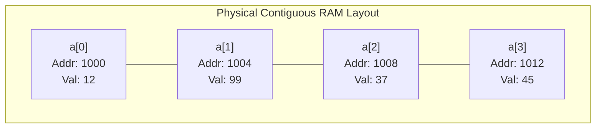
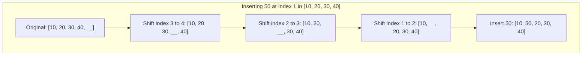

# Chapter 2: Arrays, Memory Contiguity & Lab 1 Problem Patterns

## 3.1 Contiguous Memory & Direct Address Arithmetic

An **Array** is a contiguous block of physical RAM cells allocated consecutively side-by-side.

Because every element in the array has identical byte size $S$ (for example, 4 bytes for an `int` or 8 bytes for a `long`), the hardware does not need to search through memory to find element `a[i]`. It computes the target physical memory address directly in a single CPU cycle:

$$\text{Address of } a[i] = \text{Base Address} + (i \times S)$$



### Why Indexing is Always $O(1)$
Because finding the address requires only one multiplication and one addition ($1000 + i \times 4$), reading or writing to any index in an array takes **strictly $O(1)$ constant time**, regardless of whether the array has 10 elements or 100 million elements.

In bioinformatics, this is why chromosome sequences or alignment coverage tracks are stored as contiguous arrays: looking up coordinate `chr1:5000000` is instantaneous direct arithmetic.

---

## 3.2 Fixed Java Arrays (`int[]`) vs Dynamic Arrays (`ArrayList<T>`)

| Feature | Raw Java Array (`int[]`) | Dynamic Array (`ArrayList<Integer>`) |
| :--- | :--- | :--- |
| **Capacity** | Fixed at instantiation (`new int[10]`) | Resizes dynamically as elements are added |
| **Data Types** | Stores primitives directly (`int`, `double`) | Stores object wrappers (`Integer`, `Double`) |
| **Memory Footprint** | Minimal: raw contiguous values in Heap | Overhead from object headers and pointers |
| **Size Property** | `.length` (field access) | `.size()` (method call) |
| **Element Access** | `arr[i]` | `list.get(i)` |
| **Element Mutation** | `arr[i] = val` | `list.set(i, val)` |

---

## 3.3 The Insertion and Deletion Penalty: Why Shifting Takes $O(n)$

Although reading an existing index takes $O(1)$ time, inserting or deleting an element at an arbitrary position in an array requires shifting downstream elements:



### The Biological Analogy
Think of an array insertion like an insertion mutation causing a **frameshift** in a coding sequence: inserting a single nucleotide in the middle shifts every single downstream base by one position.
- In the worst case (inserting at index 0), all $n$ elements must be moved: $O(n)$ time.
- Similarly, deleting an element at index 0 requires shifting all remaining $n - 1$ elements to the left: $O(n)$ time.

---

## 3.4 Lab 1 Core Problem Patterns & Algorithmic Blueprints

### Pattern 1: Maximal Contiguous Homopolymer / Equal-Value Blocks
- **Scenario:** Count contiguous runs of identical values (identical to detecting homopolymers in DNA like `AAAA` or `TTT`).
- **Input:** `[4, 4, -1, -1, -1, 7, 4, 4]` $\implies$ **Output:** `4` blocks (`[4, 4]`, `[-1, -1, -1]`, `[7]`, `[4, 4]`).
- **Algorithmic Blueprint:** A single linear pass. A new block begins if and only if $a[i] \ne a[i - 1]$.

```java
public static int countEqualValueBlocks(int[] arr) {
    if (arr == null || arr.length == 0) return 0;
    
    // First element starts the first block
    int blockCount = 1;
    
    // Check adjacent pairs from index 1 to n - 1
    for (int i = 1; i < arr.length; i++) {
        if (arr[i] != arr[i - 1]) {
            blockCount++; // Transition detected: previous block ended, new block started
        }
    }
    return blockCount;
}
// Time Complexity: O(n) - exactly n - 1 comparisons
// Auxiliary Space: O(1) - in-place counters
```

---

### Pattern 2: Suffix Maximum Queries & Precomputation
- **Scenario:** Given an array and repeated queries for the maximum value in suffix `arr[p ... n - 1]`.
- **Naive Approach:** For each query, scan from $p$ to $n - 1$, taking $O(n)$ per query, or $O(q \cdot n)$ total.
- **Optimal Blueprint:** Precompute a suffix maximum array in reverse in $O(n)$ time. Then each query is answered in $O(1)$ time.

```java
public static int[] buildSuffixMax(int[] arr) {
    int n = arr.length;
    if (n == 0) return new int[0];
    
    int[] suffixMax = new int[n];
    suffixMax[n - 1] = arr[n - 1]; // Rightmost base case
    
    // Accumulate from right to left
    for (int i = n - 2; i >= 0; i--) {
        suffixMax[i] = Math.max(arr[i], suffixMax[i + 1]);
    }
    return suffixMax;
}

public static int querySuffixMax(int[] suffixMax, int p) {
    return suffixMax[p]; // Instant O(1) lookup
}
// Precomputation Time: O(n), Auxiliary Space: O(n)
// Query Time: O(1)
```

---

### Pattern 3: Finding the Missing Number (Math vs. XOR vs. Frequency)
- **Scenario:** An array contains $n$ distinct numbers chosen from the range $[0, n]$. Exactly one number is missing.

#### Approach A: Arithmetic Summation
- The sum of numbers from $0$ to $n$ is $S = \frac{n(n + 1)}{2}$.
- Compute the actual sum of elements in the array: $S_{\text{actual}}$.
- $\text{Missing Number} = S - S_{\text{actual}}$.
- *Caution:* If $n$ is very large (e.g., $n > 10^5$), $n(n + 1)$ exceeds the 32-bit `int` limit and will overflow unless calculated using `long`.

#### Approach B: Bitwise XOR (No Overflow Risk)
- Properties of XOR ($\oplus$):
  - $x \oplus x = 0$ (a number XORed with itself cancels out).
  - $x \oplus 0 = x$ (XOR with zero leaves the number unchanged).
- If we XOR all indices from $0$ to $n$ and then XOR all values present in the array, every number present in both sets cancels out, leaving only the missing number.

```java
public static int findMissingXOR(int[] nums) {
    int n = nums.length;
    int xor = 0;
    for (int i = 0; i <= n; i++) xor ^= i;
    for (int x : nums) xor ^= x;
    return xor; // Time: O(n), Auxiliary Space: O(1)
}
```

---

### Pattern 4: First Unique Position (Frequency Arrays vs. Hash Maps)
- **Scenario:** Identify the first non-repeating element in an array of records.
- **Blueprint:** Two linear passes:
  1. Pass 1: Build a frequency count of each value (using a direct array `freq[val]` if values fall in a small known range $[0, R]$, or a `HashMap<Integer, Integer>` if values are sparse or large).
  2. Pass 2: Iterate through the original array in original order, returning the first element whose recorded frequency equals 1.
- **Complexity:** $O(n)$ time, $O(n)$ or $O(R)$ auxiliary space.

---

### Pattern 5: Sum of All Subarray Sums (The Contribution Technique)
- **Scenario:** Calculate the total sum of all possible contiguous subarrays.
- **Example:** For `[1, 2, 3]`, the contiguous subarrays are `[1]`, `[2]`, `[3]`, `[1,2]`, `[2,3]`, `[1,2,3]`. Total sum = $1 + 2 + 3 + 3 + 5 + 6 = 20$.
- **Naive Approach:** Generate every subarray and compute its sum: $O(n^2)$ time.
- **Optimal Blueprint (Contribution Method):**
  Instead of summing subarray by subarray, calculate how many subarrays include element `arr[i]`:
  - The starting index can be any position from $0$ to $i$ ($i + 1$ choices).
  - The ending index can be any position from $i$ to $n - 1$ ($n - i$ choices).
  - Element `arr[i]` appears in exactly $(i + 1) \times (n - i)$ subarrays.
  - Multiply each element by its appearance count and add to the running total.

```java
public static long totalSubarraySum(int[] arr) {
    long total = 0;
    int n = arr.length;
    for (int i = 0; i < n; i++) {
        long appearanceCount = (long)(i + 1) * (n - i);
        total += arr[i] * appearanceCount;
    }
    return total; // Time: O(n), Auxiliary Space: O(1)
}
```

---

### Pattern 6: In-Place Array Interleaving and Block Reversals
- **Scenario:** Given an array $[a_1, a_2, \dots, a_k, b_1, b_2, \dots, b_k]$, rearrange elements into $[a_1, b_1, a_2, b_2, \dots]$ without extra memory.
- **Reversal Helper:** Reversing an interval `[lo, hi]` in-place is a foundational building block:

```java
public static void reverse(int[] a, int lo, int hi) {
    while (lo < hi) {
        int temp = a[lo];
        a[lo] = a[hi];
        a[hi] = temp;
        lo++;
        hi--;
    }
}
// Time Complexity: O(hi - lo)
// Auxiliary Space: O(1)
```
