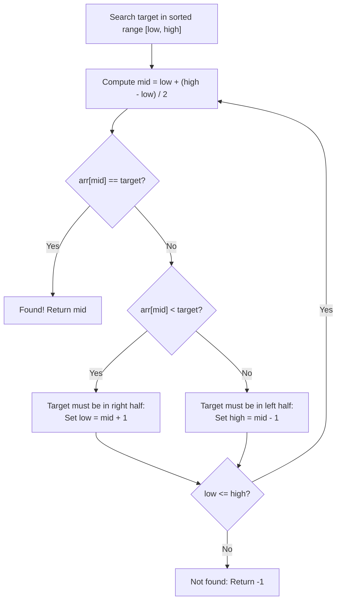
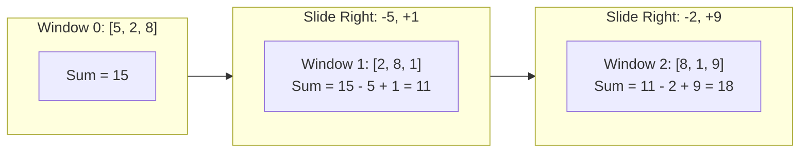

# Chapter 3: Searching Techniques, Two Pointers & Sliding Windows (Lab 2)

## 4.1 Linear Search: Mechanics and Unsorted Guarantees

Searching is the fundamental operation of retrieving the position of a specific target value from a collection.
The most direct approach is **Linear Search** (or Sequential Search):

```java
public static int linearSearch(int[] arr, int target) {
    for (int i = 0; i < arr.length; i++) {
        if (arr[i] == target) {
            return i; // Target located
        }
    }
    return -1; // Target not found
}
```

### Properties and Analysis
- **Precondition:** None. Functions on completely unsorted, random, or duplicated collections.
- **Best-Case Time:** $\Theta(1)$ (target matches the very first element at index 0).
- **Worst-Case Time:** $\Theta(n)$ (target is at the final index or absent entirely).
- **Average-Case Time:** $\Theta(n/2) = \Theta(n)$ (assuming uniform random distribution).
- **Auxiliary Space:** $O(1)$ (only primitive loop counters used).

---

## 4.2 Binary Search: The Invariant, Interval Shrinking, and Overflow Safety

When an array is **sorted**, we can eliminate half of the remaining candidate elements with every single comparison. This is **Binary Search**.



### The Search Invariant
At every step of execution, if the target exists in the array, it is guaranteed to reside within the closed index interval `[low, high]`.

### The Integer Overflow Bug
In introductory code, midpoints are often calculated as:
```java
int mid = (low + high) / 2; // Dangerous in production
```
If `low + high` exceeds $2^{31} - 1$ ($2,147,483,647$), the sum overflows into a negative value, triggering an immediate `ArrayIndexOutOfBoundsException`.
The robust formula used throughout DSA is:
```java
int mid = low + (high - low) / 2; // Mathematically identical, zero overflow risk
```

### Implementation
```java
public static int binarySearch(int[] arr, int target) {
    int low = 0;
    int high = arr.length - 1;
    
    while (low <= high) {
        int mid = low + (high - low) / 2;
        
        if (arr[mid] == target) {
            return mid; // Match found
        } else if (arr[mid] < target) {
            low = mid + 1; // Discard left half
        } else {
            high = mid - 1; // Discard right half
        }
    }
    return -1; // Interval collapsed (low > high): element is absent
}
```

### Complexity
- With each comparison, the search interval halves: $n \to \frac{n}{2} \to \frac{n}{4} \to \dots \to 1$.
- Total halving steps: $\log_2 n$.
- **Best-Case:** $\Theta(1)$.
- **Worst-Case:** $\Theta(\log_2 n)$.
- **Auxiliary Space:** $O(1)$ for the iterative implementation.

---

## 4.3 Binary Search Variants

In real-world data and exam problems, datasets often contain duplicate values, requiring boundary determinations.

### Variant 1: Finding the First Occurrence (`lower_bound`)
When duplicates exist (e.g., searching for 5 in `[2, 5, 5, 5, 8]`), basic binary search lands on an arbitrary match.
To locate the **first** (leftmost) occurrence: when `arr[mid] == target`, save `mid` as a candidate, but **continue searching to the left** (`high = mid - 1`).

```java
public static int findFirstOccurrence(int[] arr, int target) {
    int low = 0, high = arr.length - 1;
    int result = -1;
    
    while (low <= high) {
        int mid = low + (high - low) / 2;
        if (arr[mid] == target) {
            result = mid;   // Candidate match saved
            high = mid - 1; // Continue leftward for earlier occurrences
        } else if (arr[mid] < target) {
            low = mid + 1;
        } else {
            high = mid - 1;
        }
    }
    return result;
}
```

### Variant 2: Finding the Last Occurrence (`upper_bound`)
To find the **last** (rightmost) occurrence: when `arr[mid] == target`, save `mid` as a candidate, but **continue searching to the right** (`low = mid + 1`).

```java
public static int findLastOccurrence(int[] arr, int target) {
    int low = 0, high = arr.length - 1;
    int result = -1;
    
    while (low <= high) {
        int mid = low + (high - low) / 2;
        if (arr[mid] == target) {
            result = mid;  // Candidate match saved
            low = mid + 1; // Continue rightward for later occurrences
        } else if (arr[mid] < target) {
            low = mid + 1;
        } else {
            high = mid - 1;
        }
    }
    return result;
}
```

### Counting Duplicates in $O(\log n)$ Time
To count how many times a value occurs in a sorted array:
1. Find `first = findFirstOccurrence(arr, target)`.
2. If `first == -1`, count is 0.
3. Otherwise, find `last = findLastOccurrence(arr, target)`.
4. $\text{Count} = \text{last} - \text{first} + 1$.
- Total time: two binary searches = $O(\log n)$, compared to an $O(n)$ linear scan.

### Variant 3: Binary Search on the Answer Space
Binary search can also optimize numerical parameters over a range $[L, R]$ rather than querying an explicit array:
- If a property is **monotonic** (for example: *"If parameter $X$ is sufficient, any value $> X$ is also sufficient"*), we can binary search across the parameter range.
- If testing feasibility takes $O(C)$ time, finding the optimal boundary takes $O(C \cdot \log(R - L))$ time.

---

## 4.4 The Sliding Window & Two Pointers Paradigm

### 1. Fixed-Width Sliding Windows (Rolling Metrics)
- **Scenario:** Given an array of length $n$, find the maximum sum or average across any contiguous window of fixed length $k$.
- **The Naive Mistake:** Recomputing the sum of all $k$ elements from scratch for every window takes $(n - k + 1) \times k \approx O(n \cdot k)$ time. If $k \approx n/2$, this degrades to $O(n^2)$.
- **The Sliding Window Insight:**
  When shifting a window one position to the right, adjacent windows share $k - 1$ identical elements:
  $$\text{New Sum} = \text{Old Sum} - \text{Outgoing Element} + \text{Incoming Element}$$



```java
public static int maxFixedWindowSum(int[] arr, int k) {
    int n = arr.length;
    if (n < k) return 0;
    
    // Compute initial window
    int currentSum = 0;
    for (int i = 0; i < k; i++) currentSum += arr[i];
    int maxSum = currentSum;
    
    // Slide across array
    for (int i = k; i < n; i++) {
        currentSum += arr[i] - arr[i - k]; // Add incoming, subtract outgoing
        if (currentSum > maxSum) {
            maxSum = currentSum;
        }
    }
    return maxSum; // Time: O(n), Auxiliary Space: O(1)
}
```

### 2. Variable-Width Two Forward Pointers (Caterpillar Model)
- **Scenario:** Find the longest contiguous subarray with sum $\le \text{limit}$, or the shortest subarray with sum $\ge \text{target}$.
- **Precondition:** **All elements must be non-negative ($arr[i] \ge 0$).**
- **Mental Model:** A caterpillar inching along the array:
  - The `right` pointer expands the window forward to absorb elements.
  - When the sum violates the constraint, the `left` pointer contracts the window from behind until the condition is satisfied again.

```java
public static int longestSubarrayWithinLimit(int[] arr, int limit) {
    int left = 0;
    int currentSum = 0;
    int maxLength = 0;
    
    for (int right = 0; right < arr.length; right++) {
        currentSum += arr[right]; // Expand window
        
        // Contract window while constraint is violated
        while (currentSum > limit && left <= right) {
            currentSum -= arr[left];
            left++;
        }
        
        // Window [left ... right] is valid
        int currentLength = right - left + 1;
        if (currentLength > maxLength) {
            maxLength = currentLength;
        }
    }
    return maxLength;
}
// Time Complexity: O(n) amortized (left and right advance at most n times each)
// Auxiliary Space: O(1)
```

### 3. Sliding Windows with Frequency Tracking
- **Scenario:** Find the length of the longest contiguous segment containing unique elements (e.g., unique $k$-mers or nucleotide sequences).
- **Mechanism:** Maintain an array or hash map tracking character counts in the current window. When an incoming character causes a count to exceed 1, advance `left` and decrement counts until the duplicate is evicted.

### 4. The Non-Negativity Precondition: When Two Pointers Fail
Why does the variable two-pointer sliding window work?
Because when all elements are non-negative:
- Advancing `right` **monotonically increases** (or maintains) the window sum.
- Advancing `left` **monotonically decreases** (or maintains) the window sum.

> **CRITICAL EXAM TAKEAWAY:**
> **If negative numbers exist in the array, monotonicity is broken!**
> Adding an element could decrease the sum, and shrinking the window could increase the sum. The caterpillar loses its navigation invariant.
> For arrays with negative numbers, you **cannot** use two pointers; you must use **Prefix Sums with a Hash Map** ($O(n)$ time, $O(n)$ auxiliary space).
