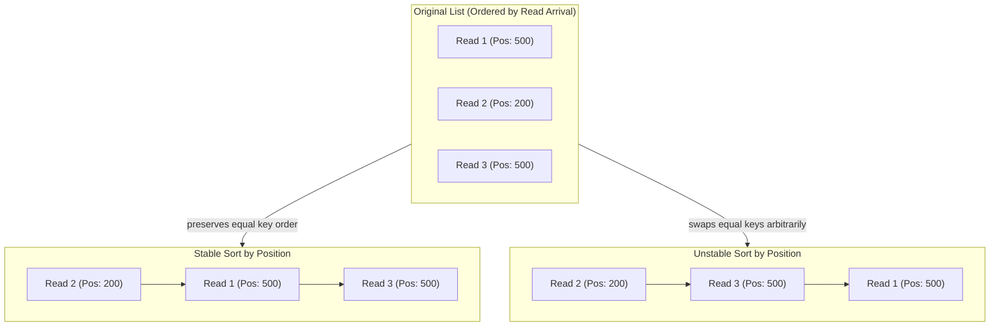

# Chapter 4: Elementary Sorting Algorithms & Invariants (Lab 2 & Week 03)

## 5.1 Why Sorting Matters & The Invariant Mental Model

Sorting arranges elements into a defined linear order (ascending or descending).
In computational biology and computer science, sorting is the prerequisite that unlocks:
- Fast logarithmic $O(\log n)$ binary searching.
- Rapid duplicate and collision detection.
- Positional genome alignments (sorting millions of sequencing reads by chromosome and coordinate).

### The Power of Loop Invariants
Rather than memorizing code lines, understand sorting algorithms through their **Loop Invariants**—the condition guaranteed to be true at the start of every iteration:

| Algorithm | Loop Invariant |
| :--- | :--- |
| **Bubble Sort** | After pass $k$, the **largest $k$ elements are permanently locked** in their final positions at the right end. |
| **Selection Sort** | After pass $k$, the **smallest $k$ elements are permanently locked** in their final positions at the left end. |
| **Insertion Sort** | After pass $k$, the **leftmost $k + 1$ elements are sorted among themselves**, though they may shift right later. |

---

## 5.2 Stability in Sorting: Why It Matters to Data Integrity

A sorting algorithm is **Stable** if records with equal sorting keys retain their original relative order after sorting.



### Practical Importance
In genomic data (such as BAM or VCF files), sorting reads primarily by chromosomal position should not scramble the secondary order (such as sequencing timestamp or quality score).
- **Stable Elementary Sorts:** Bubble Sort (with strict inequality), Insertion Sort (with strict inequality).
- **Unstable Elementary Sorts:** Selection Sort (long-distance swaps leapfrog across equal keys).

---

## 5.3 Bubble Sort: Adjacent Pairwise Swaps

### The Mechanism
Traverse the array from left to right, comparing adjacent pairs $(a[j], a[j + 1])$. If $a[j] > a[j + 1]$, swap them. The largest unsorted value "bubbles up" to the end of the array like an air bubble in liquid.

### Early-Exit Optimization
If an entire pass completes **without a single swap**, the array is already sorted. We can break early, achieving $O(n)$ time on already-sorted data.

```java
public static void bubbleSort(int[] a) {
    int n = a.length;
    for (int i = 0; i < n - 1; i++) {
        boolean swapped = false;
        
        for (int j = 0; j < n - 1 - i; j++) {
            if (a[j] > a[j + 1]) { // Strict '>' maintains stability
                int temp = a[j];
                a[j] = a[j + 1];
                a[j + 1] = temp;
                swapped = true;
            }
        }
        
        if (!swapped) break; // Early termination if already sorted
    }
}
```

### Analysis
- **Comparisons:** $\frac{n(n - 1)}{2} \approx \frac{n^2}{2}$ in the worst case.
- **Swaps:** Best-case 0 swaps; worst-case $\approx \frac{n^2}{2}$ swaps; average $\approx \frac{n^2}{4}$ swaps.
- **Time Complexity:**
  - Best-Case: $\Theta(n)$ (with early-exit check on sorted input).
  - Worst-Case: $\Theta(n^2)$ (reverse sorted input).
  - Average-Case: $\Theta(n^2)$.
- **Auxiliary Space:** $O(1)$ (in-place).
- **Stability:** **Stable**.

---

## 5.4 Selection Sort: Finding Extremes with Minimum Swaps

### The Mechanism
Scan the entire unsorted suffix to locate the minimum element. Once found, execute **at most one swap** to place that minimum at the beginning of the unsorted segment.

```java
public static void selectionSort(int[] a) {
    int n = a.length;
    for (int i = 0; i < n - 1; i++) {
        int minIndex = i;
        
        // Scan remaining unsorted elements to find minimum
        for (int j = i + 1; j < n; j++) {
            if (a[j] < a[minIndex]) {
                minIndex = j;
            }
        }
        
        // At most 1 swap per outer pass
        if (minIndex != i) {
            int temp = a[i];
            a[i] = a[minIndex];
            a[minIndex] = temp;
        }
    }
}
```

### Analysis
- **Comparisons:** Always scans the entire unsorted suffix:
  $$(n - 1) + (n - 2) + \dots + 1 = \frac{n(n - 1)}{2} = \Theta(n^2) \text{ comparisons across ALL inputs!}$$
- **Swaps:** At most $n - 1$ swaps total across the entire execution ($O(n)$ writes).
- **Time Complexity:** $\Theta(n^2)$ for best, average, and worst cases alike.
- **Auxiliary Space:** $O(1)$ (in-place).
- **Stability:** **UNSTABLE**.
  - *Proof of Instability:* Consider `[4a, 4b, 2]`. In pass 1, the minimum is `2` at index 2. Swapping `a[0]` (`4a`) with `a[2]` (`2`) yields `[2, 4b, 4a]`. Notice that `4b` has jumped ahead of `4a`, inverting their original order.

### When to Use Selection Sort
When write cycles to memory are expensive or physically destructive (such as embedded flash memory or EEPROM where write operations wear out silicon cells), Selection Sort is preferable because it minimizes memory writes to at most $n - 1$.

---

## 5.5 Insertion Sort: The Card-Player Algorithm

### The Mechanism
Analogous to sorting playing cards in hand: the sorted cards are kept on the left. When a new card (`temp`) is drawn, shift all cards in the sorted hand that are greater than `temp` one position to the right, and insert `temp` into the vacant slot.

```java
public static void insertionSort(int[] a) {
    int n = a.length;
    for (int i = 1; i < n; i++) {
        int temp = a[i]; // Card to insert
        int j = i - 1;
        
        // Shift larger sorted elements rightward
        while (j >= 0 && a[j] > temp) {
            a[j + 1] = a[j]; // Single write shift
            j--;
        }
        a[j + 1] = temp; // Place card into open position
    }
}
```

### Analysis
- **Shifts vs. Swaps:** A shift (`a[j + 1] = a[j]`) requires only 1 variable assignment, whereas a swap requires 3 assignments. Insertion sort runs considerably faster in practice than Bubble Sort.
- **Time Complexity:**
  - **Best-Case (Already sorted or nearly sorted):** $\Theta(n)$. The condition `a[j] > temp` fails immediately, executing zero shifts.
  - **Worst-Case (Reverse sorted):** $\Theta(n^2)$ shifts.
  - **Average-Case:** $\Theta(n^2)$ shifts (approximately half the work of Bubble Sort).
- **Auxiliary Space:** $O(1)$ (in-place).
- **Stability:** **Stable**.

---

## 5.6 Sorting Objects with Custom Keys (Java `Comparable` & `compareTo`)

In bioinformatics, datasets consist of structured biological entities rather than standalone numbers (e.g., Genomic Features with Chromosome, Start Position, and Read Count).

In Java, objects implement `Comparable<T>` to define natural ordering:

```java
public class GenomicFeature implements Comparable<GenomicFeature> {
    public String chromosome;
    public int startPosition;
    public double expressionScore;

    public GenomicFeature(String chr, int pos, double score) {
        this.chromosome = chr;
        this.startPosition = pos;
        this.expressionScore = score;
    }

    // compareTo contract:
    // returns negative if (this < other)
    // returns zero if (this == other)
    // returns positive if (this > other)
    @Override
    public int compareTo(GenomicFeature other) {
        // Primary criterion: chromosome name
        int chrCmp = this.chromosome.compareTo(other.chromosome);
        if (chrCmp != 0) return chrCmp;
        
        // Secondary criterion: start position ascending
        return Integer.compare(this.startPosition, other.startPosition);
    }
}
```

---

## 5.7 Deep Comparison Matrix: Bubble vs. Selection vs. Insertion

| Property | Bubble Sort (Early Exit) | Selection Sort | Insertion Sort |
| :--- | :--- | :--- | :--- |
| **Best-Case Time** | $\Theta(n)$ | $\Theta(n^2)$ | **$\Theta(n)$** |
| **Average-Case Time** | $\Theta(n^2)$ | $\Theta(n^2)$ | $\Theta(n^2)$ ($\approx 2\times$ faster than Bubble) |
| **Worst-Case Time** | $\Theta(n^2)$ | $\Theta(n^2)$ | $\Theta(n^2)$ |
| **Comparisons (Worst)** | $\approx n^2 / 2$ | $\approx n^2 / 2$ | $\approx n^2 / 2$ |
| **Data Movement** | $\approx n^2 / 4$ swaps | **At most $n - 1$ swaps ($O(n)$)** | $\approx n^2 / 4$ shifts (1 write/shift) |
| **Auxiliary Space** | $O(1)$ | $O(1)$ | $O(1)$ |
| **Stable?** | **Yes** | **No** | **Yes** |
| **Best Used For** | Conceptual demonstration | Minimizing disk/flash writes | Small lists ($n < 50$) or nearly-sorted data |
