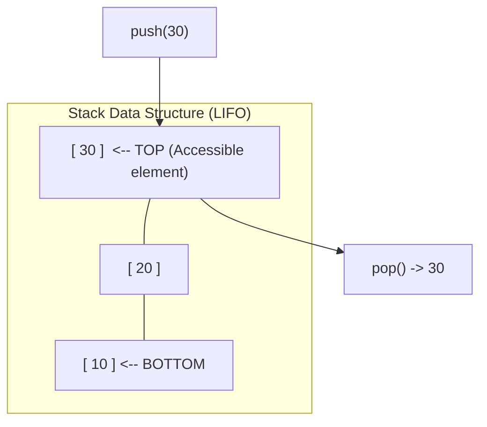

# Chapter 5: Stacks (LIFO), Monotonic Stacks, and Parsing (Lab 3 & Week 04)

## 6.1 The Stack ADT: Contract, Operations, and Boundary States

An **Abstract Data Type (ADT)** defines a data collection strictly by its **behavior (WHAT it does)** from an interface perspective, independent of its concrete **implementation (HOW it does it)**.

A **Stack** is a linear collection governed by the **Last-In, First-Out (LIFO)** principle:
- The most recently added item is the first item removed.
- Think of a vertical stack of laboratory Petri dishes or a spring-loaded plate dispenser: dishes can only be placed onto the top or removed from the top.



### The Stack Contract
1. `push(x)`: Places element $x$ onto the top of the stack.
2. `pop()`: Removes and returns the element currently at the top of the stack.
3. `peek()`: Returns the element at the top without removing it.
4. `isEmpty()`: Returns `true` if the stack contains zero elements.
5. `isFull()`: Returns `true` if a fixed-capacity stack has no open space remaining.
6. `size()`: Returns the current number of elements in the stack.

### Boundary Exceptions
- **Stack Overflow:** Calling `push()` on a fixed-capacity stack that is already full.
- **Stack Underflow:** Calling `pop()` or `peek()` on a stack that contains no elements.

---

## 6.2 Implementations: Fixed Array vs. Linked Stack

### 1. Fixed-Array Stack Implementation
Maintains an array `data[]` of capacity $K$ and an index `top` tracking the uppermost element. When empty, `top = -1`.

```java
public class ArrayStack {
    private int[] data;
    private int top;
    private int capacity;

    public ArrayStack(int capacity) {
        this.capacity = capacity;
        this.data = new int[capacity];
        this.top = -1; // -1 indicates empty
    }

    public void push(int x) {
        if (top == capacity - 1) {
            throw new IllegalStateException("Stack Overflow");
        }
        data[++top] = x;
    }

    public int pop() {
        if (isEmpty()) {
            throw new IllegalStateException("Stack Underflow");
        }
        return data[top--];
    }

    public int peek() {
        if (isEmpty()) {
            throw new IllegalStateException("Stack Underflow");
        }
        return data[top];
    }

    public boolean isEmpty() { return top == -1; }
    public int size() { return top + 1; }
}
```
- **Performance:** `push`, `pop`, and `peek` are all strictly $\Theta(1)$ constant time.
- **Trade-off:** Preallocates fixed memory; cannot expand if more items arrive.

### 2. Singly Linked Stack Implementation
Stores each element inside a dynamic `Node`. The top of the stack is anchored at the `head`:
- `push(x)`: Create a node pointing to current `head`, then set `head = newNode`. ($O(1)$ time).
- `pop()`: Read `head.item`, advance `head = head.next`. ($O(1)$ time).
- **Pros:** Can grow dynamically until computer memory is exhausted; no wasted preallocated slots.
- **Cons:** Node overhead (memory addresses and object headers).

---

## 6.3 Classical Stack Applications

### Application 1: Sequence Reversal
Due to LIFO ordering, pushing a sequence onto a stack and popping all items produces the exact reverse sequence.
- **Complexity:** $O(n)$ time, $O(n)$ space.

### Application 2: Delimiter Matching & RNA Secondary Structure Verification
In code syntax checking and computational RNA folding, paired brackets or nucleotide stems must close in proper nested order. In RNA secondary structure, stems form between complementary bases ($A-U$, $G-C$), which must not cross illegally:

$$\text{Valid Hairpin: } (((...))) \quad \iff \quad \text{Valid Delimiters: } [100 \times (100 - 50)] / 2$$

```java
public static boolean isBalanced(String expression) {
    java.util.ArrayDeque<Character> stack = new java.util.ArrayDeque<>();
    
    for (int i = 0; i < expression.length(); i++) {
        char ch = expression.charAt(i);
        
        // Push opening delimiters
        if (ch == '(' || ch == '[' || ch == '{') {
            stack.push(ch);
        } 
        // Match and pop on closing delimiters
        else if (ch == ')' || ch == ']' || ch == '}') {
            if (stack.isEmpty()) return false; // Closing delimiter with no match
            
            char top = stack.pop();
            if (ch == ')' && top != '(') return false;
            if (ch == ']' && top != '[') return false;
            if (ch == '}' && top != '{') return false;
        }
    }
    return stack.isEmpty(); // Must be empty at end (no unclosed openers)
}
// Time Complexity: O(n)
// Auxiliary Space: O(n)
```

---

### Application 3: Arithmetic Expression Parsing (Infix to Postfix)
Humans write expressions in **Infix** notation: $A + B \times C$.
Infix is difficult for computers to evaluate sequentially because of operator precedence and parentheses.
Computers translate Infix into **Postfix** (Reverse Polish Notation):
$$A + B \times C \implies A\ B\ C\ \times\ +$$
In Postfix, operators appear immediately after their operands, making parentheses unnecessary.

#### Postfix Evaluation Algorithm
1. Initialize an empty operand stack.
2. Scan tokens from left to right:
   - If the token is an **operand** (number), push it onto the stack.
   - If the token is an **operator** ($+$, $-$, $\times$, $/$, etc.):
     - Pop the top value into $B$.
     - Pop the next top value into $A$.
     - Compute $\text{result} = A \text{ operator } B$.
     - Push the result back onto the stack.
3. The final result is the single value remaining on the stack.

---

### Application 4: Two-Stack Undo and Redo Architecture
Text editors and sequence alignment viewers implement Undo and Redo operations using two synchronized stacks:
1. `undoStack`: Stores completed actions.
2. `redoStack`: Stores reversed actions.
- **New Action:** Push to `undoStack`, clear `redoStack`.
- **Undo:** Pop action from `undoStack`, revert it, push to `redoStack`.
- **Redo:** Pop action from `redoStack`, re-apply it, push to `undoStack`.
- All operations run in strictly $O(1)$ time.

---

### Application 5: The Min-Stack ($O(1)$ Minimum Queries)
How can a stack support `push`, `pop`, and `getMin()` all in $O(1)$ time?
- Maintain a secondary parallel stack `minStack`.
- When pushing $x$: push $x$ to `mainStack`, and push $\min(x, \text{currentMin})$ to `minStack`.
- When popping: pop from both stacks simultaneously.
- `getMin()` simply inspects `minStack.peek()` in $O(1)$ time.

---

## 6.4 The Monotonic Stack Technique: Next Greater Element in $O(n)$ Amortized

A **Monotonic Stack** is a stack whose stored elements are maintained in strictly increasing or decreasing order.

### The Next Greater Element Problem
Given an array `[2, 5, 3, 6]`, find the first element to the right of each position that is strictly greater than it. If none exists, output `-1`.

```java
public static int[] nextGreaterElement(int[] arr) {
    int n = arr.length;
    int[] result = new int[n];
    java.util.Arrays.fill(result, -1);
    
    // Stack stores indices of elements waiting for a greater element
    java.util.ArrayDeque<Integer> stack = new java.util.ArrayDeque<>();
    
    for (int i = 0; i < n; i++) {
        // While stack is not empty and current value resolves the element at stack top
        while (!stack.isEmpty() && arr[i] > arr[stack.peek()]) {
            int resolvedIndex = stack.pop();
            result[resolvedIndex] = arr[i];
        }
        stack.push(i); // Current index waits for a future greater element
    }
    return result;
}
```

### Why the Runtime is Linear $O(n)$, Not Quadratic $O(n^2)$
A nested `while` inside a `for` loop looks like $O(n^2)$ at first glance, but consider the lifecycle of each array index:
1. Each index $i$ is pushed onto the stack **exactly once**.
2. Each index is popped from the stack **at most once**.
3. Therefore, the inner `while` condition evaluates to `true` at most $n$ times across the **entire program run**.
$$\text{Total Work} \le n \text{ pushes} + n \text{ pops} = 2n \implies O(n) \text{ amortized time}$$
