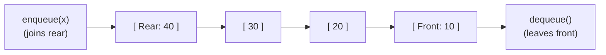
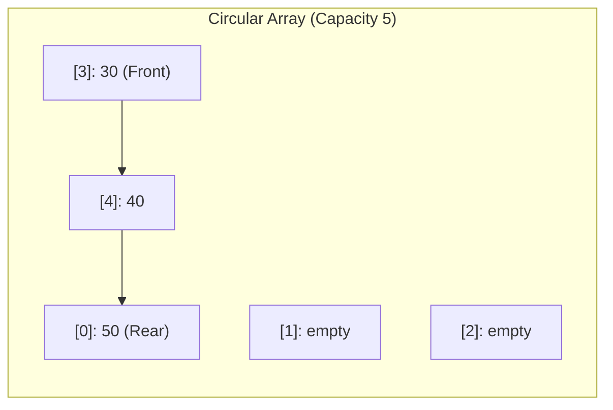
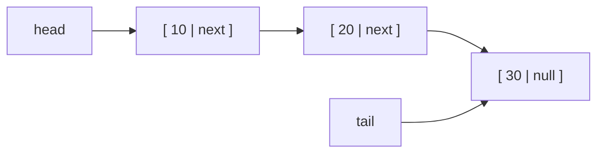

# Chapter 6: Queues (FIFO), Circular Queues, Deques & Monotonic Deques (Lab 3 & Week 04)

## 7.1 The Queue ADT: Contract, Operations, and Real-World Processing

A **Queue** is a linear collection governed by the **First-In, First-Out (FIFO)** principle:
- The first item inserted is the first item removed.
- Think of a line of sequencing runs awaiting alignment on a compute cluster: new jobs join at the **rear (tail)**, and the next job to execute is pulled from the **front (head)**.



### The Queue Contract
1. `enqueue(x)`: Inserts element $x$ at the rear.
2. `dequeue()`: Removes and returns the element at the front.
3. `peek()`: Inspects the front element without removing it.
4. `isEmpty()`: Returns `true` if size is 0.
5. `isFull()`: Returns `true` if capacity is reached.

---

## 7.2 The Naive Array Queue Flaw: The $O(n)$ Dequeue Penalty

If a queue is built naively on a standard array by appending to the end (`data[size++] = x`), removing from the front requires taking `data[0]`.
To maintain elements consecutively starting at index 0, every single remaining element must be **shifted one position to the left**:
$$data[0] = data[1], \quad data[1] = data[2], \quad \dots$$
This forces `dequeue()` to take **$O(n)$ time**. Performing $n$ dequeue operations on an array of size $n$ takes quadratic $O(n^2)$ time.

---

## 7.3 The Circular Array Queue: Modular Arithmetic & State Disambiguation

To eliminate the shifting penalty and achieve $O(1)$ performance for both `enqueue` and `dequeue`, we use a **Circular Array (Ring Buffer)**.
Instead of shifting elements, the `front` and `rear` pointers advance forward, wrapping back around to index 0 when they reach the end of the array using the **modulo operator (`%`)**:

$$\text{nextIndex} = (\text{currentIndex} + 1) \pmod{\text{capacity}}$$



### State Disambiguation: Full vs. Empty
Notice that in a circular array, when the queue is completely empty, `front == rear`.
However, when the queue becomes completely full, `front == rear` as well.
To distinguish between empty and full:
- **Method 1 (Standard):** Maintain an explicit `size` counter (`isEmpty` $\iff size == 0$; `isFull` $\iff size == capacity$).
- **Method 2:** Leave one array slot intentionally vacant, defining full as `(rear + 1) % capacity == front`.

```java
public class CircularQueue {
    private int[] data;
    private int front;
    private int rear;
    private int size;
    private int capacity;

    public CircularQueue(int capacity) {
        this.capacity = capacity;
        this.data = new int[capacity];
        this.front = 0;
        this.rear = -1;
        this.size = 0;
    }

    public void enqueue(int x) {
        if (size == capacity) throw new IllegalStateException("Queue is Full");
        rear = (rear + 1) % capacity; // Wrap around using modulo
        data[rear] = x;
        size++;
    }

    public int dequeue() {
        if (size == 0) throw new IllegalStateException("Queue is Empty");
        int val = data[front];
        front = (front + 1) % capacity; // Wrap around using modulo
        size--;
        return val;
    }

    public int peek() {
        if (size == 0) throw new IllegalStateException("Queue is Empty");
        return data[front];
    }

    public boolean isEmpty() { return size == 0; }
    public boolean isFull() { return size == capacity; }
    public int size() { return size; }
}
```
- **Performance:** All operations (`enqueue`, `dequeue`, `peek`) execute in strictly $\Theta(1)$ constant time.

---

## 7.4 The Linked Queue with Head and Tail Pointers

A linked queue maintains two pointers: `head` (pointing to the front node) and `tail` (pointing to the rear node).



- **Enqueue:** Create a node, set `tail.next = newNode`, and advance `tail = newNode`. ($O(1)$ time).
- **Dequeue:** Read `head.item`, advance `head = head.next`. ($O(1)$ time).
- **Critical Invariant:** If `head` becomes `null` after a dequeue, the queue is now empty. You **must** also set `tail = null`, otherwise `tail` continues holding a reference to the detached node, preventing garbage collection.

---

## 7.5 Priority Queues: Priority-Based Extraction

In a standard queue, order is strictly chronological (arrival time).
In a **Priority Queue**, each element has an associated priority value; `dequeue()` always returns the element with the **highest priority** (or lowest in a min-priority queue), regardless of when it arrived.

| Implementation | `enqueue()` Time | `dequeueMax()` Time | Characteristics |
| :--- | :--- | :--- | :--- |
| **Unsorted Array** | $\Theta(1)$ (append to end) | $\Theta(n)$ (scan all to find max) | Optimal when insertions vastly outnumber extractions |
| **Sorted Array** | $\Theta(n)$ (shift to maintain order) | $\Theta(1)$ (remove from end) | Optimal when extractions vastly outnumber insertions |
| **Sorted Linked List** | $\Theta(n)$ (traverse to find slot) | $\Theta(1)$ (remove head) | No array shifting, but pointer traversal still takes $O(n)$ |
| **Binary Heap** | $\Theta(\log n)$ | $\Theta(\log n)$ | Balanced tree structure (covered in course 2nd half) |

---

## 7.6 Double-Ended Queues (Deque) & Monotonic Deque

A **Deque** (Double-Ended Queue) allows insertions and deletions at **both ends** in $O(1)$ time:
`addFirst`, `addLast`, `removeFirst`, `removeLast`.

### The Sliding Window Maximum Problem (Lab 3 Problem 5)
Given an array and a sliding window of width $k$, output the maximum value in every window position.
- **Naive Approach:** Scan all $k$ elements in every window: $O(n \cdot k)$ time.
- **Optimal Monotonic Deque Approach ($O(n)$ Time):**
  Maintain a Deque that stores **indices** of candidate elements in **monotonically decreasing** order of their values:
  1. **Evict Expired Indices:** If `deque.peekFirst() <= i - k`, remove it from the front (it has slipped outside the active window).
  2. **Maintain Decreasing Order:** While `deque` is not empty and $arr[i] \ge arr[\text{deque.peekLast()}]$, remove from the back. (Why? Because as long as $arr[i]$ is inside the window, smaller elements older than it can never be the window maximum!).
  3. `deque.addLast(i)`.
  4. Once $i \ge k - 1$, the maximum of the active window is always at `arr[deque.peekFirst()]`.

```java
public static int[] maxSlidingWindow(int[] arr, int k) {
    if (arr == null || k <= 0) return new int[0];
    int n = arr.length;
    int[] result = new int[n - k + 1];
    java.util.ArrayDeque<Integer> deque = new java.util.ArrayDeque<>(); // Stores INDICES
    
    for (int i = 0; i < n; i++) {
        // Step 1: Evict elements outside active window
        if (!deque.isEmpty() && deque.peekFirst() < i - k + 1) {
            deque.pollFirst();
        }
        
        // Step 2: Remove smaller elements from rear
        while (!deque.isEmpty() && arr[deque.peekLast()] < arr[i]) {
            deque.pollLast();
        }
        
        // Step 3: Add current index to rear
        deque.offerLast(i);
        
        // Step 4: Record answer once window has reached width k
        if (i >= k - 1) {
            result[i - k + 1] = arr[deque.peekFirst()];
        }
    }
    return result; // Time: O(n) amortized, Auxiliary Space: O(k)
}
```
