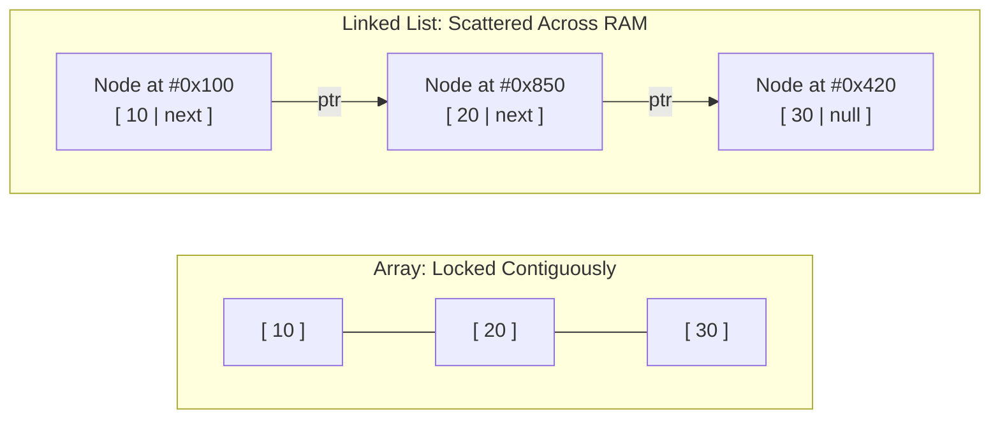
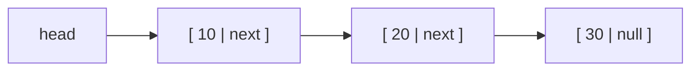
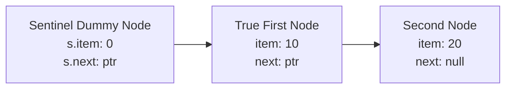
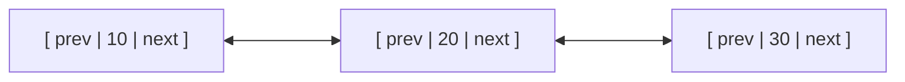

# Chapter 7: Linked Lists in Depth: Nodes, Pointers, and Invariants (Lab 3 & Week 05)

## 8.1 Memory Architecture: Why References Replace Contiguity

In an array, all elements must reside in contiguous physical RAM addresses. While this gives instantaneous $O(1)$ random indexing, it imposes severe limitations:
1. Resizing requires allocating a completely new array and copying all existing items ($O(n)$).
2. Inserting or deleting at the front requires shifting every element downstream ($O(n)$).
3. Memory fragmentation: if available RAM is fragmented into small disjoint chunks, allocating a large contiguous array of 1 GB may fail even if total free RAM exceeds 4 GB.

A **Linked List** abandons contiguous physical allocation entirely.
Instead of sitting next to each other, elements are stored in independent memory objects called **Nodes**. Each node contains:
1. **Data payload:** The item value (e.g., nucleotide, coordinate, or integer).
2. **Reference pointer (`next`):** The 64-bit memory address of the next node in the chain.



---

## 8.2 Singly Linked Lists: Node Structure, Head, and Tail

### Node Definition
```java
public class Node {
    public int item;
    public Node next; // Reference address to next Node on the Heap

    public Node(int item, Node next) {
        this.item = item;
        this.next = next;
    }
}
```

### Core Operations



1. **Insert at Front (`addFirst(x)`):**
   - Create `newNode = new Node(x, head)`.
   - Update `head = newNode`.
   - **Time:** Strictly $\Theta(1)$ constant time. No elements are shifted.
2. **Delete at Front (`removeFirst()`):**
   - If `head == null`, throw underflow.
   - Set `head = head.next`. The detached node is automatically reaped by the Garbage Collector.
   - **Time:** Strictly $\Theta(1)$ constant time.
3. **Insert at End (`addLast(x)`):**
   - In a list with **Head only**: You must traverse all $n$ nodes to find the node whose `next == null`. Time: **$\Theta(n)$**.
   - In a list with a **Tail pointer** (`head + tail`): Set `tail.next = newNode; tail = newNode`. Time: **$\Theta(1)$**.
4. **Delete at End (`removeLast()`):**
   - **CRITICAL EXAM TRAP:** Even if you maintain a `tail` pointer, deleting the last element in a Singly Linked List still takes **$\Theta(n)$ time**!
   - *Why?* Because to detach `tail`, you must set the *predecessor's* `next` pointer to `null`. Pointers only point forward; you cannot look backward from `tail`! You must traverse from `head` to find the node immediately before `tail`.

---

## 8.3 The Sentinel Node Pattern: Eliminating Null Pointers Forever

In naive linked lists, operations are cluttered with edge-case checks: `if (head == null)`, `if (head.next == null)`, etc. Forgetting one check leads to a fatal `NullPointerException`.

The standard solution taught in CS 61B and university DSA is the **Sentinel Node** (as implemented in `SLList.java` in the course materials).
A Sentinel is a permanent dummy node at the head of the list that holds no meaningful data. Its `next` pointer always points to the true first element.



```java
// Pattern from: in-class-assignments/exercise-01_session-04/SLList.java
public class SLList {
    private static class IntNode {
        public int item;
        public IntNode next;

        public IntNode(int i, IntNode n) {
            this.item = i;
            this.next = n;
        }
    }

    private IntNode s; // Sentinel node: NEVER null!
    private int size;

    public SLList() {
        s = new IntNode(0, null); // Sentinel created permanently
        size = 0;
    }

    public void addFirst(int x) {
        // No 'if (head == null)' check needed!
        s.next = new IntNode(x, s.next);
        size++;
    }

    public void display() {
        IntNode p = s.next; // Skip sentinel dummy, begin at true first node
        while (p != null) {
            System.out.print(p.item + " ");
            p = p.next;
        }
        System.out.println();
    }
}
```

---

## 8.4 Doubly Linked Lists: Bidirectional Traversal and $O(1)$ Deletions

A **Doubly Linked List (DLL)** equips each node with two pointers:
- `next`: Points to the following node.
- `prev`: Points to the preceding node.



### Why Doubly Linked Lists are Powerful:
1. **Bidirectional Traversal:** Traversal can proceed forward or backward.
2. **$O(1)$ Removal of Any Known Node:**
   In a singly linked list, removing node $P$ requires traversing to find its predecessor. In a DLL, node $P$ already holds a direct reference to its predecessor (`P.prev`):
   ```java
   // Detaching known node P in strictly O(1) time:
   P.prev.next = P.next;
   if (P.next != null) {
       P.next.prev = P.prev;
   }
   ```
3. **$O(1)$ Deletion at Tail:** `removeLast()` executes in $\Theta(1)$ because `tail.prev` immediately yields the second-to-last node.

---

## 8.5 Circular Linked Lists (Singly and Doubly)

- **Circular Singly Linked List:** The last node's `next` pointer points back to `head`.
  - *Pro-tip:* If you maintain a single pointer to `tail`, you get access to both ends for free: `tail` is the end, and `tail.next` is the `head`.
- **Circular Doubly Linked List:** `head.prev` points to `tail`, and `tail.next` points to `head`, forming a completely closed ring.

---

## 8.6 Essential Linked List Algorithms

### 1. Iterative Link Reversal (The Three-Pointer Dance)
- **Problem:** Reverse a singly linked list in-place in $O(n)$ time and $O(1)$ auxiliary space.
- **Blueprint:** Maintain three pointers: `prev`, `curr`, and `nextTemp`. At each node, invert `curr.next` to point back to `prev`.

```java
public static Node reverseList(Node head) {
    Node prev = null;
    Node curr = head;
    
    while (curr != null) {
        Node nextTemp = curr.next; // Step 1: Save next node before severing reference
        curr.next = prev;          // Step 2: Reverse pointer backward
        prev = curr;               // Step 3: Advance prev
        curr = nextTemp;           // Step 4: Advance curr
    }
    return prev; // prev is now the head of the reversed list
}
// Time Complexity: O(n)
// Auxiliary Space: O(1)
```

---

### 2. Middle Node Detection (Tortoise and Hare)
- **Problem:** Locate the exact middle node of a list in a single pass without knowing its length.
- **Blueprint:**
  - Launch two pointers at `head`: `slow` (advances 1 step) and `fast` (advances 2 steps).
  - When `fast` reaches the end of the list, `slow` is sitting at the midpoint.

```java
public static Node findMiddle(Node head) {
    if (head == null) return null;
    Node slow = head;
    Node fast = head;
    
    while (fast != null && fast.next != null) {
        slow = slow.next;       // 1 step
        fast = fast.next.next;  // 2 steps
    }
    return slow; // Time: O(n), Space: O(1)
}
```

---

### 3. Cycle Detection: Floyd's Algorithm vs. Hash Set Tracking
- **Problem:** Detect if a list contains a cycle (an infinite loop where a node points back to an earlier node).
- **Approach A (Hash Set):** Record visited node references in a `HashSet<Node>`. If a node is seen twice, a cycle exists. Cost: $O(n)$ space.
- **Approach B (Floyd's Tortoise and Hare - $O(1)$ Space):**
  - Advance `slow` by 1 step, `fast` by 2 steps.
  - If acyclic, `fast` hits `null` and finishes.
  - If a cycle exists, `fast` enters the loop and laps `slow` from behind until `slow == fast`.

```java
public static boolean hasCycle(Node head) {
    if (head == null) return false;
    Node slow = head;
    Node fast = head;
    
    while (fast != null && fast.next != null) {
        slow = slow.next;
        fast = fast.next.next;
        if (slow == fast) {
            return true; // Cycle detected
        }
    }
    return false; // Reached null: acyclic
}
```

---

### 4. Why Binary Search FAILS on Linked Lists

> **THE #1 MIDTERM THEORY QUESTION:**
> *"Can we perform Binary Search on a sorted Singly Linked List in $O(\log n)$ time?"*
>
> **ANSWER: ABSOLUTELY NOT.**
> Binary search relies on inspecting the midpoint in $O(1)$ time via direct address arithmetic (`arr[mid]`).
> In a linked list, to reach the midpoint node, you must walk reference-by-reference from `head`, which costs $\Theta(n)$ steps.
> The recurrence becomes:
> $$T(n) = T(n/2) + \Theta(n) \implies T(n) = \Theta(n)$$
> Binary search on a linked list collapses to **linear $\Theta(n)$ time**—offering no performance advantage over a simple linear search.

---

### 5. The LRU (Least Recently Used) Cache Architecture
How do software caches keep frequently used data and discard old data?
- Combines a **Doubly Linked List** and a **Hash Map**:
  - The DLL maintains access order (Head = Most Recently Used, Tail = Least Recently Used).
  - The Hash Map maps keys directly to DLL Node references for $O(1)$ lookup.
  - When an item is accessed or added: unlink it from its current position in $O(1)$ and insert at Head in $O(1)$.
  - When cache capacity is exceeded: evict `tail.prev` in $O(1)$ time.
