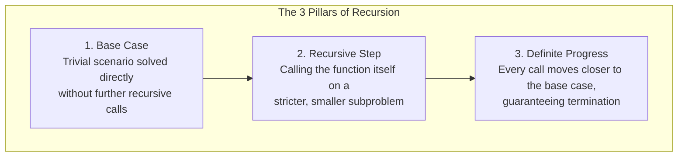
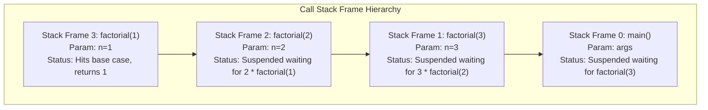

# Chapter 8: Recursion & The Call-Stack Mechanics (Lab 4 & Week 06)

## 9.1 The Recursive Mental Model: Contracts and Self-Similarity

**Recursion** is a problem-solving strategy where a method solves a problem by calling itself to solve smaller instances of the exact same problem.

### The Contract Mental Model
When writing or reading a recursive method, avoid trying to mentally simulate every nested call simultaneously. Instead, rely on the **Method Contract**:
1. State the contract: *"What does `solve(input)` guarantee to return?"*
2. Assume the recursive call on a smaller input (`solve(smallerInput)`) **already works as promised**.
3. Determine how to combine the result of that smaller subproblem with the current step to satisfy the full contract.

---

## 9.2 The Three Mandatory Invariants of Recursion

Every valid, terminating recursive algorithm must fulfill three requirements:



Omitting the base case or failing to reduce the problem size causes infinite recursion, which exhausts JVM memory and throws a `StackOverflowError`.

---

## 9.3 Under the Hood: The JVM Call Stack & Stack Frame Lifecycle

How does the computer execute a recursive function?
Every time a Java method is invoked, the JVM allocates a **Stack Frame** (or Activation Record) on the Call Stack.



### Contents of a Stack Frame
1. **Parameters:** Arguments passed to this invocation.
2. **Local Variables:** Variables declared within the method scope.
3. **Return Address:** The instruction line in the caller method where execution resumes once this call finishes.

---

## 9.4 Call Descent vs. Return Ascent (Unwinding)

Consider computing $4!$ (4 factorial):
```java
static long factorial(int n) {
    if (n <= 1) return 1;       // Base case
    return n * factorial(n - 1); // Recursive call
}
```

Recursion always executes in two distinct phases:

1. **Call Descent (Stack Growth):**
   Calls descend deeper, pushing new stack frames on top of the call stack. Computations at each level remain suspended waiting for child calls to finish:
   - `factorial(4)` calls `factorial(3)`
   - `factorial(3)` calls `factorial(2)`
   - `factorial(2)` calls `factorial(1)` $\implies$ Base case reached! Returns 1.

2. **Return Ascent (Stack Unwinding):**
   Once the base case returns, values propagate back up the stack. Each suspended frame completes its pending arithmetic and is discarded:
   - `factorial(2)` computes $2 \times 1 = 2$, returns 2 (Frame destroyed).
   - `factorial(3)` computes $3 \times 2 = 6$, returns 6 (Frame destroyed).
   - `factorial(4)` computes $4 \times 6 = 24$, returns 24 (Frame destroyed).

- **Time Complexity:** $\Theta(n)$ (exactly $n$ function invocations).
- **Auxiliary Stack Space:** $\Theta(n)$ (at peak descent, $n$ stack frames exist simultaneously).

> **Bioinformatics Precision Note (64-bit Integer Overflow):**
> In genomics and combinatorics, $20! \approx 2.43 \times 10^{18}$, which fits within Java's signed 64-bit `long` (max $\approx 9.22 \times 10^{18}$).
> Calling `factorial(21)` silently overflows into negative numbers! For $n > 20$, `java.math.BigInteger` is mandatory.

---

## 9.5 Fundamental Recursive Patterns

### Pattern 1: Single Decreasing Integer (Triangular Numbers)
A triangular number $T(n)$ represents the sum of numbers from $1$ to $n$: $T(n) = n + (n - 1) + \dots + 1$.
- Contract: `triangle(n) = n + triangle(n - 1)`, with base `triangle(1) = 1`.

```java
static int triangle(int n) {
    if (n <= 1) return n;
    return n + triangle(n - 1);
}
```

---

### Pattern 2: Suffix / Linear Array Traversal (`sumArray`)
- Contract: `sumArray(a, i)` returns the sum of elements from index $i$ to the end of the array.

```java
static long sumArray(int[] a, int i) {
    if (i == a.length) return 0; // Base case: empty suffix has sum 0
    return a[i] + sumArray(a, i + 1); // Current item + sum of remaining suffix
}
```

---

### Pattern 3: Two-Pointer Convergent Recursion (`isPalindrome`)
- Contract: Checks if subarray `a[lo ... hi]` is symmetric.
- Progress: Both pointers converge inward toward each other (`lo + 1`, `hi - 1`).

```java
static boolean isPalindrome(int[] a, int lo, int hi) {
    if (lo >= hi) return true; // Base case: 0 or 1 elements left
    if (a[lo] != a[hi]) return false; // Mismatch
    return isPalindrome(a, lo + 1, hi - 1); // Step inward
}
```

---

### Pattern 4: Digit Sum
- Contract: Computes the sum of base-10 digits of an integer.

```java
static int digitSum(int n) {
    if (n < 10) return n; // Single digit base case
    return (n % 10) + digitSum(n / 10); // Last digit + remaining digits
}
```

---

### Pattern 5: Recursive Binary Search
- Contract: Searches sorted subarray `arr[lo ... hi]` for target $t$.

```java
static int binarySearchRecursive(int[] sorted, int lo, int hi, int t) {
    if (lo > hi) return -1; // Base case: empty range
    
    int mid = lo + (hi - lo) / 2;
    if (sorted[mid] == t) return mid;
    if (sorted[mid] < t) {
        return binarySearchRecursive(sorted, mid + 1, hi, t);
    } else {
        return binarySearchRecursive(sorted, lo, mid - 1, t);
    }
}
```
- **Recurrence:** $T(n) = T(n/2) + O(1)$.
- **Time Complexity:** $\Theta(\log n)$.
- **Auxiliary Stack Space:** $\Theta(\log n)$ (maximum call depth is $\log_2 n$).

---

### Pattern 6: Multi-Branch Recursion (Towers of Hanoi)
Move $n$ disks from Source peg ($S$) to Destination peg ($D$) using Intermediate peg ($I$), without placing a larger disk on a smaller disk.
- Strategy:
  1. Recursively move top $n - 1$ disks from $S$ to $I$.
  2. Move disk $n$ directly from $S$ to $D$.
  3. Recursively move $n - 1$ disks from $I$ to $D$.

```java
public static void hanoi(int n, char S, char I, char D) {
    if (n == 1) {
        System.out.println("Move disk 1 from " + S + " to " + D);
        return;
    }
    hanoi(n - 1, S, D, I);
    System.out.println("Move disk " + n + " from " + S + " to " + D);
    hanoi(n - 1, I, S, D);
}
```
- **Recurrence:** $T(n) = 2T(n - 1) + 1$.
- **Time Complexity:** $\Theta(2^n)$ (Exponential).

---

## 9.6 Recurrence Relations: The Unwinding Method Explained

To determine the Big-O bound of a recursive algorithm, express its runtime as an equation in terms of subproblem sizes and solve by repeated substitution:

### Example: Linear Unwinding
For a function that does constant work $c$ and calls itself on $n - 1$:
$$T(n) = T(n - 1) + c$$
Substitute repeatedly:
$$T(n) = T(n - 2) + 2c$$
$$T(n) = T(n - 3) + 3c$$
After $k$ steps:
$$T(n) = T(n - k) + k \cdot c$$
Setting $n - k = 1 \implies k = n - 1$:
$$T(n) = T(1) + (n - 1)c \implies \Theta(n)$$
Each reduction of 1 step over $n$ levels yields linear time.
