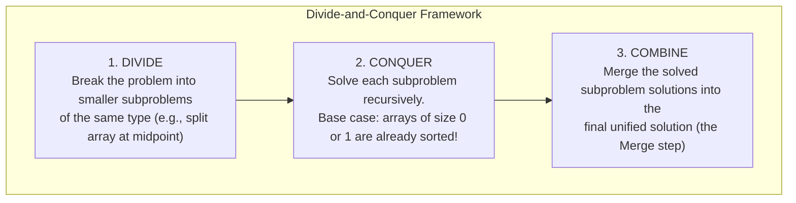
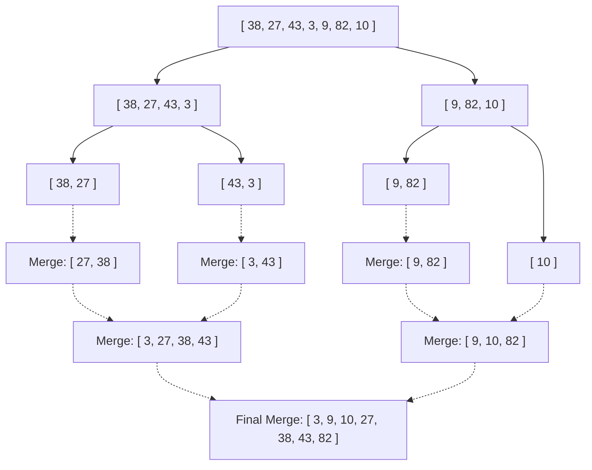

# Chapter 9: Merge Sort: The Divide-and-Conquer Masterclass (Week 06 & Session 05)

## 10.1 The Divide-and-Conquer Paradigm

Elementary sorting algorithms (Bubble, Selection, Insertion) exhibit quadratic $O(n^2)$ worst-case performance. For a bioinformatics dataset of 10 million sequence reads, an $O(n^2)$ algorithm is computationally prohibitive.

To break past the quadratic barrier, computer science uses the **Divide-and-Conquer** paradigm:



In **Merge Sort**, the Divide step is trivial (cut array in half), the Conquer step is recursive, and the **Combine step (the Merge)** is where all computational work occurs.

---

## 10.2 The Core Merging Engine: Merging Two Sorted Subarrays in $O(n)$

Suppose you have two piles of sequencing records, each **already sorted** in ascending order:
- Pile $L$: `[2, 5, 8]`
- Pile $R$: `[1, 6, 9]`

How do you combine them into a single sorted list?
Inspect the front elements of both piles. Whichever is smaller is placed into the output array, and that pile's pointer advances. This repeats until both piles are merged.

### Method 1: The Sentinel Method (Course `Main.java`)
In classic CLRS algorithm design (taught in session 5: `exercise-01_session-05/Main.java`), to avoid checking whether array $L$ or $R$ has run out of elements on every step, a **Sentinel value** ($\infty$, represented by `Integer.MAX_VALUE`) is placed at the end of both temporary arrays.

Because `Integer.MAX_VALUE` is larger than any valid integer, once one array is exhausted, the comparison `L[i] <= R[j]` naturally selects the remaining items from the other array without requiring extra boundary `while` loops:

```java
// Pattern from: in-class-assignments/exercise-01_session-05/Main.java
private static void mergeWithSentinels(int[] A, int p, int q, int r) {
    int n1 = q - p + 1; // Size of left subarray
    int n2 = r - q;     // Size of right subarray

    // Allocate temporary arrays with 1 extra slot for the sentinel
    int[] L = new int[n1 + 1];
    int[] R = new int[n2 + 1];

    for (int i = 0; i < n1; i++) L[i] = A[p + i];
    for (int j = 0; j < n2; j++) R[j] = A[q + 1 + j];

    // Place sentinels at ends
    L[n1] = Integer.MAX_VALUE;
    R[n2] = Integer.MAX_VALUE;

    int i = 0;
    int j = 0;

    // Merge back into original array A
    for (int k = p; k <= r; k++) {
        if (L[i] <= R[j]) { // '<=' ensures STABILITY!
            A[k] = L[i++];
        } else {
            A[k] = R[j++];
        }
    }
}
```

### Method 2: The Standard Boundary-Checked Method
If data can legitimately contain `Integer.MAX_VALUE`, sentinels cannot be used. We use standard index boundary checks:

```java
private static void mergeStandard(int[] a, int p, int q, int r) {
    int n1 = q - p + 1;
    int n2 = r - q;
    int[] L = new int[n1];
    int[] R = new int[n2];

    for (int i = 0; i < n1; i++) L[i] = a[p + i];
    for (int j = 0; j < n2; j++) R[j] = a[q + 1 + j];

    int i = 0, j = 0, k = p;
    while (i < n1 && j < n2) {
        if (L[i] <= R[j]) {
            a[k++] = L[i++];
        } else {
            a[k++] = R[j++];
        }
    }
    // Append remaining elements
    while (i < n1) a[k++] = L[i++];
    while (j < n2) a[k++] = R[j++];
}
```

---

## 10.3 Complete Merge Sort Algorithm & Recursive Tree Walkthrough

```java
public class MergeSort {

    public static void mergeSort(int[] A, int p, int r) {
        // Base case: if p >= r, the subarray has 0 or 1 elements and is already sorted
        if (p < r) {
            int q = p + (r - p) / 2; // Midpoint
            
            mergeSort(A, p, q);      // Sort left half
            mergeSort(A, q + 1, r);  // Sort right half
            
            merge(A, p, q, r);       // Merge sorted halves
        }
    }
}
```

### Execution Tree Walkthrough



---

## 10.4 Rigorous Complexity & Memory Analysis

### 1. Why Runtime is $\Theta(n \log n)$ Across ALL Cases
The runtime can be understood by looking at the recursion tree:
- **Tree Depth:** Halving an array of size $n$ until size 1 takes exactly $\log_2 n$ levels.
- **Work at Each Level:**
  - Level 0: 1 merge of size $n \implies c \cdot n$ operations.
  - Level 1: 2 merges of size $n/2 \implies 2 \times c(n/2) = c \cdot n$ operations.
  - Level 2: 4 merges of size $n/4 \implies 4 \times c(n/4) = c \cdot n$ operations.
  - Every level of the tree requires a total of $c \cdot n$ merging work!

$$\text{Total Runtime} = (\text{Work per Level}) \times (\text{Number of Levels}) = (c \cdot n) \times (\log_2 n + 1) = \Theta(n \log n)$$

> **CRITICAL EXAM TAKEAWAY:**
> Unlike Bubble Sort or Insertion Sort, **Merge Sort is completely insensitive to input order**.
> Whether the input is sorted, reversed, or random:
> - **Best-Case:** $\Theta(n \log n)$
> - **Average-Case:** $\Theta(n \log n)$
> - **Worst-Case:** $\Theta(n \log n)$

### 2. Auxiliary Space: Why Merge Sort Requires $O(n)$ Memory
During merging, elements are copied into temporary scratch arrays $L$ and $R$:
- At the top merge level, scratch arrays of combined size $n$ are allocated.
- In addition, recursive method calls reach a call stack depth of $\log_2 n$.
- Auxiliary Space: $\Theta(n)$ scratch memory + $\Theta(\log n)$ call stack = **$\Theta(n)$ auxiliary space**.
- Merge Sort is **not an in-place sort** on raw arrays.

### 3. Stability Analysis: Why Merge Sort Preserves Equality Order
Notice the condition when merging:
```java
if (L[i] <= R[j]) {
    A[k] = L[i++];
}
```
When an element in the left half equals an element in the right half ($L[i] == R[j]$), the `<=` condition evaluates to `true`, taking the element from the **left array first**.
Because elements in the left array appeared earlier in the original input, their original relative order is strictly preserved.
Therefore, **Merge Sort is STABLE**.

*(Caution: If written with `<` instead of `<=`, equal elements from the right half are taken first, destroying stability!)*

---

## 10.5 Merge Sort vs. Elementary Sorts: When to Use What

| Feature | Bubble Sort | Selection Sort | Insertion Sort | **Merge Sort** |
| :--- | :--- | :--- | :--- | :--- |
| **Best-Case Time** | $\Theta(n)$ | $\Theta(n^2)$ | $\Theta(n)$ | **$\Theta(n \log n)$** |
| **Average-Case Time** | $\Theta(n^2)$ | $\Theta(n^2)$ | $\Theta(n^2)$ | **$\Theta(n \log n)$** |
| **Worst-Case Time** | $\Theta(n^2)$ | $\Theta(n^2)$ | $\Theta(n^2)$ | **$\Theta(n \log n)$** |
| **Auxiliary Space** | $O(1)$ (In-place) | $O(1)$ (In-place) | $O(1)$ (In-place) | **$\Theta(n)$ (Scratch Array)** |
| **Stable?** | Yes | No | Yes | **Yes** |
| **Scale to $n = 10^6$** | Unusable ($\approx 16\text{ min}$) | Unusable ($\approx 16\text{ min}$) | Unusable ($\approx 16\text{ min}$) | **Fast ($\approx 0.02\text{ sec}$)** |
| **Best Practical Use** | Pedagogy | Minimizing writes | Small lists ($n < 50$), nearly sorted | **Large general-purpose sorting** |
