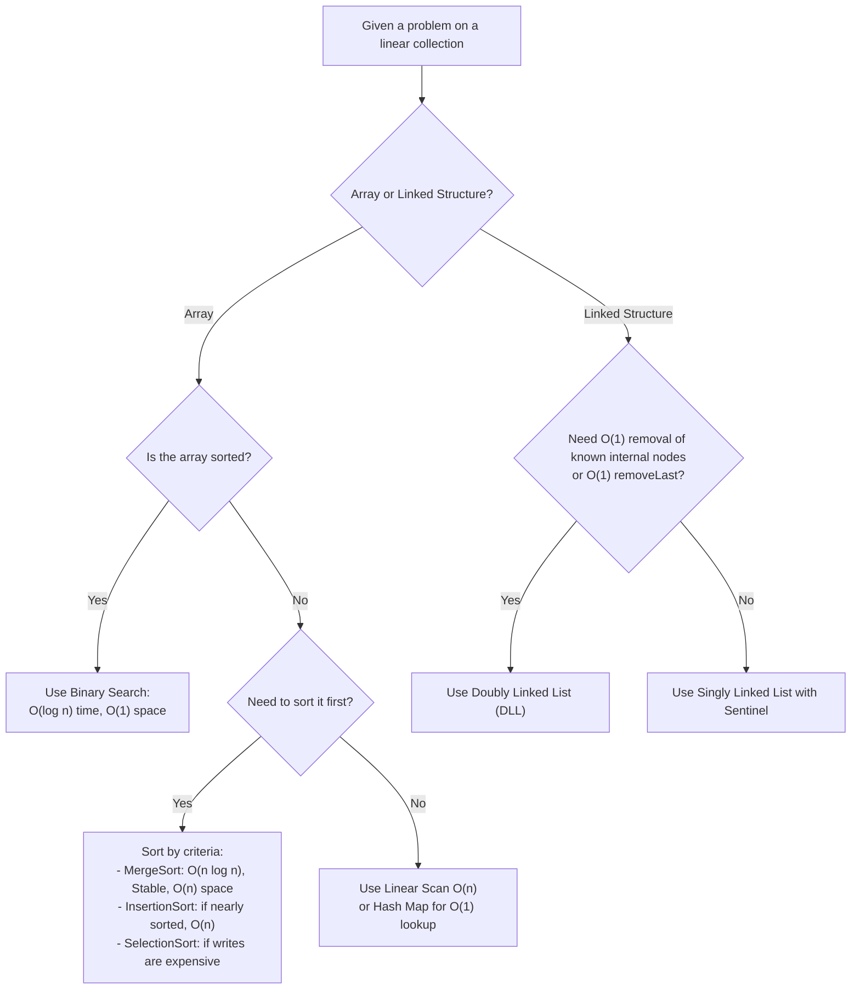

# Chapter 10: Midterm Synthesis, Master Complexity Tables & Decision Trees

## 11.1 The Master Complexity Reference Table

### 1. Sorting Algorithms
| Algorithm | Best-Case Time | Average Time | Worst-Case Time | Auxiliary Space | Stable? | Key Mechanism |
| :--- | :--- | :--- | :--- | :--- | :--- | :--- |
| **Bubble Sort (Early Exit)** | $\Theta(n)$ | $\Theta(n^2)$ | $\Theta(n^2)$ | $O(1)$ | Yes | Adjacent swaps; terminates if pass performs 0 swaps. |
| **Bubble Sort (Standard)** | $\Theta(n^2)$ | $\Theta(n^2)$ | $\Theta(n^2)$ | $O(1)$ | Yes | Always executes all $n(n - 1)/2$ comparisons. |
| **Selection Sort** | $\Theta(n^2)$ | $\Theta(n^2)$ | $\Theta(n^2)$ | $O(1)$ | **No** | Scans suffix for minimum; at most $n - 1$ swaps. |
| **Insertion Sort** | $\Theta(n)$ | $\Theta(n^2)$ | $\Theta(n^2)$ | $O(1)$ | Yes | Shifts sorted prefix rightward; fast on nearly-sorted data. |
| **Merge Sort** | $\Theta(n \log n)$ | $\Theta(n \log n)$ | $\Theta(n \log n)$ | **$\Theta(n)$** | Yes | Divide-and-conquer; merges sorted halves using scratch arrays. |

---

### 2. Searching Algorithms
| Method | Best Time | Worst Time | Auxiliary Space | Precondition / Requirements |
| :--- | :--- | :--- | :--- | :--- |
| **Linear Search** | $\Theta(1)$ | $\Theta(n)$ | $O(1)$ | Works on unsorted, random data. |
| **Binary Search (Iterative)** | $\Theta(1)$ | $\Theta(\log n)$ | $O(1)$ | **Sorted array with $O(1)$ indexed access.** |
| **Binary Search (Recursive)** | $\Theta(1)$ | $\Theta(\log n)$ | $\Theta(\log n)$ | Sorted array; consumes call stack frames. |
| **First/Last Occurrence Binary** | $\Theta(\log n)$ | $\Theta(\log n)$ | $O(1)$ | Continues search in left/right half on match. |
| **Binary Search on Answer** | $O(C)$ | $O(C \cdot \log R)$ | Check-dependent | Monotonic feasibility check function $C$. |

---

### 3. Arrays, Vectors, and Sliding Windows
| Operation / Technique | Time Complexity | Auxiliary Space | Notes & Constraints |
| :--- | :--- | :--- | :--- |
| **Array Read/Set by Index** | $\Theta(1)$ | $O(1)$ | Valid index within $[0, n - 1]$. |
| **Array Insert/Delete (Front/Mid)** | $\Theta(n)$ | $O(1)$ | Requires shifting downstream elements. |
| **`ArrayList.add` at End** | $\Theta(1)$ amortized | $O(1)$ | Occasional resize costs $O(n)$ copying. |
| **Fixed-Width Window ($k$)** | $\Theta(n)$ | $O(1)$ | Add incoming, subtract outgoing ($arr[i] - arr[i - k]$). |
| **Two Forward Pointers Window** | $\Theta(n)$ amortized | $O(1)$ | **Requires non-negative elements ($arr[i] \ge 0$).** |
| **Prefix Sum Array** | $\Theta(n)$ build, $\Theta(1)$ query | $\Theta(n)$ | Handles range sum queries on arrays with negative numbers. |

---

### 4. Stacks, Queues, and Linked Structures
| Structure / Variant | Push / Enqueue | Pop / Dequeue | Peek | Stored Space / Notes |
| :--- | :--- | :--- | :--- | :--- |
| **Fixed Array Stack** | $\Theta(1)$ | $\Theta(1)$ | $\Theta(1)$ | Fixed capacity $K$; throws Overflow when full. |
| **Linked Stack (Head Node)** | $\Theta(1)$ | $\Theta(1)$ | $\Theta(1)$ | Node allocations; dynamically grows. |
| **Naive Array Queue** | $\Theta(1)$ | **$\Theta(n)$** | $\Theta(1)$ | Dequeue requires shifting all elements left. |
| **Circular Array Queue** | $\Theta(1)$ | $\Theta(1)$ | $\Theta(1)$ | Modular arithmetic `(front + 1) % capacity`. |
| **Linked Queue (Head + Tail)** | $\Theta(1)$ | $\Theta(1)$ | $\Theta(1)$ | Clear tail pointer when last node departs. |
| **Monotonic Stack (Next Greater)** | $\Theta(n)$ amortized | - | - | Each index pushed and popped at most once. |
| **Monotonic Deque (Window Max)** | $\Theta(n)$ amortized | - | - | Auxiliary space: $O(k)$ deque capacity. |
| **Singly Linked List (Head + Tail)** | Insert First/Last: $O(1)$ | Remove First: $O(1)$, **Remove Last: $O(n)$** | - | Tail removal requires traversal to find predecessor. |
| **Doubly Linked List (Head + Tail)** | Insert/Remove First/Last: $O(1)$ | Remove Known Node: $O(1)$ | - | Bidirectional pointers (`prev`, `next`). |

---

## 11.2 Midterm Trap Checklist: 10 Classic Fallacies Exposed

1. **Fallacy:** *"A nested loop always means $O(n^2)$."*
   - **Truth:** If the inner pointer only advances forward (such as two forward pointers or monotonic stacks), the total operations over the entire program are bounded by $2n = O(n)$ amortized.
2. **Fallacy:** *"Deleting a node from a Linked List is always $O(1)$."*
   - **Truth:** Deletion is $O(1)$ **only if** you already possess a direct pointer to the target node and its predecessor (or in a DLL). Deleting by value requires an initial $O(n)$ linear search.
3. **Fallacy:** *"We can perform Binary Search on a Linked List in $O(\log n)$."*
   - **Truth:** No. Linked lists lack $O(1)$ random indexing. Traversing to the midpoint costs $\Theta(n)$, reducing total search time to linear $\Theta(n)$.
4. **Fallacy:** *"Selection Sort is stable."*
   - **Truth:** Selection sort is **unstable** because swapping the minimum into index $i$ leaps across intermediate equal elements, inverting their relative order (e.g., `[4a, 4b, 2]`).
5. **Fallacy:** *"Merge Sort is an in-place sort with $O(1)$ auxiliary space."*
   - **Truth:** Standard Merge Sort requires $\Theta(n)$ auxiliary scratch array memory to merge sorted halves.
6. **Fallacy:** *"Recursion is faster than iteration."*
   - **Truth:** Recursion is typically **slower** than iteration due to stack frame allocations, method invocation overhead, and register manipulation. It also consumes $O(\text{depth})$ call-stack memory.
7. **Fallacy:** *"Two-pointer sliding windows work on all subarray sum problems."*
   - **Truth:** Two-pointer sliding windows **fail** when numbers can be negative because the sum is no longer monotonic. Negative sum problems require Prefix Sums + Hash Map.
8. **Fallacy:** *"In a Singly Linked List with a Tail pointer, `removeLast()` is $O(1)$."*
   - **Truth:** It is $\Theta(n)$. You cannot step backward from `tail` to update the second-to-last node's `next` pointer to `null`.
9. **Fallacy:** *"Big-O means worst-case."*
   - **Truth:** Big-O is an asymptotic upper bound, not an input case. You can express the Big-O of the best case (e.g., best-case Bubble Sort is $O(n)$) or the Big-O of the worst case.
10. **Fallacy:** *"The Sentinel node in SLList is returned to the user."*
    - **Truth:** The sentinel is an internal dummy anchor. User traversals always start at `sentinel.next`.

---

## 11.3 Technique Recognition Decision Trees

### Primary Data Structure and Search Decision Tree



### Window & Subarray Decision Tree

```mermaid
flowchart TD
    StartWin["Subarray / Window Problem"] --> WType{"Fixed or Variable Width?"}
    
    WType -->|Fixed width k| FixedW["Fixed Sliding Window:\nAdd incoming, subtract outgoing\narr[i] - arr[i - k]\nTime: O(n), Space: O(1)"]
    
    WType -->|Variable width| SignCheck{"Are all elements non-negative?"}
    SignCheck -->|Yes: arr[i] >= 0| TwoPointers["Two Forward Pointers (Caterpillar):\nExpand right, contract left\nTime: O(n) amortized, Space: O(1)"]
    SignCheck -->|No: Negatives exist| PrefixMap["Prefix Sums + Hash Map:\nTrack running sums and index differences\nTime: O(n), Space: O(n)"]

    StartWin --> Extrema{"Finding Range Extrema?"}
    Extrema -->|Next Greater / Next Smaller| MonoStack["Monotonic Stack:\nStores unresolved indices\nTime: O(n) amortized"]
    Extrema -->|Max/Min in sliding window k| MonoDeque["Monotonic Deque:\nStores candidate indices in decreasing order\nTime: O(n) amortized, Space: O(k)"]
```

---

## 11.4 Comprehensive Course Glossary for Bioinformaticians

- **Abstract Data Type (ADT):** A formal specification of a data structure defining supported operations and behaviors independently of physical code implementation.
- **Activation Record (Stack Frame):** A memory block allocated on the JVM call stack containing a method's parameters, local variables, and return address.
- **Amortized Analysis:** The average runtime of an operation over a sequence of operations (e.g., dynamic array capacity doubling).
- **Auxiliary Space:** The extra memory allocated by an algorithm during execution, excluding the input data and required output buffer.
- **Binary Search:** An $O(\log n)$ divide-and-conquer search algorithm that repeatedly halves a sorted search interval.
- **Call Descent:** The initial phase of recursion where new stack frames are pushed onto the call stack toward the base case.
- **Circular Queue (Ring Buffer):** A fixed-capacity queue that uses modular arithmetic (`%`) to wrap `front` and `rear` pointers, achieving $O(1)$ operations without memory shifting.
- **Deque (Double-Ended Queue):** A sequence allowing insertion and deletion at both ends in $O(1)$ time.
- **Divide and Conquer:** An algorithmic paradigm that divides a problem into subproblems, recursively conquers them, and combines their solutions.
- **Dynamic Array (`ArrayList`):** A resizable array that doubles its capacity when full, achieving $O(1)$ amortized append time.
- **Garbage Collector (GC):** The JVM process that automatically scans heap memory and reclaims memory from objects that no longer have active references.
- **Heap Memory:** The large shared memory region where all Java objects and arrays reside.
- **In-Place Algorithm:** An algorithm whose auxiliary space complexity is $O(1)$ (or $O(\log n)$ for recursive call frames).
- **Loop Invariant:** A logical statement that holds true before and after each iteration of a loop, used to prove correctness.
- **Merge Sort:** An asymptotically optimal $\Theta(n \log n)$, stable, divide-and-conquer sorting algorithm.
- **Monotonic Stack / Deque:** A stack or deque whose stored elements are maintained in strictly increasing or decreasing order, solving range-extrema queries in $O(n)$ amortized time.
- **Primitive Type:** Basic Java data types (`int`, `long`, `double`, `boolean`) stored directly as raw values in memory.
- **Reference (Pointer):** A 64-bit variable that stores the memory address of an object located on the heap.
- **Return Ascent (Unwinding):** The second phase of recursion where base cases return values upward, completing suspended computations and popping stack frames.
- **Sentinel Node (Dummy Node):** An artificial node placed at the boundary of a linked list to eliminate null checks and edge-case branches.
- **Stability:** The property of a sorting algorithm that preserves the original relative order of items with equal sorting keys.
- **Stack Underflow:** An error caused by attempting to pop or peek an empty stack.
- **Stack Overflow:** An error caused by exceeding fixed stack capacity or exceeding JVM call-stack depth through runaway recursion.
- **Tightly Bound ($\Theta$):** An asymptotic growth rate that acts simultaneously as an upper and lower bound.
